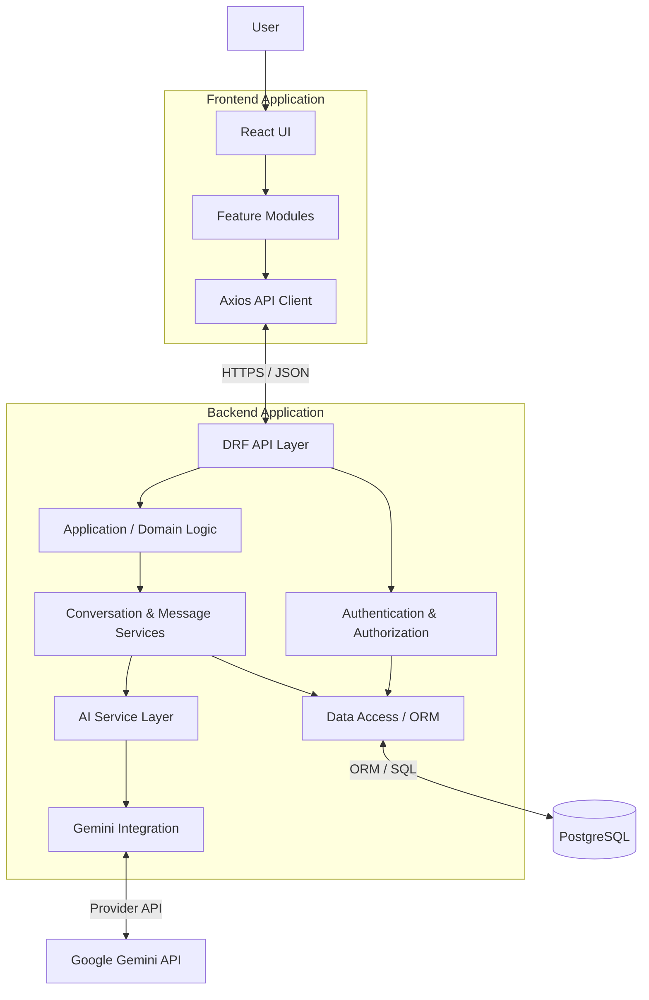
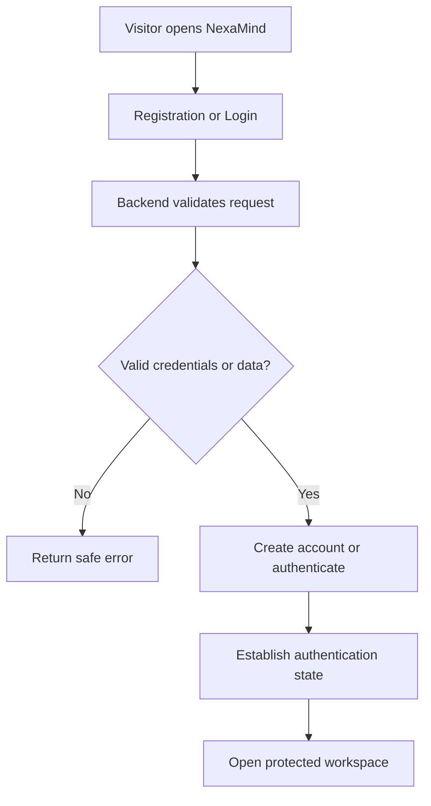
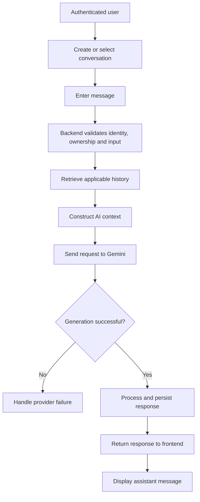

# NexaMind — Architecture Overview

**Project:** NexaMind AI Chat
**Document:** Architecture Overview
**Version:** 1.0
**Status:** Draft — System Design
**Related Documents**

- [System Context](../02-system-design/system-context.md)
- [Project Charter](../00-project-foundation/project-charter.md)
- [Product Requirements Document (PRD)](../01-requirements/PRD.md)
- [Software Requirements Specification (SRS)](../01-requirements/SRS.md)
- [Acceptance Criteria](../01-requirements/acceptance-criteria.md)

---

## 1. Purpose

This document describes the high-level software architecture of NexaMind.

It establishes:

- The architectural style.
- The major application components.
- Responsibilities and boundaries.
- Communication between components.
- How data moves through the system.
- Architectural principles and constraints.
- Important quality attributes.
- Decisions that require further investigation.

It provides a shared architectural reference before detailed frontend, backend, AI, and database designs are created.

## 2. Architectural Goals

NexaMind's architecture should support the following goals.

| ID     | Goal            | Description                                                                |
| ------ | --------------- | -------------------------------------------------------------------------- |
| AG-001 | Security        | Protect user identities, conversations, credentials, and private data.     |
| AG-002 | Maintainability | Keep responsibilities separated and code understandable.                   |
| AG-003 | Reliability     | Handle application and external-service failures safely.                   |
| AG-004 | Extensibility   | Allow future capabilities without unnecessary architectural rewrites.      |
| AG-005 | Testability     | Support isolated unit tests and realistic integration tests.               |
| AG-006 | Data integrity  | Preserve correct relationships between users, conversations, and messages. |
| AG-007 | Usability       | Support responsive and understandable user interactions.                   |
| AG-008 | Cost awareness  | Avoid unnecessary external AI requests and uncontrolled usage.             |

These goals guide architectural decisions. They do not imply that the application already satisfies them.

## 3. Architectural Style

### 3.1 Selected Style: Layered Monolithic Architecture

The initial NexaMind implementation will use a **layered monolithic architecture**.

The frontend and backend will be separate applications within one repository, while the backend will initially be deployed as one application rather than split into independent microservices.

A monolithic backend is appropriate because:

- The initial product has a relatively small domain.
- Authentication, conversations, messages, and AI orchestration are closely related.
- One backend simplifies development and deployment.
- Database transactions and consistency are easier to manage.
- The project does not yet require independent service scaling.
- A modular internal structure preserves room for future evolution.

A monolith does not mean putting all business logic in one file. It means the application is deployed as one backend unit while its internal responsibilities remain organized.

### 3.2 High-Level Architecture Diagram

**Diagram note:** This is a logical architecture. It shows responsibilities and relationships, not an exact Django folder structure or every internal function.

## 4. Major Architectural Components

### 4.1 Frontend Application

**Technology:** React, Vite, JavaScript, Axios.

**Primary responsibility:** Provide the user-facing experience.

Responsibilities:

- Render registration and login interfaces.
- Display the chat workspace.
- Display and navigate conversations.
- Collect and submit messages.
- Display assistant responses.
- Manage loading, error, and empty states.
- Display and edit conversation instructions.
- Communicate with backend APIs.
- Maintain appropriate client-side authentication state.

The frontend must not:

- Connect directly to PostgreSQL.
- Contain the Gemini API key.
- Decide whether a user owns a protected conversation.
- Reimplement backend authorization rules as its security mechanism.

Detailed design: `frontend-architecture.md`.

### 4.2 Backend API Layer

**Technology:** Django REST Framework.

**Primary responsibility:** Expose application functionality through controlled HTTP APIs.

Responsibilities:

- Receive frontend requests.
- Validate request structures.
- Apply authentication and authorization.
- Invoke application logic.
- Serialize responses.
- Return consistent status codes and error responses.

The API layer should not become the location for all application business logic.

### 4.3 Authentication and Authorization

**Technology:** Django authentication capabilities and a JWT solution to be selected.

**Primary responsibility:** Identify users and enforce access permissions.

Responsibilities:

- Register user accounts.
- Authenticate login attempts.
- Issue and validate authentication tokens.
- Identify the user making each request.
- Enforce resource ownership.
- Protect private application resources.

Authentication answers:

> Who is making this request?

Authorization answers:

> Is this user allowed to perform this operation on this resource?

Both are required.

### 4.4 Application and Domain Logic

**Primary responsibility:** Implement NexaMind's application rules.

Responsibilities include:

- Conversation lifecycle management.
- Message lifecycle management.
- Custom instruction management.
- Context-selection rules.
- Application-level validation.
- Coordination between database operations and AI generation.

The purpose is to keep application behavior understandable and testable rather than embedding it entirely in HTTP views.

### 4.5 AI Service Layer

**Primary responsibility:** Coordinate AI-related application behavior.

Responsibilities:

- Receive validated generation requests.
- Build the applicable prompt/context.
- Apply conversation instructions.
- Select configured model and generation settings.
- Invoke the provider integration.
- Process provider results.
- Handle provider failures.
- Process available usage metadata.

The AI service layer should be independent of frontend presentation details.

### 4.6 Gemini Integration

**Technology:** Official Google Gemini SDK/API, to be verified during implementation.

**Primary responsibility:** Communicate with Google's AI service.

Responsibilities:

- Use backend-managed credentials.
- Submit supported generation requests.
- Receive provider responses.
- Translate provider-specific failures into application-level errors.
- Expose a focused interface to the AI service layer.

Initially, Gemini is the only provider. A generalized multi-provider framework is not required until there is a real second-provider requirement.

### 4.7 Data Persistence Layer

**Technology:** PostgreSQL and Django ORM.

**Primary responsibility:** Store and retrieve application data.

Responsibilities:

- Persist user records.
- Persist conversations.
- Persist messages.
- Maintain data relationships.
- Enforce database constraints.
- Support efficient queries.
- Maintain consistency through appropriate transactions.

Detailed design: `database-design.md`.

## 5. Backend Responsibility Boundaries

The backend will organize its responsibilities into logical layers.

| Layer              | Responsibility              | Example                               |
| ------------------ | --------------------------- | ------------------------------------- |
| API / Presentation | HTTP requests and responses | DRF views, serializers                |
| Application        | Coordinates use cases       | Send message, create conversation     |
| Domain             | Enforces application rules  | Ownership and message lifecycle rules |
| AI integration     | Communicates with provider  | Gemini client/service                 |
| Persistence        | Reads and writes data       | Django ORM, PostgreSQL                |

These are logical responsibilities, not a requirement to create a separate Python package for every row.

### 5.1 Example: Sending a Message

A request to send a message should follow this responsibility flow:

1. The API receives the HTTP request.
2. Authentication identifies the current user.
3. Authorization verifies conversation ownership.
4. Input validation checks the message.
5. Application logic coordinates the operation.
6. Persistence retrieves the relevant conversation history.
7. AI logic constructs the generation context.
8. Gemini integration sends the request.
9. Application logic processes the provider result.
10. Persistence stores the appropriate message records.
11. The API returns a structured response.

Each stage has a distinct responsibility.

The exact order of persistence operations and failure recovery must be finalized in the backend message-lifecycle design.

## 6. Communication Architecture

### 6.1 Frontend to Backend

The frontend communicates through REST-style HTTP endpoints.

Expected characteristics:

- HTTPS in deployed environments.
- JSON request and response bodies.
- JWT-based authentication, subject to the final token strategy.
- Consistent HTTP status codes.
- Explicit validation and error responses.
- Versioned API namespace, initially `/api/v1/`.

### 6.2 Backend to Database

The backend uses Django ORM operations to interact with PostgreSQL.

The frontend never connects directly to the database.

### 6.3 Backend to Gemini

The backend uses the selected official Gemini integration.

The frontend does not receive the provider credential or communicate with the provider directly.

### 6.4 Communication Summary

| From           | To               | Communication         | Purpose                      |
| -------------- | ---------------- | --------------------- | ---------------------------- |
| Browser        | React frontend   | Browser execution     | User interface               |
| React frontend | Django backend   | HTTPS / JSON          | Application operations       |
| Django backend | PostgreSQL       | ORM / SQL             | Persistent data              |
| Django backend | Gemini           | Provider API          | AI generation                |
| Administrator  | Hosting platform | Operational interface | Configuration and deployment |

## 7. Core Application Workflows

### 7.1 Account Registration and Login

### 7.2 Conversation Creation and Messaging

The diagrams describe intended workflows, not implemented behavior.

## 8. Data Ownership and Architectural Security

Security is a cross-cutting architectural responsibility.

### 8.1 User Ownership

Every conversation must be associated with an owner.

Operations on conversations and their messages must be scoped to the authenticated user.

### 8.2 Backend Enforcement

Ownership must be verified by backend logic, not merely by hiding or disabling frontend controls.

### 8.3 Credential Protection

The Gemini API key and database credentials must remain in backend-managed configuration.

### 8.4 Input and Output Validation

The application must validate incoming data and handle provider responses before using or persisting them.

### 8.5 Failure Isolation

A Gemini service failure must not cause unrelated authentication or conversation functionality to become unavailable unnecessarily.

Detailed security controls will be documented in `security-architecture.md`.

## 9. State Management and Data Ownership

NexaMind has two different categories of state.

### 9.1 Persistent Application State

Stored in PostgreSQL:

- User accounts.
- Conversations.
- Messages.
- Custom instructions.
- Available generation and usage metadata.

This state must survive frontend refreshes and application restarts, subject to the deployment's persistence guarantees.

### 9.2 Temporary Interface State

Managed by the React frontend:

- Current input value.
- Active conversation selection.
- Loading indicators.
- Open menus and dialogs.
- Temporary validation messages.
- Other transient presentation state.

Temporary interface state must not be treated as the authoritative record of conversations or messages.

### 9.3 Architectural Principle

> PostgreSQL stores the application's persistent history; the backend decides which portion of that history becomes AI context; Gemini generates a response.

These are separate responsibilities.

## 10. Quality Attribute Strategies

| Quality attribute | Architectural strategy                                             |
| ----------------- | ------------------------------------------------------------------ |
| Security          | Backend authentication, ownership checks, secure secret management |
| Maintainability   | Separate frontend features and backend responsibilities            |
| Reliability       | Explicit provider/database failure handling                        |
| Testability       | Isolated application logic and mocked provider integration         |
| Performance       | Efficient database queries, pagination, bounded AI context         |
| Extensibility     | Focused provider integration boundary and modular backend          |
| Data integrity    | Database constraints and appropriate transaction boundaries        |
| Usability         | Responsive React interface and clear application states            |

These strategies establish design direction. Their effectiveness must be verified through implementation and testing.

## 11. Deployment Architecture Direction

The initial deployment is expected to use separate frontend and backend hosting.

A possible deployment arrangement is:

- React frontend hosted on a frontend hosting platform.
- Django backend hosted as a web service.
- PostgreSQL hosted through a managed database provider.
- Gemini accessed through backend-to-provider communication.

The exact providers, network configuration, environment variables, domains, and deployment process remain open decisions.

No hosting provider is committed by this document.

## 12. Architectural Decisions and Trade-offs

| Decision                                     | Benefit                                    | Trade-off                                                   |
| -------------------------------------------- | ------------------------------------------ | ----------------------------------------------------------- |
| Layered monolithic backend                   | Simpler deployment and development         | Requires discipline to prevent tightly coupled modules      |
| React frontend separated from Django backend | Clear client/server boundaries             | Requires API integration and CORS configuration             |
| PostgreSQL                                   | Relational consistency and structured data | Requires database administration and migration management   |
| Gemini as initial provider                   | Focused integration scope                  | Creates initial provider dependency                         |
| Backend-controlled context                   | Security and consistent AI behavior        | More backend processing and token-management responsibility |
| Feature-based React organization             | Groups related UI behavior                 | Requires thoughtful boundaries to avoid duplication         |

## 13. What This Architecture Does Not Require Yet

The MVP does not require:

- Microservices.
- Kubernetes.
- Event-driven infrastructure.
- Message queues.
- Redis.
- A vector database.
- Multiple AI providers.
- Complex distributed state management.
- A generalized plugin system.

These technologies may become useful when supported by actual requirements, measurable bottlenecks, or operational needs.

Architectural complexity should be justified rather than introduced for appearance.

## 14. Open Architectural Decisions

The following items require further design work:

1. Exact frontend routing and feature organization.
2. Detailed Django application boundaries.
3. JWT implementation and token storage strategy.
4. Conversation and message database schema.
5. Gemini service interface and error mapping.
6. Message transaction and failure lifecycle.
7. Context-window and history-selection strategy.
8. API endpoint contracts.
9. Logging, monitoring, and health checks.
10. Hosting and deployment topology.

These topics will be addressed in their dedicated architecture documents.

## 15. Architecture Review Checklist

Before implementation begins, verify that:

- [ ] The frontend/backend responsibility boundary is clear.
- [ ] Authentication and authorization are distinct.
- [ ] Backend ownership enforcement is defined.
- [ ] Gemini credentials are backend-only.
- [ ] Persistent and temporary state are distinguished.
- [ ] Conversation context is controlled by the backend.
- [ ] Database responsibilities are separated from AI generation.
- [ ] Provider failures are considered.
- [ ] The architecture supports automated testing.
- [ ] The MVP avoids unjustified infrastructure complexity.
- [ ] Open decisions are documented rather than silently assumed.

---

**Document status:** Draft — System Design

**Next review:** After frontend and backend architecture documents are completed.

**Core architectural principle:** Keep the application simple enough to build and maintain, but structured enough to evolve safely.
