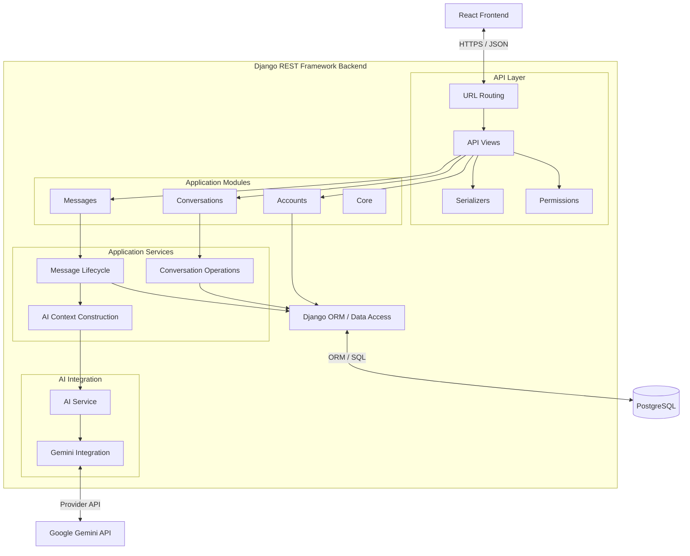
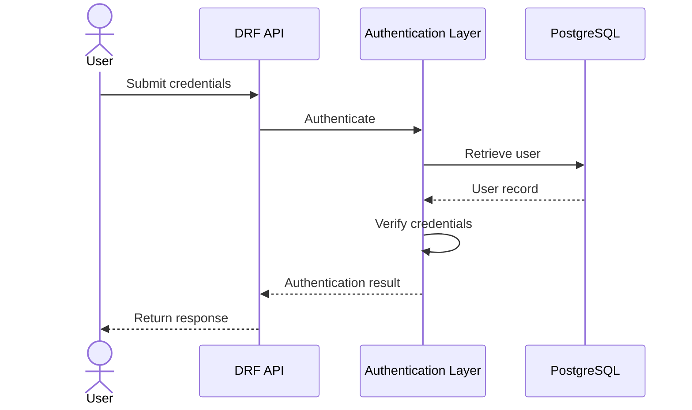
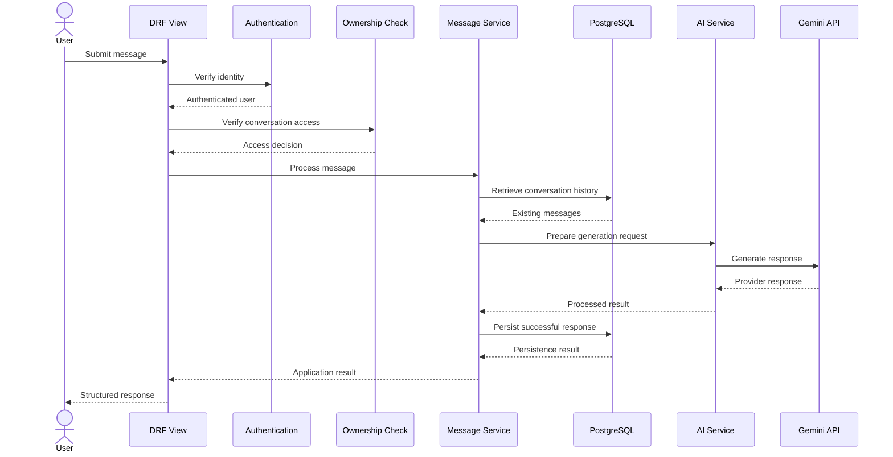

# NexaMind — Backend Architecture

**Project:** NexaMind AI Chat
**Document:** Backend Architecture
**Version:** 1.0
**Status:** Draft — System Design
**Related documents:**

- [System Context](./system-context.md)
- [Architecture Overview](./architecture-overview.md)
- [Frontend Architecture](./frontend-architecture.md)
- [Software Requirements Specification (SRS)](../01-requirements/SRS.md)
- [Acceptance Criteria](../01-requirements/acceptance-criteria.md)

---

## 1. Purpose

This document defines the internal architecture of the NexaMind backend.

It establishes:

- Django and Django REST Framework responsibilities.
- Backend application organization.
- API, validation, business logic, and persistence boundaries.
- Authentication and authorization architecture.
- Conversation and message management.
- Gemini integration boundaries.
- Error handling and transaction considerations.
- Testing and maintainability strategies.

The goal is to create a backend that is secure, testable, understandable, and capable of supporting future product development.

## 2. Backend Architectural Goals

| ID        | Goal                   | Description                                                                         |
| --------- | ---------------------- | ----------------------------------------------------------------------------------- |
| BE-AG-001 | Separation of concerns | Keep HTTP handling, business operations, and persistence responsibilities distinct. |
| BE-AG-002 | Security               | Enforce authentication, authorization, and conversation ownership.                  |
| BE-AG-003 | Maintainability        | Organize Django applications around meaningful responsibilities.                    |
| BE-AG-004 | Testability            | Make business logic testable independently where practical.                         |
| BE-AG-005 | Data integrity         | Maintain correct relationships between users, conversations, and messages.          |
| BE-AG-006 | AI integration         | Isolate Gemini-specific implementation from conversation business logic.            |
| BE-AG-007 | Reliability            | Handle database and external provider failures safely.                              |
| BE-AG-008 | Extensibility          | Allow future capabilities without unnecessary abstractions today.                   |

## 3. Backend Technology Stack

| Technology                      | Responsibility               | Status                                     |
| ------------------------------- | ---------------------------- | ------------------------------------------ |
| Python                          | Backend programming language | Selected                                   |
| Django                          | Backend framework            | Selected                                   |
| Django REST Framework           | REST API development         | Selected                                   |
| PostgreSQL                      | Relational database          | Selected                                   |
| Django ORM                      | Database interaction         | Selected                                   |
| JWT authentication              | API authentication strategy  | Selected conceptually; implementation TBD  |
| Gemini official SDK/API         | AI provider integration      | Selected; exact integration to be verified |
| OpenAPI                         | API documentation            | Planned                                    |
| Pytest or Django test framework | Automated testing            | To be finalized                            |

Dependencies and supported versions will be verified during backend initialization.

## 4. Backend Architectural Style

### 4.1 Modular Layered Monolith

NexaMind will use a modular Django monolith.

The backend will initially run as one application, but its internal responsibilities will be separated into Django apps and logical layers.

This provides:

- Simpler deployment.
- Shared database access.
- Easier transaction management.
- Straightforward local development.
- Clearer application boundaries.
- Lower operational complexity than microservices.

Each Django app should represent a meaningful application responsibility.

### 4.2 Backend Architecture Diagram



This is a logical responsibility diagram. The actual implementation may use Django models, managers, querysets, services, and selectors to realize these responsibilities.

## 5. Django Application Organization

### 5.1 Proposed Applications

The initial backend will use the following Django applications:

| Application     | Primary responsibility                                                 |
| --------------- | ---------------------------------------------------------------------- |
| `core`          | Shared infrastructure and common application functionality.            |
| `accounts`      | User model, registration, and authentication-related functionality.    |
| `conversations` | Conversation records, ownership, and conversation management.          |
| `messages`      | Message records, message operations, and conversation message history. |
| `ai`            | AI request orchestration and provider integration.                     |

### 5.2 Why Separate Django Apps?

Django apps provide organizational boundaries.

For example:

- `accounts` owns user-related functionality.
- `conversations` owns conversation-related functionality.
- `messages` owns message-related functionality.
- `ai` owns AI-provider integration.

This organization makes responsibilities easier to understand.

However, an app boundary does not automatically require a separate database, server, or deployment.

All these apps initially operate inside the same Django backend.

### 5.3 Custom User Model

NexaMind will define its custom Django user model in the `accounts` application.

**Important implementation constraint:**

The custom user model must be configured through `AUTH_USER_MODEL` before the first database migrations are created.

Why?

Django applications can depend on the user model through foreign-key relationships and authentication behavior. Changing the user model after initial migrations can introduce substantial migration complexity.

Therefore, user-model design is an early backend implementation task.

## 6. Proposed Backend Directory Structure

```text
backend/
├── README.md
├── manage.py
│
├── requirements/
│   ├── base.txt
│   ├── development.txt
│   └── production.txt
│
├── config/
│   ├── __init__.py
│   ├── urls.py
│   ├── asgi.py
│   ├── wsgi.py
│   │
│   └── settings/
│       ├── __init__.py
│       ├── base.py
│       ├── development.py
│       └── production.py
│
├── apps/
│   ├── __init__.py
│   │
│   ├── core/
│   │   ├── apps.py
│   │   ├── exceptions.py
│   │   └── tests/
│   │
│   ├── accounts/
│   │   ├── apps.py
│   │   ├── models.py
│   │   ├── serializers.py
│   │   ├── views.py
│   │   ├── urls.py
│   │   ├── permissions.py
│   │   └── tests/
│   │
│   ├── conversations/
│   │   ├── apps.py
│   │   ├── models.py
│   │   ├── serializers.py
│   │   ├── views.py
│   │   ├── urls.py
│   │   ├── services.py
│   │   ├── selectors.py
│   │   └── tests/
│   │
│   ├── messages/
│   │   ├── apps.py
│   │   ├── models.py
│   │   ├── serializers.py
│   │   ├── views.py
│   │   ├── urls.py
│   │   ├── services.py
│   │   ├── selectors.py
│   │   └── tests/
│   │
│   └── ai/
│       ├── apps.py
│       ├── services.py
│       ├── config.py
│       ├── providers/
│       │   └── gemini.py
│       └── tests/
│
├── api/
│   └── v1/
│       ├── __init__.py
│       └── urls.py
│
└── tests/
    ├── integration/
    └── factories/
```

**Structure note:** This is a target structure, not a requirement to create every file at project initialization. Some modules should be introduced only when their responsibilities become meaningful.

## 7. Backend Responsibility Layers

### 7.1 URL Routing

**Responsibility:** Map incoming HTTP paths to appropriate API views.

Examples:

- Account endpoints.
- Conversation endpoints.
- Message endpoints.

Routing should remain simple. Business decisions do not belong in URL configuration.

### 7.2 API Views

**Responsibility:** Handle HTTP interactions.

Views coordinate:

- Receiving requests.
- Accessing the authenticated user.
- Invoking serializers.
- Applying permissions.
- Calling application operations.
- Returning HTTP responses.

Views should not become large collections of database queries and AI orchestration code.

### 7.3 Serializers

**Responsibility:** Validate incoming data and represent outgoing data.

Examples:

- Registration input.
- Login input.
- Conversation creation.
- Conversation representation.
- Message submission.
- Message representation.

Serializers help define the API's data contract.

They are not a replacement for authorization or business logic.

### 7.4 Permissions

**Responsibility:** Enforce access rules.

Examples:

- Require authentication.
- Restrict conversation operations to their owners.
- Prevent unauthorized message access.

Permissions and ownership checks must be applied consistently across relevant operations.

### 7.5 Application Services

**Responsibility:** Coordinate operations that change application state or involve multiple components.

Examples:

- Create a conversation.
- Rename a conversation.
- Delete a conversation.
- Submit and process a message.
- Apply custom instructions.

Services help keep complex operations out of HTTP views.

### 7.6 Selectors

**Responsibility:** Organize read-only data retrieval operations when query complexity or reuse justifies it.

Examples:

- Retrieve a user's conversations.
- Retrieve a conversation with its messages.
- Retrieve a bounded message history.

Selectors are a useful organizational pattern, not a mandatory layer for every database query.

### 7.7 Models and Persistence

**Responsibility:** Represent and persist application data.

Django models define:

- Fields.
- Relationships.
- Database constraints.
- Model-level behavior where appropriate.

The ORM manages communication with PostgreSQL.

## 8. Accounts Architecture

Location: `apps/accounts/`

### 8.1 Responsibilities

- Define the custom user model.
- Support user registration.
- Support authentication-related operations.
- Enforce unique account identifiers.
- Provide user-related serializers.
- Support authentication tests.

### 8.2 User Model Design Considerations

The user model must support:

- A stable primary key.
- A unique login identifier.
- Secure password storage through Django's authentication mechanisms.
- Account timestamps where useful.
- Appropriate account status fields.

The exact model fields and login identifier will be finalized during database design.

### 8.3 Authentication Flow



The JWT implementation, refresh strategy, and token lifecycle will be documented separately before implementation.

## 9. Conversations Architecture

Location: `apps/conversations/`

### 9.1 Responsibilities

- Create conversations.
- Retrieve conversations.
- List a user's conversations.
- Rename conversations.
- Delete conversations.
- Store conversation-specific custom instructions.
- Enforce conversation ownership.

### 9.2 Ownership Principle

Every conversation belongs to one user in the initial MVP.

The backend must scope conversation queries to the authenticated user.

Conceptually:

```text
Authenticated User
        |
        v
Retrieve only conversations owned by that user
        |
        v
Perform authorized operation
```

The actual database queries and permission implementation will be designed during backend development.

### 9.3 Custom Instructions

Conversation-specific instructions belong to the conversation domain.

They should not be stored as an unrelated global preference when the intended behavior is to configure instructions independently for each conversation.

## 10. Messages Architecture

Location: `apps/messages/`

### 10.1 Responsibilities

- Accept message submissions.
- Validate message content.
- Associate messages with conversations.
- Retrieve message history.
- Preserve message ordering.
- Coordinate message processing.
- Support message persistence and failure handling.

### 10.2 Message Ownership

Messages belong to conversations.

A user can access a message only through a conversation they are authorized to access.

This creates an ownership relationship:

```text
User
  |
  | owns
  v
Conversation
  |
  | contains
  v
Messages
```

The backend must not trust a conversation identifier supplied by the frontend without verifying ownership.

### 10.3 Message Roles

The initial system will distinguish between:

- `user`
- `assistant`

The exact model choices, allowed values, and any future system/tool roles will be finalized during database design and AI integration.

## 11. AI Architecture

Location: `apps/ai/`

### 11.1 Responsibilities

The AI application is responsible for coordinating communication with the selected AI provider.

It must:

- Receive a structured generation request.
- Apply the configured model.
- Construct the provider input using approved context.
- Apply custom instructions.
- Apply supported generation settings.
- Call Gemini.
- Process the response.
- Handle provider errors.
- Return normalized application-level results.

### 11.2 AI Service and Provider Separation

The application should distinguish between two responsibilities.

**AI service**

Coordinates application-level AI behavior.

Examples:

- Prepare generation input.
- Apply context policy.
- Select generation configuration.
- Coordinate provider invocation.
- Process results.

**Gemini integration**

Handles provider-specific communication.

Examples:

- Configure the official SDK.
- Use the API credential.
- Submit Gemini requests.
- Interpret Gemini responses.
- Translate provider-specific errors.

### 11.3 Proposed AI Structure

```text
apps/ai/
├── services.py
├── config.py
├── providers/
│   └── gemini.py
└── tests/
```

This is intentionally small.

A generalized provider factory, abstract provider hierarchy, or multiple provider adapters are not required when Gemini is the only initial provider.

If a second provider becomes a real requirement, the integration boundary can be refactored based on actual shared behavior.

### 11.4 Provider Credential Management

The Gemini API key must:

- Be supplied through backend environment configuration.
- Never be committed to Git.
- Never be returned through an API response.
- Never be exposed in frontend environment variables.
- Be handled carefully in application logs.

The exact SDK, model identifier, and API methods must be verified against current official Google documentation during integration.

## 12. Message Processing Architecture

Sending a message is one of the backend's most important application workflows.

### 12.1 High-Level Processing Sequence



This represents the successful generation path.

### 12.2 Message Lifecycle Questions

Before implementing this workflow, the following behavior must be decided:

1. At what point is the user message persisted?
2. What happens when Gemini fails after the user message has been stored?
3. Should failed generation attempts have a persisted status?
4. How are duplicate submissions handled?
5. What happens if generation succeeds but database persistence fails?
6. How should the frontend recover from an interrupted request?

These are important because a database transaction cannot automatically roll back an external Gemini API operation.

The application must define explicit behavior rather than assuming that database transactions and external API calls form one atomic operation.

### 12.3 Transaction Considerations

Database transactions should protect operations that require database consistency.

However, external AI generation should not be treated as part of a normal database transaction with guaranteed rollback of the external operation.

A later implementation decision must define:

- Persistence order.
- Transaction boundaries.
- Failure statuses.
- Retry behavior.
- Duplicate-request protection.

## 13. Database Interaction Architecture

The backend will use Django ORM for database operations.

### 13.1 Data Relationships

The initial domain model is:

```text
User
 |
 | 1:N
 |
Conversation
 |
 | 1:N
 |
Message
```

Conversation-specific custom instructions are initially stored as part of the conversation.

### 13.2 Data Access Responsibilities

- Models define the data structure.
- Querysets and managers support reusable query behavior where appropriate.
- Selectors organize complex read operations where justified.
- Services coordinate writes and multi-step operations.
- Database constraints protect data integrity.

### 13.3 Query Efficiency

The backend should consider:

- Efficient retrieval of conversation lists.
- Avoiding unnecessary repeated database queries.
- Pagination for message history.
- Appropriate indexes.
- Efficient retrieval of conversation ownership.
- Bounded context retrieval for AI requests.

Detailed schema, indexes, and constraints belong in `database-design.md`.

## 14. API Architecture

### 14.1 API Versioning

The initial API namespace will be:

```text
/api/v1/
```

Versioning provides a clear boundary for future API evolution.

### 14.2 API Responsibilities

The backend API will expose operations for:

- Registration and authentication.
- Conversation management.
- Message submission and retrieval.
- Conversation instruction management.
- Health verification.

### 14.3 Request and Response Design

API contracts should use:

- Clear resource-oriented paths.
- Appropriate HTTP methods.
- Consistent JSON structures.
- Appropriate status codes.
- Predictable validation errors.
- Explicit pagination metadata where required.

Exact endpoint paths and JSON schemas will be documented separately in the API design phase.

## 15. Error Handling Architecture

Errors may originate from multiple layers.

| Error source         | Example                              | Backend responsibility                                 |
| -------------------- | ------------------------------------ | ------------------------------------------------------ |
| Validation           | Empty message                        | Return structured validation response.                 |
| Authentication       | Invalid token                        | Reject unauthorized request.                           |
| Authorization        | Conversation belongs to another user | Deny operation safely.                                 |
| Database             | Connection failure                   | Handle and log safely.                                 |
| Gemini               | Provider error                       | Translate into application-level failure.              |
| Network              | Provider timeout                     | Apply defined timeout and recovery policy.             |
| Persistence          | Failed message write                 | Preserve consistency and report failure.               |
| Unexpected exception | Programming error                    | Log diagnostic information without exposing internals. |

### 15.1 Error Handling Principles

1. Never expose secrets in error messages.
2. Never expose internal stack traces to normal users.
3. Use consistent API error structures.
4. Preserve diagnostic information in protected logs.
5. Distinguish validation failures from provider failures.
6. Do not return a successful assistant response when generation failed.
7. Do not silently discard accepted user messages.

## 16. Backend Security Architecture

### 16.1 Authentication

Every protected operation must identify the authenticated user.

### 16.2 Authorization

Every conversation operation must verify ownership.

### 16.3 Input Validation

Incoming requests must be validated before application operations or provider calls.

### 16.4 Credential Protection

Database credentials, JWT secrets, and Gemini API credentials must be managed through secure backend configuration.

### 16.5 Data Isolation

Queries must be scoped to authorized users.

### 16.6 CORS and HTTPS

CORS must be configured for the intended frontend origin.

Production communication must use HTTPS.

CORS is a browser cross-origin policy, not a replacement for authentication or authorization.

### 16.7 Security Documentation

Detailed controls and threats will be expanded in:

`docs/02-system-design/security-architecture.md`

## 17. Testing Architecture

### 17.1 Unit Testing

Verify isolated backend logic.

Examples:

- Serializer validation.
- Context construction.
- Business rules.
- Error normalization.
- Ownership-related helper logic.

### 17.2 Integration Testing

Verify interactions between Django components and PostgreSQL.

Examples:

- Registration persistence.
- Conversation ownership.
- Message persistence.
- Query behavior.
- Database constraints.

### 17.3 API Testing

Verify:

- HTTP methods.
- Authentication.
- Authorization.
- Request validation.
- Response structures.
- Error status codes.

### 17.4 AI Integration Testing

Use a mock or test double to verify normal application behavior without requiring a live Gemini request for every test.

Separately verify the real provider integration with controlled credentials and usage.

### 17.5 Cross-User Security Testing

Tests must establish that:

- User A cannot retrieve User B's conversations.
- User A cannot modify User B's conversations.
- User A cannot retrieve User B's messages.
- User A cannot use another user's conversation identifier to bypass ownership checks.

## 18. Configuration and Environment Management

The backend must distinguish between development and production configuration.

### 18.1 Development Configuration

May include:

- Local database configuration.
- Debugging settings.
- Development CORS origins.
- Local logging.
- Test configuration.

### 18.2 Production Configuration

Must include:

- Debugging disabled.
- Secure secret configuration.
- Restricted allowed hosts.
- Restricted CORS origins.
- Secure database connection settings.
- Appropriate HTTPS-related settings.
- Production logging.
- Appropriate static and deployment configuration.

### 18.3 Environment Variables

Expected configuration categories include:

```text
SECRET_KEY
DEBUG
ALLOWED_HOSTS
DATABASE_URL
GEMINI_API_KEY
GEMINI_MODEL
FRONTEND_URL
```

These are configuration names for planning purposes. Their exact implementation and supported settings will be finalized during environment setup.

Real secret values must never be placed in the example file.

## 19. Backend Architectural Constraints

The initial backend must avoid:

1. Putting all application logic inside DRF views.
2. Allowing frontend input to determine resource ownership.
3. Exposing Gemini credentials.
4. Mixing provider-specific code throughout the conversation application.
5. Introducing microservices without a justified need.
6. Creating abstract provider frameworks for only one provider.
7. Adding unnecessary database abstraction layers.
8. Using database transactions as if they could roll back external API operations.
9. Returning internal exceptions directly to users.
10. Introducing complex background processing before the MVP requires it.

## 20. Open Decisions

The following decisions remain unresolved:

1. Exact custom user model fields.
2. JWT implementation and token lifecycle.
3. Login identifier and registration validation rules.
4. Conversation and message model fields.
5. Message failure-status representation.
6. Transaction boundaries for message processing.
7. Gemini SDK version and supported model.
8. Provider timeout and retry policy.
9. Context construction and history limits.
10. Message pagination strategy.
11. API error response format.
12. Logging and monitoring configuration.
13. Production database connection strategy.
14. Whether background processing is needed for any future operation.

These decisions will be resolved in their appropriate engineering phases.

## 21. Backend Architecture Review Checklist

Before backend implementation, verify:

- [ ] Django apps have clear responsibilities.
- [ ] A custom user model is planned before initial migrations.
- [ ] API views remain focused on HTTP coordination.
- [ ] Serializers handle request validation and response representation.
- [ ] Authentication and authorization are separated.
- [ ] Conversation ownership is enforced server-side.
- [ ] Application services coordinate complex operations.
- [ ] Read operations are separated where query complexity justifies it.
- [ ] Gemini integration is isolated.
- [ ] API credentials remain backend-only.
- [ ] Message persistence and failure behavior are understood.
- [ ] Database transactions have explicit boundaries.
- [ ] API versioning is planned.
- [ ] Error handling is consistent.
- [ ] Tests cover security and provider failures.
- [ ] Unnecessary abstractions are avoided.

---

**Document status:** Draft — System Design

**Next review:** Before Django project initialization and implementation of the first backend application.

**Core principle:** Keep HTTP handling, application behavior, persistence, and AI-provider communication separate enough to test and maintain independently—without overengineering a single-backend MVP.
