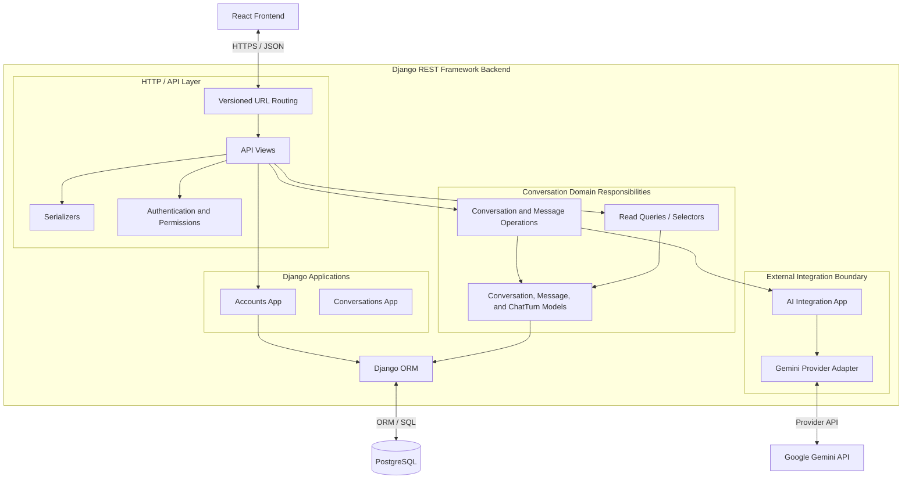
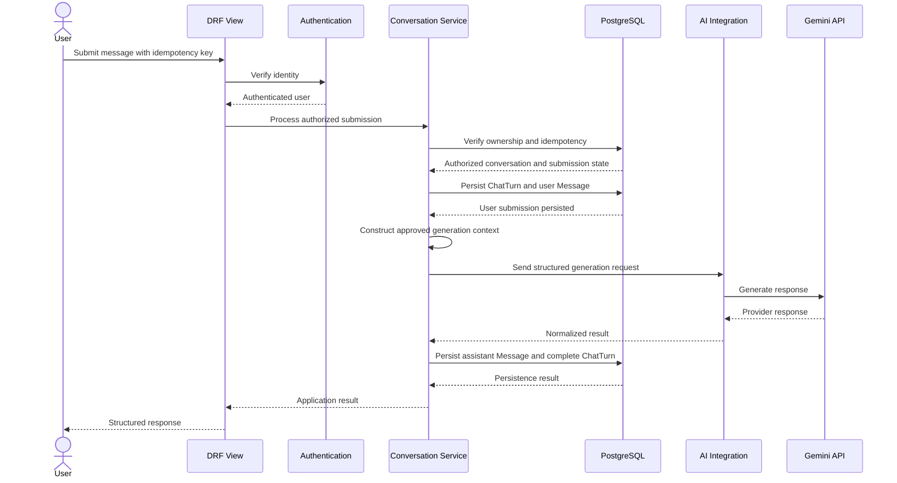

# NexaMind — Backend Architecture

**Project:** NexaMind AI Chat
**Document:** Backend Architecture
**Version:** 1.0
**Status:** Draft — System Design
**Related documents:**

- [System Context](./system-context.md)
- [Architecture Overview](./architecture-overview.md)
- [Frontend Architecture](./frontend-architecture.md)
- [Software Requirements Specification (SRS)](../01-requirements/SRS.md)
- [Acceptance Criteria](../01-requirements/acceptance-criteria.md)

---

## 1. Purpose

This document defines the internal architecture of the NexaMind backend.

It establishes:

- Django and Django REST Framework responsibilities.
- Backend application organization.
- API, validation, business logic, and persistence boundaries.
- Authentication and authorization architecture.
- Conversation and message management.
- Gemini integration boundaries.
- Error handling and transaction considerations.
- Testing and maintainability strategies.

The goal is to create a backend that is secure, testable, understandable, and capable of supporting future product development.

## 2. Backend Architectural Goals

| ID        | Goal                   | Description                                                                         |
| --------- | ---------------------- | ----------------------------------------------------------------------------------- |
| BE-AG-001 | Separation of concerns | Keep HTTP handling, business operations, and persistence responsibilities distinct. |
| BE-AG-002 | Security               | Enforce authentication, authorization, and conversation ownership.                  |
| BE-AG-003 | Maintainability        | Organize Django applications around meaningful responsibilities.                    |
| BE-AG-004 | Testability            | Make business logic testable independently where practical.                         |
| BE-AG-005 | Data integrity         | Maintain correct relationships between users, conversations, and messages.          |
| BE-AG-006 | AI integration         | Isolate Gemini-specific implementation from conversation business logic.            |
| BE-AG-007 | Reliability            | Handle database and external provider failures safely.                              |
| BE-AG-008 | Extensibility          | Allow future capabilities without unnecessary abstractions today.                   |

## 3. Backend Technology Stack

| Technology            | Responsibility               | Status                                                          |
| --------------------- | ---------------------------- | --------------------------------------------------------------- |
| Python                | Backend programming language | Selected and in use                                             |
| Django                | Backend framework            | Installed and configured                                        |
| Django REST Framework | REST API development         | Installed and configured                                        |
| PostgreSQL            | Relational database          | Configured as the active Django database backend                |
| Django ORM            | Database interaction         | Selected and in use                                             |
| JWT authentication    | API authentication strategy  | SimpleJWT configured; end-to-end behavior requires verification |
| Google Gemini API     | AI provider integration      | SDK and provider adapter implemented; live API behavior and model compatibility remain unverified |
| OpenAPI               | API documentation            | Specification drafted; runtime schema integration not configured |
| Django test framework | Automated testing            | Available through Django; test coverage is being developed      |
| Pytest                | Alternative test runner      | Optional; not yet selected                                      |

The dependency versions currently pinned in `backend/requirements/base.txt` are the implementation baseline. The Gemini SDK and provider adapter are implemented; compatibility of the configured model and live API behavior still requires verification.

JWT configuration currently includes DRF's `JWTAuthentication`, SimpleJWT token endpoints, refresh-token rotation, and blacklist-after-rotation configuration. Configuration and route presence do not by themselves prove the complete authentication lifecycle works correctly. Integration tests must verify token issuance, refresh, invalidation, and protected-resource access.

## 4. Backend Architectural Style

### 4.1 Modular Layered Monolith

NexaMind uses a modular Django monolith.

The backend runs as one application and one deployment unit. Internally, Django apps and logical responsibility layers separate domain behavior, HTTP handling, persistence, and external integrations.

This provides:

- Simpler deployment and local development.
- A shared relational database.
- Straightforward database transaction management.
- Clearer application and integration boundaries.
- Lower operational complexity than microservices.
- Room to introduce additional modules when real requirements justify them.

A Django app represents a meaningful application responsibility. It does not automatically require a separate database, server, or deployment.

### 4.2 Backend Architecture Diagram



**Diagram interpretation:** The diagram represents the logical architecture and the current implementation boundaries. The accounts and conversations apps, AI integration app, Gemini provider adapter, and Conversation, Message, and ChatTurn models exist. The conversation-generation orchestration that coordinates context preparation, persistence, and provider generation remains to be implemented.

The application services and selectors are logical responsibilities. They should be introduced within the appropriate app when their implementation is needed, rather than creating abstractions solely to match a diagram.

## 5. Django Application Organization

### 5.1 Application Boundaries

The initial MVP currently uses three Django applications: `accounts`, `conversations`, and `ai`. The `core` app remains deferred until justified.

| Application     | Primary responsibility                                                                       | Status                   |
| --------------- | -------------------------------------------------------------------------------------------- | ------------------------ |
| `accounts`      | Custom user model, registration, and authentication-related functionality                    | Exists                   |
| `conversations` | Conversation, Message, and ChatTurn persistence; ownership and conversation workflows | Exists                   |
| `ai`            | Gemini integration and provider-specific communication                                       | Exists                   |
| `core`          | Shared infrastructure and common functionality                                               | Deferred until justified |

There will not be a separate `messages` Django app in the initial MVP. Message and ChatTurn are part of the conversation domain and will remain in `apps/conversations/`.

### 5.2 Application Responsibility Boundaries

- `accounts` owns user-related functionality and authentication endpoints.
- `conversations` owns conversation-related data and workflows, including messages and generation lifecycle coordination.
- `ai` isolates communication with Gemini and provider-specific behavior.
- `core` will be introduced only if genuine shared infrastructure emerges that does not naturally belong to an existing application.

The AI integration boundary does not own Conversation, Message, or ChatTurn persistence. The conversation domain coordinates its database operations and invokes the AI integration when generation is required.

Keeping these responsibilities in one Django deployment does not make them a single undifferentiated module. Their dependencies and responsibilities should remain explicit.

### 5.3 Custom User Model

NexaMind defines its custom Django user model in the `accounts` application.

The current implementation includes:

- A custom `User` model in `apps/accounts/models.py`.
- `AUTH_USER_MODEL = "accounts.User"` in Django settings.
- A custom user manager.

**Important implementation constraint:**

The custom user model must be configured before the project's initial migrations are created. Changing the user model after dependent migrations exist can introduce substantial migration complexity.

The model and settings configuration are already present. Future changes must preserve compatibility with the approved database design and existing migration history.

## 6. Backend Directory Structure

The following structure distinguishes the current implementation from planned additions. It is not a requirement to create every planned module immediately.

### 6.1 Current Backend Structure

The relevant current structure is:

```text
backend/
├── manage.py
├── requirements/
│   ├── base.txt
│   └── development.txt
│
├── config/
│   ├── __init__.py
│   ├── settings.py
│   ├── urls.py
│   ├── asgi.py
│   └── wsgi.py
│
└── apps/
    ├── __init__.py
    │
    ├── accounts/
    │   ├── apps.py
    │   ├── models.py
    │   ├── serializers.py
    │   ├── views.py
    │   ├── urls.py
    │   ├── admin.py
    │   └── tests.py
    │
    └── conversations/
        ├── apps.py
        ├── models.py
        ├── serializers.py
        ├── views.py
        ├── urls.py
        ├── admin.py
        └── tests.py
```

This reflects the existing app and configuration organization. It does not imply that every possible service or selector module has already been created.

### 6.2 Planned Additions

As implementation progresses, the following structure may be introduced where justified:

```text
backend/
├── apps/
│   ├── accounts/
│   ├── conversations/
│   │   ├── services/
│   │   ├── selectors.py
│   │   └── ...
│   │
│   └── ai/
│       ├── apps.py
│       ├── services.py
│       ├── config.py
│       ├── providers/
│       │   └── gemini.py
│       └── tests/
│
└── tests/
    └── integration/
```

The exact internal organization can evolve with actual implementation needs.

Architectural constraints:

- Do not create a separate `messages` app for the initial MVP.
- Keep Message and ChatTurn within `conversations`.
- Keep Gemini provider communication within the existing `ai` app; extend its capabilities only when justified by implementation needs.
- Do not introduce `core` without a concrete shared responsibility.
- Keep the existing single `config/settings.py` arrangement until a justified configuration split is needed.
- Preserve the existing `/api/v1/` routing approach.
- Add services, selectors, and test modules when their responsibilities justify them.

## 7. Backend Responsibility Layers

The backend uses logical responsibility layers. These are boundaries for organizing code, not a requirement to create a separate Python module for every layer.

### 7.1 URL Routing

**Responsibility:** Map incoming HTTP paths to the appropriate API views.

The current project exposes versioned routes through the root Django URL configuration:

- `/api/v1/auth/` for authentication endpoints.
- `/api/v1/conversations/` for conversation endpoints.
- `/admin/` for Django administration.

Routing should remain simple. Business decisions do not belong in URL configuration.

### 7.2 API Views

**Responsibility:** Handle HTTP interactions.

Views coordinate:

- Receiving requests.
- Accessing the authenticated user.
- Invoking serializers.
- Applying permissions.
- Calling application operations.
- Returning HTTP responses.

Views should not become large collections of database queries, domain workflows, or AI-provider orchestration code.

### 7.3 Serializers

**Responsibility:** Validate incoming data and represent outgoing data.

Examples:

- Registration input.
- Conversation creation and representation.
- Message submission and representation.

Serializers define the API data contract. They are not a replacement for authorization or application-level business rules.

### 7.4 Authentication and Permissions

**Responsibility:** Establish the request identity and enforce access rules.

Authentication identifies the user associated with a request. Authorization determines whether that user may perform the requested operation.

Examples:

- Require a valid access token for protected endpoints.
- Restrict conversation operations to their owners.
- Prevent access to messages through conversations the user does not own.

Ownership checks must be consistently enforced in the relevant query and operation paths. A frontend-supplied identifier is never proof of authorization.

### 7.5 Application Services

**Responsibility:** Coordinate state-changing operations and workflows involving multiple components.

The primary home for conversation-domain workflows is `apps/conversations/`.

Potential operations include:

- Create, rename, and delete conversations.
- Submit a user message.
- Coordinate ChatTurn lifecycle transitions.
- Construct the approved generation context.
- Invoke the AI integration boundary.
- Persist successful or failed generation outcomes according to the database design.

Services should be introduced when the workflow complexity justifies them. Simple operations do not need an artificial service abstraction.

### 7.6 Selectors

**Responsibility:** Organize read-only data retrieval when query complexity or reuse justifies it.

Examples:

- Retrieve a user's conversations.
- Retrieve a conversation with its messages.
- Retrieve bounded message history for generation context.

Selectors are an organizational pattern, not a mandatory layer for every database query.

### 7.7 Models and Persistence

**Responsibility:** Represent and persist application data.

The `accounts` app owns the User model.

The `conversations` app owns the Conversation, Message, and ChatTurn models.

Django models define:

- Fields and relationships.
- Database constraints.
- Model-level behavior where appropriate.

The Django ORM manages communication with PostgreSQL. Application services coordinate multi-step writes, while database constraints protect data integrity.

The AI integration app, when introduced, must not take ownership of conversation-domain persistence.

## 8. Accounts Architecture

Location: `apps/accounts/`

### 8.1 Responsibilities

- Define the custom user model.
- Support user registration.
- Provide authentication endpoints.
- Enforce account identity and validation rules.
- Provide user-related serializers.
- Support authentication and account tests.

### 8.2 User Model Design Considerations

The custom user model must support:

- A stable primary key.
- The approved account fields and relationships.
- Secure password storage through Django's authentication mechanisms.
- Account timestamps where defined by the database design.
- Appropriate account status fields.

The remaining account decisions, including the login identifier and associated registration validation rules, must remain consistent with the database design and resolved product policies.

### 8.3 Authentication Flow

The current account URL configuration exposes:

- `POST /api/v1/auth/register/` for registration.
- `POST /api/v1/auth/login/` for obtaining a token pair.
- `POST /api/v1/auth/token/refresh/` for refreshing an access token.
- `POST /api/v1/auth/token/verify/` for token verification.

DRF is configured to use SimpleJWT's `JWTAuthentication`. Refresh-token rotation and blacklist-after-rotation are enabled in the current configuration.

The following distinction is important:

- JWT packages, authentication configuration, and routes are implemented.
- End-to-end token issuance, refresh, invalidation, and protected-resource behavior still require integration testing.
- The final login identifier, token lifetime policy, and complete logout/invalidation behavior must be verified against the account requirements and security design.

Authentication establishes the request identity. Authorization and conversation ownership checks determine which resources that identity may access.

## 9. Conversations Architecture

Location: `apps/conversations/`

### 9.1 Responsibilities

The conversations application owns the conversation domain, including:

- Create, retrieve, list, rename, and delete conversations.
- Store conversation-specific custom instructions.
- Persist messages associated with conversations.
- Coordinate ChatTurn generation lifecycles.
- Enforce conversation ownership.
- Retrieve bounded conversation history when required.

Conversation, Message, and ChatTurn belong to this application. They are not divided across separate Django apps in the initial MVP.

### 9.2 Ownership Principle

Every conversation belongs to one user in the initial MVP.

The backend must scope conversation queries and operations to the authenticated user.

Conceptually:

```text
Authenticated User
        |
        v
Retrieve only conversations owned by that user
        |
        v
Perform authorized operation
```

A conversation identifier supplied by the frontend is not proof of ownership. The backend must verify ownership before retrieving, modifying, deleting, or generating content for a conversation.

### 9.3 Custom Instructions

Conversation-specific instructions belong to the conversation domain.

They are stored and managed as part of the conversation configuration rather than as an unrelated global preference.

The conversation workflow is responsible for applying the appropriate instructions when constructing generation context. The AI integration receives the resulting structured generation request; it does not own conversation configuration or persistence.

## 10. Message Domain Architecture

Location: `apps/conversations/`

Message handling is part of the conversations domain. This section describes message responsibilities, not a separate Django application.

### 10.1 Responsibilities

The conversations application is responsible for:

- Accepting and validating message submissions.
- Associating messages with their conversations.
- Persisting user and assistant messages.
- Retrieving message history.
- Preserving message ordering.
- Coordinating ChatTurn lifecycle transitions.
- Handling generation success and failure consistently.
- Enforcing the idempotency requirements for new generation submissions.

The `Message` and `ChatTurn` models exist in `apps/conversations/models.py`. Their implementation and migration history are documented in the approved database design.

### 10.2 Message Ownership

Messages belong to conversations.

A user can access a message only through a conversation they are authorized to access.

```text
User
  |
  | owns
  v
Conversation
  |
  | contains
  v
Messages and ChatTurns
```

The backend must not trust a conversation identifier supplied by the frontend without verifying ownership.

Message retrieval, mutation where permitted, and generation operations must follow the conversation's owner-scoped access rules.

### 10.3 Message Roles

The initial system distinguishes between:

- `user`
- `assistant`

The database design defines the initial message role model. Additional system or tool roles are not part of the initial MVP unless a later requirement justifies them.

## 11. AI Integration Architecture

Location: `apps/ai/`

The AI integration application isolates communication with Gemini from the conversation domain. The application and its Gemini provider adapter are implemented; conversation-generation orchestration remains the responsibility of the conversations domain and is not yet implemented.

### 11.1 Responsibilities

The AI integration boundary is responsible for:

- Receiving a structured generation request from the conversation workflow.
- Applying the configured Gemini model and supported generation settings.
- Submitting the request to Gemini.
- Normalizing successful provider responses into an application-level result.
- Translating provider-specific errors into application-level failures.
- Applying appropriate timeout and error-handling behavior.

It will not own Conversation, Message, or ChatTurn persistence.

The conversation domain remains responsible for authorization, conversation-specific instructions, context selection, message persistence, idempotency, and generation lifecycle management.

### 11.2 Conversation Workflow and Provider Separation

The architecture separates two responsibilities.

**Conversation application service**

Coordinates the domain workflow, including:

- Validating the authorized conversation.
- Persisting the submitted user message and generation lifecycle record.
- Constructing context from approved conversation history.
- Applying conversation-specific instructions.
- Creating the structured generation request.
- Invoking the AI integration.
- Persisting the assistant result or recording generation failure.

**AI integration and Gemini adapter**

Handle provider communication, including:

- Configuring the official SDK.
- Reading the backend-only API credential.
- Submitting generation requests.
- Interpreting provider responses.
- Normalizing provider-specific errors.

This boundary prevents Gemini-specific implementation details from spreading through conversation-domain code.

### 11.3 Current AI Structure and Extension Policy

The current integration uses an intentionally small structure:

```text
apps/ai/
├── apps.py
├── services.py
├── config.py
├── providers/
│   └── gemini.py
└── tests/
```

A generalized provider factory, abstract provider hierarchy, or multiple provider adapters are not required when Gemini is the only initial provider.

If another provider becomes a real requirement, the integration boundary can be extended based on actual shared behavior.

### 11.4 Provider Configuration and Credential Management

The Gemini API key must:

- Be supplied through backend environment configuration.
- Never be committed to Git.
- Never be returned through an API response.
- Never be exposed in frontend environment variables.
- Be handled carefully in application logs.

The SDK version is pinned and the provider request format and API methods are implemented. Compatibility of the configured model and live API behavior remain to be verified against current official Google documentation.

## 12. Message Processing Architecture

Sending a message is a critical conversation-domain workflow. The conversation application coordinates authorization, persistence, idempotency, context construction, and the generation lifecycle. The AI integration handles the external provider request.

### 12.1 High-Level Processing Sequence

The following sequence describes the intended successful workflow:



The sequence is a logical representation of the successful path. The implementation must preserve the database design's transaction boundaries and idempotency rules.

### 12.2 Failure Handling and Idempotency

The workflow must account for failures between database operations and the external provider call.

The approved database design establishes these principles:

1. A new generation submission requires a valid UUID v4 `Idempotency-Key` header, as defined in the approved database design.
2. The original user Message must be preserved if generation fails.
3. A completed ChatTurn must not exist without its required assistant Message.
4. Generation lifecycle state belongs to ChatTurn, not to mutable Message records.
5. Database transactions protect database consistency but cannot roll back a Gemini operation that has already occurred.

The conversation workflow must record generation failure according to the approved ChatTurn lifecycle design. A retry or duplicate submission must follow the idempotency policy rather than silently creating another generation.

If Gemini succeeds but the assistant result cannot be persisted, the backend must handle that consistency failure explicitly. It must not report a completed persisted response when the required database records are absent.

### 12.3 Transaction Considerations

Database transactions should protect operations that require database consistency.

The external Gemini request must not be treated as part of a database transaction with guaranteed rollback.

Implementation must follow the approved database design for:

- User-message and ChatTurn creation.
- Idempotency-key enforcement.
- Assistant-message persistence.
- ChatTurn completion and failure recording.
- Recovery from interrupted or stale generation attempts.

The conversation workflow owns these persistence and lifecycle decisions. The AI integration returns provider results and does not independently modify conversation-domain records.

## 13. Database Interaction Architecture

The backend will use Django ORM for database operations.

### 13.1 Data Relationships

The initial domain model is:

```text
User
 |
 | 1:N owns
 |
Conversation
 |
 +----------------------+
 |                      |
 | 1:N contains         | 1:N has
 |                      |
Message                ChatTurn
                          |
                          +---- references one user Message
                          |
                          +---- references zero or one
                                assistant Message
```

Conversation-specific custom instructions are initially stored as part of the conversation.

### 13.2 Data Access Responsibilities

- Models define the data structure.
- Querysets and managers support reusable query behavior where appropriate.
- Selectors organize complex read operations where justified.
- Services coordinate writes and multi-step operations.
- Database constraints protect data integrity.

### 13.3 Query Efficiency

The backend should consider:

- Efficient retrieval of conversation lists.
- Avoiding unnecessary repeated database queries.
- Pagination for message history.
- Appropriate indexes.
- Efficient retrieval of conversation ownership.
- Bounded context retrieval for AI requests.

Detailed schema, indexes, and constraints belong in `database-design.md`.

## 14. API Architecture

### 14.1 API Versioning

The initial API namespace will be:

```text
/api/v1/
```

Versioning provides a clear boundary for future API evolution.

### 14.2 API Responsibilities

The backend API will expose operations for:

- Registration and authentication.
- Conversation management.
- Message submission and retrieval.
- Conversation instruction management.
- Health verification.

### 14.3 Request and Response Design

API contracts should use:

- Clear resource-oriented paths.
- Appropriate HTTP methods.
- Consistent JSON structures.
- Appropriate status codes.
- Predictable validation errors.
- Explicit pagination metadata where required.

Exact endpoint paths, request and response schemas, and API contracts are maintained in the API documentation under `docs/03-api/`, including the endpoint reference and OpenAPI specification.

## 15. Error Handling Architecture

Errors may originate from multiple layers.

| Error source         | Example                              | Backend responsibility                                 |
| -------------------- | ------------------------------------ | ------------------------------------------------------ |
| Validation           | Empty message                        | Return structured validation response.                 |
| Authentication       | Invalid token                        | Reject unauthorized request.                           |
| Authorization        | Conversation belongs to another user | Deny operation safely.                                 |
| Database             | Connection failure                   | Handle and log safely.                                 |
| Gemini               | Provider error                       | Translate into application-level failure.              |
| Network              | Provider timeout                     | Apply defined timeout and recovery policy.             |
| Persistence          | Failed message write                 | Preserve consistency and report failure.               |
| Unexpected exception | Programming error                    | Log diagnostic information without exposing internals. |

### 15.1 Error Handling Principles

1. Never expose secrets in error messages.
2. Never expose internal stack traces to normal users.
3. Use consistent API error structures.
4. Preserve diagnostic information in protected logs.
5. Distinguish validation failures from provider failures.
6. Do not return a successful assistant response when generation failed.
7. Do not silently discard accepted user messages.

## 16. Backend Security Architecture

### 16.1 Authentication

Every protected operation must identify the authenticated user.

### 16.2 Authorization

Every conversation operation must verify ownership.

### 16.3 Input Validation

Incoming requests must be validated before application operations or provider calls.

### 16.4 Credential Protection

Database credentials, JWT secrets, and Gemini API credentials must be managed through secure backend configuration.

### 16.5 Data Isolation

Queries must be scoped to authorized users.

### 16.6 CORS and HTTPS

CORS must be configured for the intended frontend origin.

Production communication must use HTTPS.

CORS is a browser cross-origin policy, not a replacement for authentication or authorization.

### 16.7 Security Documentation

Detailed controls and threats will be expanded in:

`docs/02-system-design/security-architecture.md`

## 17. Testing Architecture

### 17.1 Unit Testing

Verify isolated backend logic.

Examples:

- Serializer validation.
- Context construction.
- Business rules.
- Error normalization.
- Ownership-related helper logic.

### 17.2 Integration Testing

Verify interactions between Django components and PostgreSQL.

Examples:

- Registration persistence.
- Conversation ownership.
- Message persistence.
- Query behavior.
- Database constraints.

### 17.3 API Testing

Verify:

- HTTP methods.
- Authentication.
- Authorization.
- Request validation.
- Response structures.
- Error status codes.

### 17.4 AI Integration Testing

Use a mock or test double to verify normal application behavior without requiring a live Gemini request for every test.

Separately verify the real provider integration with controlled credentials and usage.

### 17.5 Cross-User Security Testing

Tests must establish that:

- User A cannot retrieve User B's conversations.
- User A cannot modify User B's conversations.
- User A cannot retrieve User B's messages.
- User A cannot use another user's conversation identifier to bypass ownership checks.

## 18. Configuration and Environment Management

The backend must distinguish between development and production configuration.

### 18.1 Development Configuration

May include:

- Local database configuration.
- Debugging settings.
- Development CORS origins.
- Local logging.
- Test configuration.

### 18.2 Production Configuration

Must include:

- Debugging disabled.
- Secure secret configuration.
- Restricted allowed hosts.
- Restricted CORS origins.
- Secure database connection settings.
- Appropriate HTTPS-related settings.
- Production logging.
- Appropriate static and deployment configuration.

### 18.3 Environment Variables

Expected configuration categories include:

```text
SECRET_KEY
DEBUG
ALLOWED_HOSTS
DATABASE_URL
GEMINI_API_KEY
GEMINI_MODEL
FRONTEND_URL
```

These are configuration names for planning purposes. Their exact implementation and supported settings will be finalized during environment setup.

Real secret values must never be placed in the example file.

## 19. Backend Architectural Constraints

The initial backend must avoid:

1. Putting all application logic inside DRF views.
2. Allowing frontend input to determine resource ownership.
3. Exposing Gemini credentials.
4. Mixing provider-specific code throughout the conversation application.
5. Introducing microservices without a justified need.
6. Creating abstract provider frameworks for only one provider.
7. Adding unnecessary database abstraction layers.
8. Using database transactions as if they could roll back external API operations.
9. Returning internal exceptions directly to users.
10. Introducing complex background processing before the MVP requires it.

## 20. Open Decisions

The following decisions remain unresolved or require implementation verification:

1. Final login identifier and associated registration validation rules.
2. Email verification policy.
3. Account deletion and data-retention policy.
4. Final JWT token lifetime and logout/invalidation behavior, including end-to-end verification of the configured token flow.
5. Compatibility of the configured Gemini SDK version and model identifier with live Gemini API behavior.
6. Provider timeout, retry, and rate-limit handling policy.
7. API error response format.
8. Logging, monitoring, and operational observability configuration.
9. Production database connection and deployment strategy.
10. Whether background processing is justified for a future operation.

The database design already establishes the core Conversation, Message, ChatTurn, ownership, idempotency, message lifecycle, transaction, context-selection, and pagination decisions. Those decisions should be treated as the source of truth rather than reopened here.

Remaining decisions will be resolved in their appropriate engineering phases.

## 21. Backend Architecture Review Checklist

Use this checklist during implementation and before considering the backend architecture ready for broader integration.

- [ ] Django applications have clear and enforced responsibilities.
- [ ] The custom user model and existing migration history remain aligned.
- [ ] JWT token issuance, refresh, invalidation, and protected access are tested end-to-end.
- [ ] API views remain focused on HTTP coordination.
- [ ] Serializers handle request validation and response representation.
- [ ] Authentication and authorization are treated as separate concerns.
- [ ] Conversation ownership is enforced server-side for every relevant operation.
- [ ] Conversation, Message, and ChatTurn persistence follow the approved database design.
- [ ] New generation submissions enforce idempotency.
- [ ] Failed generation preserves the original user Message.
- [ ] A completed ChatTurn always has its required assistant Message.
- [ ] Conversation application services coordinate complex domain workflows.
- [ ] Read operations are separated where query complexity justifies it.
- [ ] Gemini integration is isolated from conversation-domain persistence.
- [ ] Provider credentials remain backend-only.
- [ ] Provider failures and persistence failures are handled explicitly.
- [ ] Database transactions follow the approved transaction boundaries.
- [ ] `/api/v1/` versioning remains consistent.
- [ ] API errors are consistent and do not expose internal details.
- [ ] Tests cover cross-user isolation, idempotency, lifecycle failures, and provider errors.
- [ ] Unnecessary abstractions and premature infrastructure are avoided.

---

**Document status:** Draft — System Design. The architectural decisions in this document have been aligned with the approved database design; implementation and integration verification remain in progress.

**Next review:** Before completing the conversation-generation workflow and integrating Gemini.

**Core principle:** Keep HTTP handling, conversation-domain behavior, persistence, and AI-provider communication separate enough to test and maintain independently—without overengineering a single-backend MVP.
