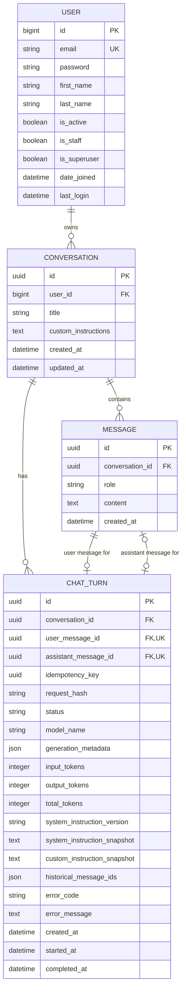

# Database Design

**Project:** NexaMind AI Chat
**Document:** Database Design
**Version:** 1.0
**Status:** Draft
**Location:** `docs/02-system-design/database-design.md`

---

## 1. Purpose

This document defines the proposed relational database architecture for NexaMind.

NexaMind needs persistent storage for user accounts, conversations, and messages. The database must support:

- Multiple registered users.
- Private conversations for each user.
- Persistent message history.
- Conversation-specific custom instructions.
- Retrieval of messages in chronological order.
- AI provider and model metadata.
- Available token usage information.
- Reliable data relationships and constraints.

The initial database will use **PostgreSQL**, accessed through Django's ORM.

This document defines the logical data model and proposed physical schema. Exact Django implementation details will be finalized during backend development.

## 2. Database Technology

### 2.1 Selected database

**PostgreSQL**

PostgreSQL is the selected relational database for the initial implementation.

Reasons:

- Strong relational data modeling.
- Foreign key and constraint support.
- Transaction management.
- Indexing capabilities.
- JSON support for future structured metadata.
- Compatibility with Django ORM.
- Suitable for a multi-user application.

### 2.2 Database access

Django will communicate with PostgreSQL through its ORM.

Conceptual architecture:

```text
React Frontend
      |
      v
Django REST Framework
      |
      v
Django Application Services
      |
      v
Django ORM
      |
      v
PostgreSQL Database
```

The React application must never connect directly to PostgreSQL.

Database credentials must remain on the backend.

## 3. Data Modeling Principles

The database design follows these principles:

| Principle             | Application                                                          |
| --------------------- | -------------------------------------------------------------------- |
| Relational integrity  | Use primary keys and foreign keys.                                   |
| Data isolation        | Every conversation belongs to a specific user.                       |
| Referential integrity | Prevent orphaned messages.                                           |
| Normalization         | Avoid unnecessary duplication of related data.                       |
| Query efficiency      | Add indexes for frequently executed queries.                         |
| Data consistency      | Use constraints for important database rules.                        |
| Security              | Enforce ownership through backend authorization and scoped queries.  |
| Extensibility         | Allow future features without building unnecessary abstractions now. |
| Migration safety      | Apply schema changes through Django migrations.                      |

## 4. Core Entities

The NexaMind MVP uses four primary application entities.

| Entity       | Purpose                                                                                                               | Implementation status                   |
| ------------ | --------------------------------------------------------------------------------------------------------------------- | --------------------------------------- |
| User         | Represents a registered NexaMind account.                                                                             | Implemented                             |
| Conversation | Represents an individual chat session owned by a user.                                                                | Implemented                             |
| Message      | Stores individual system, user, and assistant messages inside a conversation.                                         | Implemented                             |
| ChatTurn     | Tracks the lifecycle, idempotency, and generation metadata of one user message submission and its assistant response. | Model and migration implemented; generation service pending |

### 4.1 Relationship overview

One user can own many conversations.

One conversation can contain many messages and many ChatTurns.

Each message belongs to exactly one conversation.

Each ChatTurn belongs to exactly one conversation and references exactly one user Message. It may reference zero or one assistant Message.

A Message can be associated with at most one ChatTurn.

The ChatTurn entity makes generation state explicit without placing generation lifecycle and usage metadata directly on Message records.

```text
USER
  |
  | 1
  | owns
  | many
  v
CONVERSATION
  |
  +----------------------+
  |                      |
  | contains             | has
  | many                 | many
  v                      v
MESSAGE                CHATTURN
                          |
                          +---- references one USER MESSAGE
                          |
                          +---- references zero or one
                                ASSISTANT MESSAGE
```

This structure supports persistent message history, generation tracking, idempotent submissions, and explicit failure handling.

## 5. Entity Relationship Diagram



**Important:** This is a logical entity relationship model. The ChatTurn Django model, database migration, constraints, and tests have been implemented in `backend/apps/conversations/`. The diagram represents the logical design rather than the complete physical Django schema.

The User entity is implemented using NexaMind's custom Django User model. It uses email as its unique authentication identifier, with the username field disabled. The implemented fields and constraints are documented in Section 6 and Section 15.1.

## 6. User Entity

### 6.1 Purpose

The User entity represents an account registered in NexaMind.

Each user can own multiple conversations, but users must not access another user's conversations or messages.

### 6.2 Implemented User Model

NexaMind uses a custom Django User model derived from `AbstractUser`.

The model is configured through `AUTH_USER_MODEL = "accounts.User"`.
It was configured before the first database migration.

Its implemented authentication configuration includes:

- Email and password authentication.
- Email as the unique login identifier.
- No username field.
- A custom UserManager for user and superuser creation.
- Django's built-in password hashing mechanisms.

### 6.3 User Fields

| Field            | Database representation       | Purpose                                                                           |
| ---------------- | ----------------------------- | --------------------------------------------------------------------------------- |
| id               | BigAutoField                  | Automatically generated primary key, confirmed by the initial accounts migration. |
| email            | EmailField                    | Unique authentication identifier.                                                 |
| password         | Django-managed password field | Stores the password hash, never plaintext.                                        |
| first_name       | VARCHAR                       | Optional first name inherited from AbstractUser.                                  |
| last_name        | VARCHAR                       | Optional last name inherited from AbstractUser.                                   |
| is_active        | BOOLEAN                       | Controls whether the account is active.                                           |
| is_staff         | BOOLEAN                       | Controls access to Django administration.                                         |
| is_superuser     | BOOLEAN                       | Django administrative permission flag.                                            |
| date_joined      | TIMESTAMPTZ                   | Account creation timestamp.                                                       |
| last_login       | TIMESTAMPTZ, nullable         | Most recent login timestamp.                                                      |
| groups           | Many-to-many relationship     | Inherited Django group permissions.                                               |
| user_permissions | Many-to-many relationship     | Inherited individual permissions.                                                 |

The username field is not present in the implemented model.

### 6.4 User Constraints

- Each user must have a unique primary key.
- Email addresses must be unique.
- Email is the authentication identifier.
- Passwords must be stored as secure hashes generated through Django's authentication system.
- The application must never store plaintext passwords.
- Inactive users must not be allowed to access protected application functionality.
- Changes to the established User schema must follow Django's migration workflow and preserve existing account records.

### 6.5 Authentication Design Decision

The authentication design is established as email and password authentication.

| Decision                  | Current Design          |
| ------------------------- | ----------------------- |
| Authentication identifier | Email                   |
| Authentication method     | Email and password      |
| Email uniqueness          | Required                |
| Username field            | Disabled                |
| Password storage          | Django password hashing |
| User primary key          | BigAutoField            |

Email verification remains a separate unresolved product and authentication policy decision.

Email uniqueness does not establish that a user controls or has verified the email address. Any email-verification functionality must define its verification state, workflow, and access restrictions separately.

## 7. Conversation Entity

### 7.1 Purpose

The Conversation entity represents one independent chat session belonging to a user.

A conversation contains:

- A title.
- Conversation-specific custom instructions.
- Its owner.
- Creation time.
- Last update time.

### 7.2 Proposed table

```text
conversations_conversation
```

The actual table name can be configured through Django model metadata.

### 7.3 Proposed fields

| Field               | PostgreSQL type | Null | Description                                      |
| ------------------- | --------------- | ---- | ------------------------------------------------ |
| id                  | UUID            | No   | Primary key.                                     |
| user_id             | User model key  | No   | Owner of the conversation.                       |
| title               | VARCHAR(255)    | No   | Conversation title.                              |
| custom_instructions | TEXT            | Yes  | User-defined instructions for this conversation. |
| created_at          | TIMESTAMPTZ     | No   | Conversation creation timestamp.                 |
| updated_at          | TIMESTAMPTZ     | No   | Last conversation update timestamp.              |

### 7.4 Field explanations

**id**

A UUID primary key identifies the conversation.

UUIDs are useful for public resource identifiers because they are less predictable than sequential integers.

However, UUIDs are not an authorization mechanism. Backend ownership checks remain mandatory.

**user_id**

Foreign key referencing the User entity.

This establishes who owns the conversation.

**title**

Stores the conversation title.

A newly created conversation can initially use a default title such as:

```text
New chat
```

Automatic title generation can be introduced later.

**custom_instructions**

Stores optional conversation-specific preferences.

Example:

```text
Explain technical concepts step by step.
Use practical Python examples.
Avoid skipping important implementation details.
```

These instructions are user-controlled data and must be treated as untrusted input when constructing AI prompts.

**created_at**

Records when the conversation was created.

**updated_at**

Records the last time the conversation was modified.

The backend must update this field when a new message is added or when relevant conversation metadata changes.

### 7.5 Conversation relationships

```text
User (1)
   |
   | owns
   |
   v
Conversation (many)
   |
   | contains
   |
   v
Message (many)
```

### 7.6 Conversation constraints

- Every conversation must have an owner.
- The owner must reference an existing user.
- The title must not be empty or whitespace-only.
- Custom instructions may be empty or NULL.
- A conversation must not be accessible to another user through its identifier.
- Deleting a conversation should delete its associated messages according to the selected retention policy.

## 8. Message and ChatTurn Entities

This section defines two related entities with different responsibilities:

- **Message:** Stores the actual conversation content.
- **ChatTurn:** Tracks one user submission and the lifecycle of its associated assistant generation.

A Message is a persistent conversation record. A ChatTurn is an orchestration record connecting a user's submission to the corresponding assistant response.

### 8.1 Message Entity Purpose

The Message entity stores individual messages belonging to a Conversation.

Supported roles:

| Role        | Purpose                                             |
| ----------- | --------------------------------------------------- |
| `system`    | Persisted system content, when explicitly required. |
| `user`      | Content submitted by the authenticated user.        |
| `assistant` | Content generated by the backend AI service.        |

Platform and conversation instructions are constructed separately as Gemini system instructions. They are not automatically ordinary Message records.

### 8.2 Implemented Message Table

The Django default table name is:

`conversations_message`

The implemented model is located at:

`backend/apps/conversations/models.py`

### 8.3 Implemented Message Fields

| Field             | PostgreSQL Type | Null | Description                       |
| ----------------- | --------------- | ---- | --------------------------------- |
| `id`              | UUID            | No   | Primary key.                      |
| `conversation_id` | UUID            | No   | Parent Conversation foreign key.  |
| `role`            | VARCHAR(9)      | No   | `system`, `user`, or `assistant`. |
| `content`         | TEXT            | No   | Message content.                  |
| `created_at`      | TIMESTAMPTZ     | No   | Creation timestamp.               |

These fields reflect the implemented Message model and its PostgreSQL table schema.

### 8.4 Message Field Behavior

**id:** A UUID uniquely identifies each Message.

**conversation_id:** References the parent Conversation. The foreign key uses cascading deletion. The model disables the additional foreign-key index because a composite index supports conversation-history queries.

**role:** Identifies the message author. A database check constraint restricts values to:

`role IN ('system', 'user', 'assistant')`

The backend determines the role. The frontend cannot impersonate the assistant by submitting a role value.

**content:** Stores message text using PostgreSQL TEXT. Application-level validation must enforce appropriate input and output size limits. A database constraint rejects empty or whitespace-only content.

**created_at:** Records when the Message was created. Stable ordering uses both `created_at` and `id`.

### 8.5 Implemented Message Indexes and Constraints

| Name                    | Type             | Purpose                                                         |
| ----------------------- | ---------------- | --------------------------------------------------------------- |
| `msg_conv_created_idx`  | Composite index  | Supports ordering by `conversation_id`, `created_at`, and `id`. |
| `msg_role_valid`        | Check constraint | Restricts supported roles.                                      |
| `msg_content_not_blank` | Check constraint | Rejects blank content.                                          |

The model's default ordering is:

`ordering = ("created_at", "id")`

### 8.6 Message Immutability and Usage Metadata

Message content is treated as immutable after creation. The initial API does not expose individual Message update or deletion endpoints.

Provider, model, generation configuration, and token usage metadata belong to ChatTurn, not Message. ChatTurn represents the generation operation that produced the assistant response.

### 8.7 ChatTurn Purpose and Implementation Status

ChatTurn represents one user submission and its associated assistant-generation operation.

It provides:

- A stable generation identifier.
- Idempotency protection.
- Generation lifecycle status.
- Links to the user Message and optional assistant Message.
- Model, configuration, and usage metadata.
- Safe failure information.
- Snapshots of instructions and selected historical context.

The ChatTurn model, migration, constraints, and indexes are implemented. The conversation-generation service remains pending.

### 8.8 Implemented ChatTurn Table

The actual PostgreSQL table name, verified through Django model metadata and database introspection, is:

`conversations_chatturn`

The table is created by migration `0003_chatturn`, which is applied in the current development database.

### 8.9 Implemented ChatTurn Fields

| Field                          | PostgreSQL Type | Null | Description                                      |
| ------------------------------ | --------------- | ---- | ------------------------------------------------ |
| `id`                           | UUID            | No   | Primary key and turn identifier.                 |
| `conversation_id`              | UUID            | No   | Parent Conversation.                             |
| `user_message_id`              | UUID            | No   | Required one-to-one user Message reference.      |
| `assistant_message_id`         | UUID            | Yes  | Optional one-to-one assistant Message reference. |
| `idempotency_key`              | UUID            | No   | Client-provided UUID v4.                         |
| `request_hash`                 | CHAR(64)        | No   | SHA-256 digest of normalized content.            |
| `status`                       | VARCHAR         | No   | `IN_PROGRESS`, `COMPLETED`, or `FAILED`.         |
| `model_name`                   | VARCHAR         | Yes  | Actual model identifier.                         |
| `generation_metadata`          | JSONB           | No   | Safe generation configuration snapshot.          |
| `input_tokens`                 | INTEGER         | Yes  | Provider-reported input usage.                   |
| `output_tokens`                | INTEGER         | Yes  | Provider-reported output usage.                  |
| `total_tokens`                 | INTEGER         | Yes  | Provider-reported total usage.                   |
| `effective_temperature`        | NUMERIC         | Yes  | Effective generation temperature.                |
| `max_output_tokens`            | INTEGER         | Yes  | Effective output-token limit.                    |
| `system_instruction_version`   | VARCHAR         | No   | Platform prompt version.                         |
| `system_instruction_snapshot`  | TEXT            | No   | Exact platform instruction used.                 |
| `custom_instruction_snapshot`  | TEXT            | Yes  | Exact conversation instructions used.            |
| `selected_history_message_ids` | JSONB           | No   | Ordered UUIDs of selected historical messages.   |
| `error_code`                   | VARCHAR         | Yes  | Stable failure code.                             |
| `error_message`                | TEXT            | Yes  | Safe failure description.                        |
| `created_at`                   | TIMESTAMPTZ     | No   | Creation timestamp.                              |
| `started_at`                   | TIMESTAMPTZ     | No   | Generation start timestamp.                      |
| `completed_at`                 | TIMESTAMPTZ     | Yes  | Completion or failure timestamp.                 |

Token usage is nullable because the provider may not return reliable usage information. Missing usage must not be fabricated as zero.

Generation metadata must never contain API credentials, raw SDK responses, or internal model reasoning.

### 8.10 ChatTurn Relationships

A Conversation has many ChatTurns. Each ChatTurn belongs to exactly one Conversation.

Each ChatTurn references exactly one user Message and zero or one assistant Message. Each Message can be associated with at most one ChatTurn through these relationships.

Conceptually:

```text
Conversation (1)
      |
      | has
      v
ChatTurn (many)
      |
      +-----------------------+
      |                       |
      v                       v
User Message (1)       Assistant Message (0 or 1)
```

The user Message and ChatTurn are created in the same database transaction. The assistant Message is created only after successful generation.

A failed ChatTurn retains its user Message and has no assistant Message.

### 8.11 ChatTurn Lifecycle

Allowed statuses:

```text
IN_PROGRESS
COMPLETED
FAILED
```

Allowed transitions:

```text
IN_PROGRESS -> COMPLETED
IN_PROGRESS -> FAILED
```

Completed and failed turns are terminal and cannot be regenerated or reopened.

| Status        | Assistant Message | `completed_at` | Failure Information |
| ------------- | ----------------- | -------------- | ------------------- |
| `IN_PROGRESS` | NULL              | NULL           | NULL                |
| `COMPLETED`   | Required          | Required       | NULL                |
| `FAILED`      | NULL              | Required       | Required            |

The backend service controls transitions. Database constraints enforce persisted state rules.

### 8.12 Idempotency

Every new chat submission requires an `Idempotency-Key` HTTP header containing a UUID v4.

The key is stored as a UUID. A unique constraint applies to:

`(conversation_id, idempotency_key)`

The backend trims outer whitespace from submitted content and calculates its SHA-256 digest.

| Existing Key    | Content                   | Behavior                                    |
| --------------- | ------------------------- | ------------------------------------------- |
| No matching key | Valid content             | Create a new ChatTurn.                      |
| Same key        | Same content, in progress | Return HTTP 202.                            |
| Same key        | Same content, completed   | Return original result with HTTP 200.       |
| Same key        | Same content, failed      | Return recorded failure; do not regenerate. |
| Same key        | Different content         | Return HTTP 409.                            |

The database uniqueness constraint is the final authority during concurrent submissions. On an integrity conflict, the service retrieves the existing turn and compares its request hash.

An idempotency key is not an authentication credential.

### 8.13 ChatTurn Database Constraints

The proposed database design requires:

1. Unique `(conversation_id, idempotency_key)`.
2. A required user Message relationship.
3. An optional assistant Message relationship.
4. Completed turns must have an assistant Message and `completed_at`.
5. Failed turns must have `completed_at` and `error_code`.
6. In-progress turns must have NULL `completed_at`.
7. In-progress and completed turns must have no failure information.
8. Failed turns must have no assistant Message.
9. At most one `IN_PROGRESS` ChatTurn per Conversation.

The final rule should use a conditional unique constraint on `conversation_id` for rows with status `IN_PROGRESS`.

Application-level validation must also ensure both referenced Messages belong to the same Conversation as the ChatTurn and have the appropriate roles.

### 8.14 Generation Metadata and Historical Context

Each ChatTurn records:

- Actual model name.
- Effective temperature and output-token limit.
- Prompt version.
- Exact platform instruction snapshot.
- Exact custom-instruction snapshot.
- Selected historical Message UUIDs in chronological order.
- Relevant context-budget configuration.

Selected historical UUIDs exclude the current user Message.

The context builder verifies that selected messages still exist and belong to the expected Conversation. Missing required context results in `CHAT_CONTEXT_UNAVAILABLE`; the backend must not silently substitute different history.

The snapshots and historical UUIDs support reconstruction without storing a complete duplicate of the prompt.

### 8.15 Implementation Status

| Entity       | Status                           | Location                                          |
| ------------ | -------------------------------- | ------------------------------------------------- |
| User         | Implemented                      | `backend/apps/accounts/models.py`                 |
| Conversation | Implemented                      | `backend/apps/conversations/models.py`            |
| Message      | Implemented                      | `backend/apps/conversations/models.py`            |
| ChatTurn     | Implemented                      | `backend/apps/conversations/models.py`            |

The ChatTurn model, migration, constraints, and tests are implemented. The conversation-generation service and its transaction orchestration remain to be implemented.

## 9. Database Relationships and Cardinality

This section defines the relationships between the primary database entities and the cardinality of each relationship.

### 9.1 User to Conversation

Relationship:

```text
One User → Many Conversations
```

A user may create multiple conversations.

Each conversation belongs to exactly one user.

The `Conversation.user` foreign key identifies the conversation owner.

### 9.2 Conversation to Message

Relationship:

```text
One Conversation → Many Messages
```

A conversation may contain multiple messages.

Each message belongs to exactly one conversation.

The `Message.conversation` foreign key identifies the conversation containing the message.

### 9.3 Conversation to ChatTurn

Relationship:

```text
One Conversation → Many ChatTurns
```

A conversation may contain multiple ChatTurns.

Each ChatTurn belongs to exactly one conversation.

The `ChatTurn.conversation` foreign key identifies the conversation in which the generation request was submitted.

A ChatTurn represents one user submission and its associated assistant-generation lifecycle.

### 9.4 ChatTurn to User Message

Relationship:

```text
One ChatTurn → Exactly One User Message
```

Every ChatTurn must reference exactly one user Message.

The relationship is one-to-one: a user Message can be associated with at most one ChatTurn.

The referenced Message must:

- Have the `user` role.
- Belong to the same Conversation as the ChatTurn.

The `ChatTurn.user_message` relationship is required.

### 9.5 ChatTurn to Assistant Message

Relationship:

```text
One ChatTurn → Zero or One Assistant Message
```

A ChatTurn may reference one assistant Message after successful generation.

A ChatTurn in `IN_PROGRESS` or `FAILED` state has no assistant Message.

The relationship is one-to-one: an assistant Message can be associated with at most one ChatTurn.

The referenced Message must:

- Have the `assistant` role.
- Belong to the same Conversation as the ChatTurn.

The `ChatTurn.assistant_message` relationship is optional.

### 9.6 Relationship Summary

| Relationship                 | Foreign key                     | Cardinality | Required |
| ---------------------------- | ------------------------------- | ----------- | -------- |
| User → Conversation          | `conversation.user_id`          | One-to-many | Yes      |
| Conversation → Message       | `message.conversation_id`       | One-to-many | Yes      |
| Conversation → ChatTurn      | `chatturn.conversation_id`      | One-to-many | Yes      |
| ChatTurn → User Message      | `chatturn.user_message_id`      | One-to-one  | Yes      |
| ChatTurn → Assistant Message | `chatturn.assistant_message_id` | One-to-one  | No       |

### 9.7 Referential Integrity

The database must enforce foreign-key relationships and the required one-to-one uniqueness constraints.

Additional application-level validation must ensure:

1. The user Message belongs to the same Conversation as its ChatTurn.
2. The assistant Message, when present, belongs to the same Conversation as its ChatTurn.
3. The user Message has the `user` role.
4. The assistant Message has the `assistant` role.
5. A Message is not associated with multiple ChatTurns.

Ordinary foreign-key constraints alone do not enforce all these cross-record conditions.

### 9.8 Deletion Behavior

| Parent entity | Dependent entity     | Proposed deletion behavior |
| ------------- | -------------------- | -------------------------- |
| User          | Conversation         | CASCADE                    |
| Conversation  | Message              | CASCADE                    |
| Conversation  | ChatTurn             | CASCADE                    |
| Message       | Referencing ChatTurn | CASCADE                    |

Deleting a Conversation removes its associated Messages and ChatTurns.

ChatTurns must not be independently deleted through a public API endpoint.

Deleting a Conversation while Gemini generation is in progress must not allow a late provider response to recreate the deleted Conversation or persist a new assistant Message.

Before persisting a provider response, the backend must verify that the Conversation and its owner still exist and that the ChatTurn remains eligible for completion.

Account deletion requires separate consideration because it can cascade through all conversations, messages, and ChatTurns belonging to the account.

The final account and data-retention policy must define when account deletion is permitted and whether a recovery period is necessary.

## 10. Indexing Strategy

Indexes help PostgreSQL locate records efficiently without scanning entire tables for every query.

NexaMind uses indexes to support:

- Retrieving a user's conversations by recent activity.
- Retrieving messages in a conversation.
- Building historical context for Gemini requests.
- Looking up ChatTurns by idempotency key.
- Preventing multiple active ChatTurns in one conversation.
- Finding stale ChatTurns during recovery.

This section documents the indexing strategy, distinguishing indexes implemented in Django models from any additional indexes that may be considered after query-plan and workload analysis.

### 10.1 Conversation Indexes

The Conversation model currently defines the following explicit index:

| Index                   | Columns                    | Status      | Purpose                                                     |
| ----------------------- | -------------------------- | ----------- | ----------------------------------------------------------- |
| Primary key             | `id`                       | Implemented | Retrieve an individual conversation.                        |
| `conv_user_updated_idx` | `user_id, updated_at DESC` | Implemented | Retrieve a user's conversations ordered by recent activity. |

The `user` foreign key uses `db_index=False`. A separate single-column index on `user_id` is therefore not created.

The composite index supports queries that filter conversations by user and order them by descending `updated_at`.

### 10.2 Message Indexes

The Message model currently defines the following explicit index:

| Index                  | Columns                           | Status      | Purpose                                          |
| ---------------------- | --------------------------------- | ----------- | ------------------------------------------------ |
| Primary key            | `id`                              | Implemented | Retrieve an individual message.                  |
| `msg_conv_created_idx` | `conversation_id, created_at, id` | Implemented | Retrieve messages in stable chronological order. |

The `conversation` foreign key uses `db_index=False`.

The composite index supports:

- Chronological conversation history retrieval.
- Stable ordering when messages share the same timestamp.
- Reverse chronological retrieval of recent messages for context construction.

PostgreSQL can scan the B-tree index in reverse order for the corresponding reverse-order query.

A separate context-retrieval index with the same leading columns is unnecessary and would create redundant indexing overhead.

### 10.3 Implemented ChatTurn Indexes

The following ChatTurn indexes are implemented in the Django model and migration:

| Index                                | Columns or condition                             | Purpose                                                         |
| ------------------------------------ | ------------------------------------------------ | --------------------------------------------------------------- |
| Primary key                          | `id`                                             | Retrieve an individual ChatTurn.                                |
| Idempotency unique index             | `conversation_id, idempotency_key`               | Prevent duplicate submissions and support idempotency lookup.   |
| Active-turn conditional unique index | `conversation_id` where `status = 'IN_PROGRESS'` | Enforce at most one active ChatTurn per Conversation.           |
| Conversation history index           | `conversation_id, created_at`                    | Retrieve a Conversation's ChatTurns chronologically.            |
| Recovery index                       | `status, started_at`                             | Locate stale in-progress ChatTurns efficiently.                 |
| User Message unique index            | `user_message_id`                                | Enforce the one-to-one user Message relationship.               |
| Assistant Message unique index       | `assistant_message_id`                           | Enforce the optional one-to-one assistant Message relationship. |

The active-turn index must be a conditional unique constraint supported by PostgreSQL.

The user and assistant Message relationship indexes are expected to be created through Django `OneToOneField` definitions.

The index definitions and names are recorded in the implemented ChatTurn model and migration. Database query-plan and workload validation remain future optimization work.

### 10.4 Query Examples

Retrieve a user's conversations:

```python
Conversation.objects.filter(
    user=request.user
).order_by("-updated_at")
```

Retrieve messages for one authorized conversation:

```python
Message.objects.filter(
    conversation=conversation
).order_by("created_at", "id")
```

Retrieve recent history for context construction:

```python
recent_messages = list(
    Message.objects.filter(
        conversation=conversation
    ).order_by("-created_at", "-id")[:100]
)

recent_messages.reverse()
```

This retrieves up to 100 recent historical candidate messages and restores chronological order before context construction.

The 100-message limit is a candidate-selection limit, not the final context limit. The context builder must still apply token-budget rules and must not assume that all retrieved messages fit into the Gemini request.

Retrieve an existing ChatTurn using its idempotency key:

```python
ChatTurn.objects.filter(
    conversation=conversation,
    idempotency_key=idempotency_key,
).first()
```

Retrieve an active ChatTurn:

```python
ChatTurn.objects.filter(
    conversation=conversation,
    status="IN_PROGRESS",
).first()
```

Find potentially stale ChatTurns for recovery:

```python
ChatTurn.objects.filter(
    status="IN_PROGRESS",
    started_at__lt=stale_before,
)
```

These examples use the implemented ChatTurn model. Their use in the generation workflow remains pending service implementation.

### 10.5 Index Maintenance Considerations

Indexes improve read performance but introduce storage requirements and additional work during inserts, updates, and deletes.

NexaMind should therefore:

- Avoid duplicate indexes with equivalent access paths.
- Use composite indexes that match actual filtering and ordering patterns.
- Use conditional unique indexes when a constraint applies only to a subset of records.
- Verify generated SQL migrations and PostgreSQL index definitions.
- Review query plans with `EXPLAIN` when performance problems arise.

Index design should follow actual query patterns rather than adding indexes speculatively.

## 11. Data Normalization

NexaMind separates account information, conversation information, message content, and generation lifecycle data into distinct entities.

The primary entities are:

- User
- Conversation
- Message
- ChatTurn

Each entity has a defined responsibility and stores information appropriate to its role.

### 11.1 Entity Responsibilities

**User**

Stores account identity and authentication-related information.

**Conversation**

Stores conversation-level information, including its owner, title, custom instructions, and timestamps.

**Message**

Stores individual conversation messages, including their role, content, and creation timestamp.

**ChatTurn**

Stores the lifecycle and generation metadata associated with one user submission and its corresponding assistant-generation request.

This separation avoids mixing account data, conversation configuration, message content, and generation execution details in the same database record.

### 11.2 Avoid Unnecessary Duplication

NexaMind should avoid storing information repeatedly when it can be retrieved through an existing relationship.

Examples:

- Do not copy the user's email address into every Conversation.
- Do not copy the Conversation title into every Message.
- Do not store complete conversation history repeatedly inside a Conversation.
- Do not duplicate Message content inside ChatTurn records.

Related information should normally be retrieved through foreign keys and Django ORM relationships.

### 11.3 Generation Metadata Ownership

Generation metadata belongs to ChatTurn rather than the assistant Message.

A ChatTurn represents the generation operation, while a Message represents the conversational content produced or submitted.

ChatTurn stores generation-related information such as:

- Actual Gemini model name.
- Input, output, and total token usage when available.
- Effective generation settings.
- Selected historical Message UUIDs.
- Generation status and timestamps.
- Safe error information when generation fails.

The assistant Message stores the generated response content and its conversational role.

This separation allows a failed generation to retain its ChatTurn failure information without requiring an assistant Message.

### 11.4 Historical Snapshots and Controlled Duplication

Some information is intentionally captured in ChatTurn even when related configuration or messages already exist elsewhere.

Examples include:

- Exact platform instruction snapshot.
- Exact custom-instruction snapshot.
- Selected historical Message UUIDs.
- Effective generation configuration.

These snapshots preserve the inputs and configuration associated with a particular generation request.

They are deliberate historical records, not unnecessary duplication of the complete conversation.

Selected historical Message UUIDs identify the messages used as context without copying their full content into ChatTurn.

### 11.5 Structured Fields and Flexible Metadata

Frequently queried and operationally important values should use dedicated database fields.

Examples include:

- `status`
- `model_name`
- `input_tokens`
- `output_tokens`
- `total_tokens`
- `created_at`
- `started_at`
- `completed_at`

The `generation_metadata` JSONB field can hold additional non-sensitive generation details that do not require dedicated columns.

Do not use JSONB as a substitute for properly modeled relationships, constraints, or frequently queried fields.

Never store API keys, credentials, or other secrets in generation metadata.

### 11.6 Normalization and Historical Integrity

Database normalization reduces unnecessary duplication and helps maintain consistent records.

However, NexaMind also requires historical snapshots to preserve the configuration used by completed or failed generation requests.

The design therefore balances normalized relational data with deliberate snapshots needed for auditability, debugging, and generation reconstruction.

## 12. Data Integrity and Constraints

Database integrity rules protect NexaMind against invalid, inconsistent, or incomplete records.

The design uses PostgreSQL constraints and Django application-level validation. Each rule must be enforced at the appropriate layer.

### 12.1 Implemented Conversation Constraints

The current Conversation model defines:

| Constraint               | Enforcement                             | Purpose                                         |
| ------------------------ | --------------------------------------- | ----------------------------------------------- |
| Conversation primary key | UUID primary key                        | Uniquely identify each Conversation.            |
| Conversation owner       | Foreign key and NOT NULL                | Require every Conversation to belong to a User. |
| Nonblank title           | `conv_title_not_blank` check constraint | Reject titles containing only whitespace.       |

The owner foreign key uses `on_delete=models.CASCADE`.

### 12.2 Implemented Message Constraints

The current Message model defines:

| Constraint                | Enforcement                              | Purpose                                            |
| ------------------------- | ---------------------------------------- | -------------------------------------------------- |
| Message primary key       | UUID primary key                         | Uniquely identify each Message.                    |
| Conversation relationship | Foreign key and NOT NULL                 | Require every Message to belong to a Conversation. |
| Valid roles               | `msg_role_valid` check constraint        | Allow only `system`, `user`, and `assistant`.      |
| Nonblank content          | `msg_content_not_blank` check constraint | Reject content containing only whitespace.         |
| Stable message ordering   | Model ordering by `created_at`, `id`     | Provide deterministic chronological ordering.      |

The Message foreign key uses `on_delete=models.CASCADE`.

### 12.3 Implemented ChatTurn Constraints

The ChatTurn model and migration implement the following database rules:

| Rule                                         | Implemented enforcement                                                             |
| -------------------------------------------- | -------------------------------------------------------------------------------- |
| Unique ChatTurn identity                     | UUID primary key                                                                 |
| Required Conversation relationship           | Foreign key and NOT NULL                                                         |
| Required user Message                        | One-to-one relationship and NOT NULL                                             |
| Optional assistant Message                   | Nullable one-to-one relationship                                                 |
| Unique idempotency key per Conversation      | Unique constraint on `(conversation_id, idempotency_key)`                        |
| Valid lifecycle status                       | Check constraint restricting status to `IN_PROGRESS`, `COMPLETED`, or `FAILED`   |
| Nonnegative token counts                     | Check constraints on non-null token fields                                       |
| At most one active ChatTurn per Conversation | Conditional unique constraint on `conversation_id` where status is `IN_PROGRESS` |

The one-to-one Message relationships must prevent a Message from being associated with multiple ChatTurns.

### 12.4 ChatTurn Lifecycle Constraints

The database must enforce the persisted state requirements of each ChatTurn.

| Status        | Assistant Message | `completed_at` | Failure information |
| ------------- | ----------------- | -------------- | ------------------- |
| `IN_PROGRESS` | NULL              | NULL           | NULL                |
| `COMPLETED`   | Required          | Required       | NULL                |
| `FAILED`      | NULL              | Required       | Required            |

The database design must enforce these conditions through appropriate check constraints.

The application service must additionally control lifecycle transitions:

- `IN_PROGRESS` may transition to `COMPLETED`.
- `IN_PROGRESS` may transition to `FAILED`.
- `COMPLETED` is terminal.
- `FAILED` is terminal.

A completed or failed ChatTurn must not be reopened for another generation attempt. A new attempt requires a new idempotency key and a new ChatTurn.

### 12.5 Cross-Record Integrity

Some integrity requirements involve comparing fields across related records and cannot be enforced by ordinary foreign-key constraints alone.

The application service must verify that:

1. The user Message belongs to the same Conversation as its ChatTurn.
2. The user Message has the `user` role.
3. The assistant Message, when present, belongs to the same Conversation as its ChatTurn.
4. The assistant Message has the `assistant` role.
5. A completed ChatTurn has exactly one associated assistant Message.
6. A failed ChatTurn has no associated assistant Message.

These checks must be performed within the appropriate database transaction when records are created or updated.

### 12.6 Idempotency Integrity

Every new chat submission requires a valid UUID v4 idempotency key.

The database unique constraint on `(conversation_id, idempotency_key)` is the final authority for preventing duplicate ChatTurns within one Conversation.

The application service must:

- Calculate and store the normalized request content hash.
- Compare the hash when an existing key is reused.
- Return the existing result for a matching request.
- Reject reuse of the same key with different content.
- Handle concurrent uniqueness conflicts without creating duplicate generation requests.

An idempotency key is not an authentication credential.

### 12.7 Token and Generation Metadata Integrity

Token usage belongs to ChatTurn rather than Message.

When token counts are present:

- `input_tokens` must be nonnegative.
- `output_tokens` must be nonnegative.
- `total_tokens` must be nonnegative.

Usage fields may be NULL when the provider does not return reliable usage information.

The application service must not invent token counts or replace unavailable usage data with estimates.

Generation metadata must not contain API keys, credentials, or other secrets.

### 12.8 Application Validation and Database Enforcement

Django model validation and PostgreSQL constraints serve different purposes.

Application validation provides useful errors and enforces business rules such as ownership, cross-record consistency, and lifecycle transitions.

Database constraints protect persisted data even when records are written outside the normal API validation path.

NexaMind must not rely exclusively on frontend validation or Django model validation for rules that can also be enforced by database constraints.

### 12.9 Authentication and User Identity Constraints

The custom User model establishes email as the authentication identifier.

The implemented identity configuration includes:

- `username = None`, removing the username field inherited from `AbstractUser`.
- `email = models.EmailField(unique=True)`, enforcing unique email addresses.
- `USERNAME_FIELD = "email"`, making email the authentication identifier.
- `REQUIRED_FIELDS = []`, because email is the required identifier and password is handled through Django's password-management mechanisms.
- A custom UserManager for creating users and superusers.

The custom User model is configured through `AUTH_USER_MODEL` and was established before the initial database migrations.

The following identity decisions are therefore resolved:

| Decision                  | Current Design                     |
| ------------------------- | ---------------------------------- |
| Authentication identifier | Email and password                 |
| Email uniqueness          | Required                           |
| Username field            | Not used                           |
| Password storage          | Django password hashing mechanisms |

**Remaining authentication policy decision:**

- Whether email verification is required before an account can access protected application functionality.

Email uniqueness prevents duplicate account identifiers. It does not establish that a user controls or has verified the email address.

Any future email-verification implementation must define its verification state, verification workflow, and access restrictions without weakening the existing unique-email constraint.

## 13. Data Deletion and Retention

Deletion behavior must protect user ownership, preserve referential integrity, and prevent deleted conversation data from being recreated by asynchronous or delayed generation responses.

### 13.1 Conversation Deletion

When a user deletes a Conversation:

1. Authenticate the user.
2. Retrieve the Conversation using an owner-scoped query.
3. Return `404 Not Found` if the Conversation does not exist or does not belong to the authenticated user.
4. Delete the Conversation.
5. Allow the configured cascade behavior to delete its associated Messages and ChatTurns.
6. Return `204 No Content` without a response body.

The database relationships use `on_delete=models.CASCADE` for dependent records.

Deleting a Conversation must therefore delete:

- All Messages belonging to that Conversation.
- All ChatTurns belonging to that Conversation.

A user must not be able to delete another user's Conversation by modifying an identifier.

Repeated deletion of an already deleted Conversation returns `404 Not Found`.

### 13.2 ChatTurn Deletion Restrictions

ChatTurns must not be independently deleted through a public API endpoint.

A ChatTurn represents a generation operation and preserves its lifecycle and failure information for the lifetime of its Conversation.

ChatTurn records are deleted through the cascade behavior when their parent Conversation is deleted.

A new generation attempt after a failed ChatTurn must create a new ChatTurn with a new idempotency key rather than deleting or reopening the failed record.

### 13.3 Deletion During Gemini Generation

Gemini generation occurs outside the database transaction.

A Conversation may therefore be deleted while a generation request is still being processed by the provider.

The backend must prevent a late provider response from recreating deleted data or persisting an assistant response after its generation operation has become invalid.

Before persisting a generated assistant response, the backend must perform a concurrency-safe finalization operation.

The finalization operation must:

1. Start a database transaction.
2. Retrieve and lock the Conversation using `select_for_update()`.
3. Verify that the Conversation exists and belongs to the authenticated user.
4. Retrieve and lock the associated ChatTurn.
5. Verify that the ChatTurn still exists, belongs to the Conversation, and remains in the `IN_PROGRESS` state.
6. Verify that the required relationships remain valid.
7. Create the assistant Message and transition the ChatTurn to `COMPLETED` within the same database transaction.
8. Commit the transaction only if all required operations succeed.

The Conversation and ChatTurn locks must prevent concurrent deletion or generation finalization from producing inconsistent results.

The backend must use a consistent lock acquisition order, beginning with the Conversation and then the ChatTurn, to reduce the risk of deadlocks.

If the Conversation or ChatTurn no longer exists, or the ChatTurn is no longer eligible for completion, the backend must not persist the generated response.

The transaction must roll back if any required finalization operation fails.

A late provider response associated with a deleted or invalid generation operation must be discarded.

The backend must never recreate a deleted Conversation, Message, or ChatTurn.

These locking and transaction requirements rely on the database's row-level locking behavior and must be verified against the PostgreSQL implementation.

### 13.4 Account Deletion

Account deletion may remove all dependent Conversations and their associated Messages and ChatTurns through configured cascade behavior.

However, the product must define whether account deletion is immediate or whether a retention period is required.

The account deletion and retention policy remains an unresolved product and privacy decision.

### 13.5 Message and ChatTurn Retention

Messages and ChatTurns are retained for as long as their parent Conversation exists under the initial design.

Deleting a Conversation permanently removes its dependent Messages and ChatTurns from the active application database through cascade behavior.

Future requirements may introduce:

- Data export.
- Retention policies.
- Permanent deletion workflows.
- Backup retention and recovery procedures.
- Privacy-related data requests.

These policies must be consistent with applicable legal and provider requirements.

Database deletion does not necessarily mean that previously created backups are immediately erased. Backup expiration and restoration procedures must follow the eventual retention policy.

## 14. Database Migration Strategy

Django migrations manage NexaMind database schema changes.

Migration files provide a version-controlled history of schema changes and allow development and production databases to evolve consistently.

The database must not be manually modified as the normal development workflow.

### 14.1 Current Migration State

The initial Django project and the following application structure have already been created:

| Application     | Current migration state              | Model status                                |
| --------------- | ------------------------------------ | ------------------------------------------- |
| `accounts`      | `0001_initial.py`                    | Custom User model implemented               |
| `conversations` | `0001_initial.py`, `0002_message.py`, `0003_chatturn.py` | Conversation, Message, and ChatTurn models implemented |

Conversation and Message belong to the same `conversations` application.

There is no separate `messages` application.

ChatTurn is implemented in `backend/apps/conversations/models.py`. Its schema is introduced by `0003_chatturn.py`, which is applied in the current development database.

### 14.2 Remaining Migration Work

The remaining database verification work includes:

1. Review the User, Conversation, Message, and ChatTurn migrations against their current models.
2. Confirm that the development database schema matches the migration history.
3. Review the applied `0003_chatturn` migration and its SQL.
4. Verify the resulting relationships, constraints, and indexes against the development database.
5. Run database and application regression tests.
6. Repeat migration verification against a clean development database.
7. Keep production migration verification as a deployment responsibility.

The ChatTurn migration must preserve existing Conversation and Message records.

Do not recreate existing tables or introduce a separate Message model.

### 14.3 Common Django Migration Commands

Create migrations:

```bash
python manage.py makemigrations
```

Review migration status:

```bash
python manage.py showmigrations
```

Apply migrations:

```bash
python manage.py migrate
```

Inspect generated SQL for a migration:

```bash
python manage.py sqlmigrate conversations 0003
```

The migration name and number are examples. Use the actual generated migration identifiers.

Check whether model changes require migrations:

```bash
python manage.py makemigrations --check --dry-run
```

### 14.4 Migration Principles

- Review generated migrations before applying them.
- Commit migration files to Git.
- Do not edit an already-applied migration casually.
- Avoid destructive schema changes without a backup and migration plan.
- Test schema changes against a development database.
- Keep production schema changes under version control.
- Preserve existing records when introducing new relationships.
- Use data migrations when existing records require a controlled transformation.
- Verify migration behavior in a clean development database as well as an existing database.

### 14.5 Custom User Model Consideration

NexaMind uses a project-owned custom Django User model.

The custom User model was configured through `AUTH_USER_MODEL` before the first database migration, avoiding the complications of changing the user model after dependent tables have been created.

The implemented authentication identity is:

- Email and password authentication.
- `email` is the unique login identifier.
- The `username` field is disabled.
- Django's password-hashing mechanisms are used for password storage.

The initial `accounts` migration already exists. Changes to the established User schema must therefore follow Django's migration workflow and preserve existing account records.

Email verification remains a separate unresolved product and authentication policy decision. It must not be confused with email uniqueness or the selected login identifier.

## 15. Example Django Model Structure

The following examples reflect the current Django model implementation in NexaMind.

They document the existing model structure and are not a complete representation of every application file.

ChatTurn is documented separately in Section 15.4 rather than repeated in the illustrative User, Conversation, and Message model examples.

### 15.1 Custom User Model

File: `backend/apps/accounts/models.py`

The project uses a custom User model based on Django's `AbstractUser`.

Its authentication configuration includes:

- Email as the login identifier.
- No username field.
- Unique email addresses.
- A custom manager for user and superuser creation.
- Django's built-in password hashing through `set_password()`.

```python
from django.contrib.auth.models import AbstractUser, BaseUserManager
from django.db import models


class UserManager(BaseUserManager):
    """Manager for email-based user accounts."""

    use_in_migrations = True

    def create_user(self, email, password=None, **extra_fields):
        email = self.normalize_email(email or "").strip().lower()

        if not email:
            raise ValueError("An email address is required.")

        if not password:
            raise ValueError("A password is required.")

        extra_fields.setdefault("is_staff", False)
        extra_fields.setdefault("is_superuser", False)

        user = self.model(email=email, **extra_fields)
        user.set_password(password)
        user.save(using=self._db)

        return user

    def create_superuser(self, email, password=None, **extra_fields):
        extra_fields.setdefault("is_staff", True)
        extra_fields.setdefault("is_superuser", True)
        extra_fields.setdefault("is_active", True)

        if extra_fields.get("is_staff") is not True:
            raise ValueError("A superuser must have is_staff=True.")

        if extra_fields.get("is_superuser") is not True:
            raise ValueError("A superuser must have is_superuser=True.")

        return self.create_user(email, password, **extra_fields)


class User(AbstractUser):
    username = None

    email = models.EmailField(unique=True)

    USERNAME_FIELD = "email"
    REQUIRED_FIELDS = []

    objects = UserManager()
```

### 15.2 Conversation Model

File: `backend/apps/conversations/models.py`

Conversation represents a user's chat session and owns its messages and generation turns.

```python
import uuid

from django.conf import settings
from django.db import models


class Conversation(models.Model):
    id = models.UUIDField(
        primary_key=True,
        default=uuid.uuid4,
        editable=False,
    )

    user = models.ForeignKey(
        settings.AUTH_USER_MODEL,
        on_delete=models.CASCADE,
        related_name="conversations",
        db_index=False,
    )

    title = models.CharField(max_length=255)

    custom_instructions = models.TextField(
        blank=True,
        null=True,
    )

    created_at = models.DateTimeField(auto_now_add=True)
    updated_at = models.DateTimeField(auto_now=True)

    class Meta:
        indexes = [
            models.Index(
                fields=["user", "-updated_at"],
                name="conv_user_updated_idx",
            ),
        ]

        constraints = [
            models.CheckConstraint(
                condition=~models.Q(title__regex=r"^\s*$"),
                name="conv_title_not_blank",
            ),
        ]

    def __str__(self):
        return self.title
```

Important implementation details:

- Every Conversation belongs to one User.
- The title is required and has no model-level default.
- Custom instructions may be NULL or blank.
- The owner foreign key disables its automatic standalone index because the composite index covers the intended query pattern.
- The title check constraint rejects whitespace-only titles.
- `updated_at` changes when the Conversation itself is saved. Creating a related Message does not automatically update it. The message service must explicitly update the Conversation timestamp when appropriate.

### 15.3 Message Model

File: `backend/apps/conversations/models.py`

Message stores conversational content. Generation lifecycle and provider metadata belong to ChatTurn, not Message.

```python
class Message(models.Model):

    class Role(models.TextChoices):
        SYSTEM = "system", "System"
        USER = "user", "User"
        ASSISTANT = "assistant", "Assistant"

    id = models.UUIDField(
        primary_key=True,
        default=uuid.uuid4,
        editable=False,
    )

    conversation = models.ForeignKey(
        Conversation,
        on_delete=models.CASCADE,
        related_name="messages",
        db_index=False,
    )

    role = models.CharField(
        max_length=9,
        choices=Role.choices,
    )

    content = models.TextField()

    created_at = models.DateTimeField(auto_now_add=True)

    class Meta:
        ordering = ["created_at", "id"]

        indexes = [
            models.Index(
                fields=["conversation", "created_at", "id"],
                name="msg_conv_created_idx",
            ),
        ]

        constraints = [
            models.CheckConstraint(
                condition=models.Q(
                    role__in=["system", "user", "assistant"]
                ),
                name="msg_role_valid",
            ),
            models.CheckConstraint(
                condition=~models.Q(content__regex=r"^\s*$"),
                name="msg_content_not_blank",
            ),
        ]

    def __str__(self):
        return f"{self.role}: {self.content[:50]}"
```

The Message model supports three roles:

- `system`: system-level message records.
- `user`: user-submitted content.
- `assistant`: generated assistant responses.

The model does not store provider names, Gemini model names, or token usage. Those generation-related values belong to ChatTurn.

The application service must ensure that provider-controlled metadata cannot be supplied or modified through ordinary user message submissions.

### 15.4 ChatTurn Implementation Status

The ChatTurn model is implemented in:

`backend/apps/conversations/models.py`

Its database migration is:

`backend/apps/conversations/migrations/0003_chatturn.py`

The model represents one user submission and its associated generation lifecycle, including:

- Required user Message relationship.
- Optional assistant Message relationship.
- Idempotency key.
- Generation status.
- Model and token usage metadata.
- Effective generation settings.
- Historical instruction and context snapshots.
- Completion and failure information.

Its fields, constraints, indexes, and relationships are implemented in accordance with the design in Sections 8–14. The generation service that coordinates these records remains pending.

## 16. Query Patterns

The following operations represent the main database access patterns.

### 16.1 Retrieve Conversations for an Authenticated User

```python
Conversation.objects.filter(
    user=request.user
).order_by("-updated_at")
```

Expected result: only the authenticated user's conversations.

### 16.2 Retrieve one conversation safely

```python
Conversation.objects.get(
    id=conversation_id,
    user=request.user,
)
```

In an API implementation, handle the not-found case with an appropriate response.

This query combines resource retrieval and ownership scoping.

### 16.3 Retrieve Messages in Chronological Order

```python
Message.objects.filter(
    conversation=conversation
).order_by("created_at", "id")
```

### 16.4 Retrieve Paginated Message History

Long conversations must use cursor-based pagination rather than loading the entire message history.

The approved pagination configuration is:

| Setting             |                        Value |
| ------------------- | ---------------------------: |
| Default page size   |                  30 messages |
| Maximum page size   |                 100 messages |
| Ordering            | `created_at`, `id` ascending |
| Retrieval direction |            Newest page first |
| Display order       |      Chronological ascending |
| Cursor expiration   |                     24 hours |

The first query retrieves the newest page and one additional record:

```python
page = list(
    Message.objects.filter(
        conversation=conversation
    )
    .order_by("-created_at", "-id")[: page_size + 1]
)
```

The extra record determines whether older messages exist.

The application then:

1. Determines `has_more` from the extra record.
2. Keeps at most `page_size` records.
3. Reverses the selected records into chronological order.
4. Creates the next cursor from the oldest selected record.

For subsequent pages, the decoded cursor supplies the timestamp and UUID boundary of the previous page's oldest message.

```python
from django.db.models import Q

older_messages = Message.objects.filter(
    conversation=conversation
).filter(
    Q(created_at__lt=cursor_created_at)
    | Q(
        created_at=cursor_created_at,
        id__lt=cursor_message_id,
    )
).order_by("-created_at", "-id")[: page_size + 1]
```

The application applies the same page-size detection and chronological reversal.

The cursor must be signed and opaque. It must include the conversation identifier, timestamp boundary, message UUID, and expiration information.

Before using a cursor, the API must verify its signature, expiration, and conversation association. A malformed, tampered, expired, or wrong-conversation cursor returns HTTP 400.

A cursor is a pagination mechanism, not an authentication or authorization mechanism. Every request must still verify conversation ownership.

The API response follows this structure:

```json
{
  "results": [
    {
      "id": "message-uuid",
      "role": "user",
      "content": "Example message",
      "created_at": "2026-11-24T10:00:00Z"
    }
  ],
  "next": "opaque-cursor-or-null",
  "has_more": true
}
```

The frontend prepends older pages to existing history and deduplicates messages by UUID.

### 16.5 Retrieve Context Candidates for Generation

Conversation history retrieval and AI context selection are separate operations.

The context builder first retrieves a bounded set of historical candidate messages:

```python
historical_candidates = list(
    Message.objects.filter(
        conversation=conversation
    )
    .exclude(id=current_user_message.id)
    .order_by("-created_at", "-id")[:100]
)

historical_candidates.reverse()
```

This retrieves at most 100 historical candidate messages and places them in chronological order.

The candidate limit is not the final token budget.

The context builder must subsequently:

- Apply message eligibility rules.
- Exclude incomplete or failed assistant responses.
- Preserve the current user message separately.
- Count the complete Gemini context using the provider's token-counting capability.
- Remove older history when necessary to fit the configured budget.
- Preserve mandatory platform instructions, custom instructions, and the current user message.
- Record selected historical message UUIDs in the ChatTurn snapshot.

#### Context History Trimming Strategy

When the complete eligible history exceeds the configured input-token budget, the context builder must retain the largest fitting suffix of the most recent complete user-assistant exchanges.

The current implementation uses binary search over the number of retained exchanges:

1. Keep the current user message and mandatory instructions in every candidate.
2. Treat historical exchanges as indivisible pairs.
3. Search for the largest suffix of recent exchanges whose complete Gemini input fits the configured budget.
4. Remove older exchanges outside the selected suffix.
5. Preserve chronological order in the resulting context.

This optimization relies on a monotonicity assumption: adding older complete exchanges to an otherwise unchanged candidate context must not reduce its total token count. Binary search is valid only while this assumption holds for the provider's token-counting behavior and request representation.

The provider's token-counting API remains authoritative for each candidate. The implementation must not estimate token counts by summing individual message lengths.

If the provider, model, or request representation changes, this monotonicity assumption must be reassessed and the trimming strategy and its tests updated if necessary.

Mandatory platform instructions, custom instructions, and the current user message must never be removed to make historical context fit. If these mandatory inputs alone exceed the configured budget, generation must fail with `CHAT_CONTEXT_LIMIT_EXCEEDED`.


Context preparation must occur before Transaction A and outside any database transaction or row lock because provider token counting is a network operation.

The context builder prepares a candidate context using the current conversation instructions and historical messages. It counts the complete Gemini input, including platform instructions, custom instructions, historical messages, and the current user input.

Before Transaction A creates the user Message and ChatTurn, the service must revalidate that the prepared conversation instructions and historical message snapshot remain current. If the snapshot has changed, context preparation must be repeated outside the transaction, subject to a bounded retry policy.

The service must never persist a context snapshot that differs from the snapshot used for token counting.

### 16.6 Create a User Message and ChatTurn

A new chat submission must not be treated as an isolated Message insertion.

The approved workflow requires a short database transaction that coordinates:

1. Conversation ownership and locking.
2. Idempotency validation.
3. Active-turn checks.
4. New-submission rate limiting.
5. User Message creation.
6. ChatTurn creation.
7. Context and instruction snapshots.

The following illustrates the approved service responsibility. The ChatTurn model and database migration are implemented. The example describes the required transaction boundary and is conceptual rather than a complete service implementation:

```python
from django.db import transaction


with transaction.atomic():
    conversation = (
        Conversation.objects
        .select_for_update()
        .get(
            id=conversation_id,
            user=request.user,
        )
    )

    # Validate idempotency and active-turn rules.
    # Apply rate limiting for a new submission.
    # Create the user Message.
    # Create the ChatTurn.
    # Save the required context snapshots.
```

The Gemini API request must execute after this transaction commits, not while the database transaction remains open.

The assistant response and ChatTurn completion state must later be persisted together in a separate short transaction.

### 16.7 Query and Ownership Principles

All database access must preserve these principles:

- Scope user-owned resources through the authenticated user.
- Use stable chronological ordering for message history.
- Apply pagination before loading large result sets.
- Separate conversation history from model context selection.
- Query ChatTurn records using the approved ownership, conversation-scoping, and transaction-locking rules.
- Use database constraints as the final authority for uniqueness and integrity.
- Never trust frontend-supplied ownership, role, generation status, or provider usage metadata.

## 17. Transaction and Persistence Considerations

NexaMind combines local PostgreSQL persistence with remote Gemini generation.

These operations cannot be treated as one ordinary database transaction. PostgreSQL cannot roll back a Gemini request that has already been processed by the external provider.

The system therefore uses two short database transactions separated by the external generation operation.

The approved lifecycle is:

1. The backend prepares and counts the candidate context outside a database transaction.
2. Transaction A locks the Conversation, validates ownership and idempotency, revalidates the prepared context, and creates the user Message and ChatTurn with the required snapshots.
3. Transaction A commits.
4. The backend calls Gemini using the persisted context and instruction snapshots, outside a database transaction.
5. Transaction B persists the assistant Message and completes the ChatTurn atomically.
6. If generation or persistence cannot complete, the backend records a failure while preserving the user Message.

### 17.1 Transaction Boundaries

Django provides transaction management through:

```python
from django.db import transaction
```

A database transaction protects related database operations so that they either commit together or roll back together.

NexaMind uses separate transactions for submission and completion.

| Stage                | Responsibility                                      | Expected outcome                   |
| -------------------- | --------------------------------------------------- | ---------------------------------- |
| Context preflight    | Prepare and count candidate context                 | No transaction or row lock held    |
| Transaction A        | Revalidate context; create user Message and ChatTurn | Both records persist together      |
| External operation   | Call Gemini using persisted snapshots               | No database transaction held open |
| Transaction B        | Create assistant Message and complete ChatTurn     | Both changes persist together      |
| Failure transaction  | Record failed ChatTurn state                       | User Message remains persisted     |

This separation prevents long-running network requests from unnecessarily holding database locks.

#### Preflight Failure Semantics

Context preflight occurs before Transaction A. If preflight fails, including when
mandatory context exceeds the configured token budget or required context cannot
be prepared, the backend must:

- Return the appropriate API error.
- Create no user Message.
- Create no ChatTurn.
- Leave the idempotency key unreserved in the database.

These failures are request-level failures, not persisted ChatTurn failures.
A subsequent valid submission may use the same idempotency key because no
ChatTurn was created.

Only failures occurring after Transaction A commits are recorded by transitioning
the existing ChatTurn to `FAILED`.

### 17.2 Transaction A — Create the User Message and ChatTurn

Transaction A establishes the durable state of a new chat submission.

The future service implementation must:

1. Retrieve and lock the Conversation using `select_for_update()`.
2. Verify that the authenticated user owns the Conversation.
3. Validate the idempotency key and check for an existing ChatTurn.
4. Return the existing result when the request is a valid replay.
5. Reject a new submission if another turn is already in progress.
6. Apply rate limiting for a genuinely new submission.
7. Revalidate the prepared context snapshot while holding the Conversation lock.
8. If the snapshot has changed, abort Transaction A without creating records and repeat context preflight outside the transaction, subject to a bounded retry policy.
9. Create the user Message.
10. Create the ChatTurn referencing that Message.
11. Store the exact instruction and context snapshots that were revalidated.
12. Commit both records together.

Conceptual example:

```python
from django.db import transaction


with transaction.atomic():
    conversation = (
        Conversation.objects
        .select_for_update()
        .get(
            id=conversation_id,
            user=request.user,
        )
    )

    # Validate idempotency and existing turns.
    # Reject an active turn when appropriate.
    # Apply rate limiting for a new submission.

    user_message = Message.objects.create(
        conversation=conversation,
        role=Message.Role.USER,
        content=normalized_content,
    )

    # Create ChatTurn referencing user_message.
    # Save instruction and context snapshots.
```

The example illustrates transaction boundaries and is conceptual rather than a complete service implementation.

The database must enforce the unique constraint on `(conversation_id, idempotency_key)`. Application-level checks alone are insufficient to guarantee uniqueness under concurrent requests.

The user Message and ChatTurn must never be committed separately as part of this submission operation.

### 17.3 External Gemini Generation

After Transaction A commits, the backend performs the Gemini request using the exact context and instruction snapshots persisted by Transaction A. Initial context selection, token counting, and snapshot revalidation have already occurred before Transaction A.

The external operation must execute outside a PostgreSQL transaction.

The backend must:

- Load and validate the persisted context snapshots.
- Build the Gemini request from those persisted snapshots without selecting or counting a different context.
- Apply the recorded model and generation configuration.
- Enforce the configured provider timeout.
- Normalize the provider response.
- Validate that a usable assistant response was returned.

The MVP Gemini request timeout is 60 seconds.

A provider response must not be persisted as an assistant Message until the backend has verified that the corresponding Conversation and ChatTurn remain eligible for completion.

The Gemini operation cannot be rolled back by PostgreSQL.

For example, Gemini may successfully generate an answer while the subsequent database transaction fails. The application must handle this possibility without creating inconsistent records or silently repeating the provider request.

### 17.4 Transaction B — Persist the Assistant Response

After successful generation, Transaction B persists the assistant Message and updates the ChatTurn.

These operations must commit atomically.

The future service must:

1. Lock and retrieve the relevant Conversation and ChatTurn.
2. Verify that the Conversation still exists and belongs to the expected user.
3. Verify that the ChatTurn is still `IN_PROGRESS`.
4. Confirm that the ChatTurn is eligible for completion.
5. Create the assistant Message.
6. Link the assistant Message to the ChatTurn.
7. Save available model and token-usage metadata.
8. Set the ChatTurn status to `COMPLETED`.
9. Set `completed_at`.
10. Commit the changes together.

Conceptual example:

```python
with transaction.atomic():
    # Lock and retrieve the Conversation and ChatTurn.
    # Verify ownership and IN_PROGRESS status.

    # Create the assistant Message.
    # Link it to the ChatTurn.
    # Save available generation metadata.
    # Set status to COMPLETED.
    # Set completed_at.
```

If any database operation fails, Transaction B must roll back. This prevents an assistant Message from being persisted without the corresponding completed ChatTurn state.

The database must never expose a completed ChatTurn without its required assistant Message.

### 17.5 Failure Handling and Persistence

A generation or persistence failure occurring after Transaction A commits
must not erase the original user submission.

The failure-handling operation must preserve the user Message and update the
existing ChatTurn to `FAILED` in a short database transaction.

Failures occurring during context preflight before Transaction A are handled
as request-level API errors. They create neither a user Message nor a ChatTurn
and are not persisted through the failure-handling operation described here.

The failure record must contain:

- Status `FAILED`.
- A completion timestamp.
- A safe error code.
- A safe error message.
- No assistant Message.

The system must not store API credentials, raw sensitive provider responses, or internal debugging details in public error fields.

Examples of failure categories include:

| Failure                                 | Expected behavior                                    |
| --------------------------------------- | ---------------------------------------------------- |
| Gemini timeout                          | Mark turn failed with `GEMINI_REQUEST_TIMEOUT`       |
| Provider unavailable or rate limited    | Mark turn failed with `GEMINI_SERVICE_UNAVAILABLE`   |
| Invalid or unexpected provider response | Mark turn failed with an appropriate safe error code |
| Empty or unusable response              | Mark turn failed with `GEMINI_EMPTY_RESPONSE`        |

A failed ChatTurn is terminal. A new generation attempt requires a new submission and a new idempotency key.

The existing user Message remains part of conversation history.
Failure recording must follow the same lock acquisition order as successful completion:

1. Lock the Conversation using `select_for_update()`.
2. Lock the ChatTurn using `select_for_update()`.
3. Verify that the ChatTurn still exists, remains in the `IN_PROGRESS` state, belongs to the locked Conversation, and that the Conversation belongs to the expected user.
4. Transition the ChatTurn to `FAILED` within the transaction.

If the Conversation or ChatTurn has already been deleted, the failure handler must not recreate either record or attempt to persist failure information against a deleted generation operation.

### 17.6 Idempotency and Concurrent Submissions

Every new chat submission requires a valid UUID v4 `Idempotency-Key` header.

The key is scoped to its Conversation and stored on the ChatTurn.

The backend also stores a SHA-256 hash of the normalized request content.

The expected behavior is:

| Existing request state | Same key and same content         | Same key and different content |
| ---------------------- | --------------------------------- | ------------------------------ |
| `IN_PROGRESS`          | Return existing in-progress state | HTTP 409 conflict              |
| `COMPLETED`            | Return original completed result  | HTTP 409 conflict              |
| `FAILED`               | Return recorded failure           | HTTP 409 conflict              |

A repeated request must never trigger another Gemini generation.

The unique database constraint on `(conversation_id, idempotency_key)` is the final authority when concurrent requests attempt to create the same turn.

If an integrity conflict occurs, the service must retrieve the existing ChatTurn and compare its request hash before deciding whether to return the existing result or a conflict.

The Conversation row lock also serializes new submissions for the same Conversation. Different Conversations can process submissions independently.

A partial unique constraint must additionally prevent more than one `IN_PROGRESS` ChatTurn for the same Conversation.

### 17.7 Conversation Deletion During Generation

Conversation deletion can occur while a Gemini request is still running.

The backend must not recreate a deleted Conversation or persist an assistant response for a deleted Conversation.

Before Transaction B commits, the service must verify that:

- The Conversation still exists.
- The expected owner relationship is valid.
- The ChatTurn still exists.
- The ChatTurn remains eligible for completion.

Conversation deletion cascades to its Messages and ChatTurns.

If deletion wins the race, the generated response must be discarded. It must not be persisted as a new Message.

If completion wins first, a subsequent Conversation deletion removes the Conversation and its associated records through the configured cascade behavior.

### 17.8 Stale ChatTurn Recovery

A process may terminate after Transaction A commits but before the ChatTurn reaches a terminal state.

This can leave a ChatTurn in `IN_PROGRESS` even though no active generation process remains.

The MVP therefore requires a recovery mechanism.

The approved recovery configuration is:

| Setting                | Value                         |
| ---------------------- | ----------------------------- |
| Gemini request timeout | 60 seconds                    |
| Stale-turn threshold   | 120 seconds                   |
| Recovery execution     | Approximately once per minute |
| Recovery mechanism     | Django management command     |
| Automatic Gemini retry | Disabled                      |

The recovery command will be:

```bash
python manage.py recover_stale_turns
```

The command must identify stale `IN_PROGRESS` ChatTurns and transition eligible records to `FAILED`.

The failure record must include:

```text
error_code = CHAT_TURN_PROCESSING_TIMEOUT
```

It must also set `completed_at` and preserve the original user Message.

Recovery and normal completion must coordinate through database row locking and a status check. Only an `IN_PROGRESS` ChatTurn may transition to a terminal state.

If recovery wins the race, a late Gemini response must not overwrite the failed state or create an assistant Message.

The stale threshold must remain greater than the maximum expected generation-processing duration. The implementation must also account for the provider timeout and processing overhead so that active requests are not incorrectly classified as stale.

The MVP does not automatically retry stale or failed generations. A retry requires a new user submission with a new idempotency key.

The recovery command must acquire locks in the same consistent order used by generation completion and failure handling:

1. Lock the Conversation.
2. Lock the ChatTurn.
3. Verify that the ChatTurn belongs to the locked Conversation, remains in the `IN_PROGRESS` state, and still satisfies the stale threshold after both locks have been acquired.
4. Transition the ChatTurn to `FAILED` within the transaction.

If the Conversation or ChatTurn no longer exists, the recovery command must skip the deleted generation operation.

### 17.9 Transaction and Persistence Principles

The implementation must preserve the following principles:

- Keep database transactions short.
- Never hold a database transaction open while waiting for Gemini.
- Persist the user Message and ChatTurn together.
- Persist the assistant Message and completed ChatTurn together.
- Preserve user Messages when generation fails.
- Use database constraints as the final authority for integrity.
- Use idempotency to prevent duplicate generation requests.
- Coordinate normal completion, failure handling, and recovery through status checks and row locking.
- Never recreate deleted Conversations or Messages.
- Do not automatically repeat potentially billable Gemini requests after uncertain failures.
- Store only safe and necessary generation metadata.
- Acquire Conversation and ChatTurn row locks in a consistent order: Conversation first, then ChatTurn.

These principles establish the persistence foundation for reliable chat generation in NexaMind.

## 18. Scalability Considerations

NexaMind's initial database design prioritizes data integrity, predictable query behavior, and efficient resource access.

The MVP should establish sound scalability foundations without introducing infrastructure complexity before it is justified.

### 18.1 MVP Scalability Foundations

The following practices are part of the approved MVP design:

- Use indexes that support actual query patterns, including appropriate composite indexes. Avoid redundant single-column indexes when an existing composite index adequately supports the required queries.
- Apply cursor-based pagination to message history.
- Use stable `(created_at, id)` ordering for message retrieval.
- Limit message page sizes to a default of 30 and a maximum of 100.
- Retrieve bounded historical context candidates rather than loading an entire conversation.
- Apply token-budget selection before sending context to Gemini.
- Scope queries by authenticated user and Conversation ownership.
- Keep database transactions short and execute Gemini requests outside transactions.
- Use connection management appropriate to the deployment environment.
- Monitor database query performance and application resource usage.

These are correctness and operational foundations, not optional future optimizations.

### 18.2 Future Database and Infrastructure Optimizations

The following improvements are deferred until workload measurements or product requirements justify them:

| Improvement                    | Potential benefit                       | Adoption condition                                  |
| ------------------------------ | --------------------------------------- | --------------------------------------------------- |
| More specialized indexes       | Faster frequently executed queries      | Query plans identify index-related bottlenecks      |
| Advanced connection pooling    | Better connection resource utilization  | Connection volume or database limits justify it     |
| Read replicas                  | Distribute read workload                | Read traffic becomes a measurable bottleneck; account for replication lag, especially for read-after-write operations |
| Message-table partitioning     | Improve management of very large tables | Table size and query patterns justify partitioning  |
| Conversation archiving         | Reduce active-data volume               | Retention and archival requirements are established |
| Additional query optimizations | Reduce database load and latency        | Profiling identifies specific expensive queries     |

### 18.3 Scalability Principles

The implementation should follow these principles:

- Measure before optimizing.
- Preserve data integrity when introducing performance improvements.
- Avoid unnecessary infrastructure in the MVP.
- Prefer simple, observable query patterns.
- Re-evaluate indexes using actual query plans and workload measurements.
- Ensure optimization does not weaken user ownership or data-isolation guarantees.

The first priority is a correct relational model, reliable ownership enforcement, efficient ordinary queries, and predictable application behavior.

## 19. Future Database Extensions

The NexaMind MVP data model consists of four core entities:

| Core entity  | Responsibility                                                         | MVP status                       |
| ------------ | ---------------------------------------------------------------------- | -------------------------------- |
| User         | Account identity and authentication                                    | Implemented                      |
| Conversation | User-owned chat session and conversation settings                      | Implemented                      |
| Message      | Persisted system, user, and assistant messages                         | Implemented                      |
| ChatTurn     | Logical user submission, generation lifecycle, and generation metadata | Model and migration implemented |

ChatTurn is an implemented MVP database entity. Its generation-service orchestration is a separate application-layer implementation task.

### 19.1 Deferred Future Entities

Additional entities may become necessary as the product evolves.

| Future entity     | Possible purpose                                                      | MVP status |
| ----------------- | --------------------------------------------------------------------- | ---------- |
| UserPreference    | Store additional user-level application settings                      | Deferred   |
| GenerationAttempt | Track individual provider attempts separately from a logical ChatTurn | Deferred   |
| UsageRecord       | Store detailed provider usage and cost records independently          | Deferred   |
| UploadedFile      | Store user-uploaded documents and file metadata                       | Deferred   |
| DocumentChunk     | Store document segments for retrieval                                 | Deferred   |
| Embedding         | Support semantic search and retrieval-augmented generation            | Deferred   |
| APIKey            | Store credentials for future user-managed third-party integrations    | Deferred   |
| ToolExecution     | Track controlled AI tool execution and results                        | Deferred   |

### 19.2 Conditions for Future Expansion

Future entities must be introduced only when justified by actual product requirements.

Examples include:

- A separate GenerationAttempt entity if the system later needs independent tracking of multiple provider attempts for one logical ChatTurn.
- A UsageRecord entity if billing, analytics, or detailed cost reporting requires a dedicated usage ledger.
- UploadedFile, DocumentChunk, and Embedding entities if document-based retrieval or RAG becomes part of the product.
- ToolExecution if the application introduces controlled tool calling and execution history.
- UserPreference if additional user-level settings require a dedicated persistence model.
- APIKey only if future integrations require user-managed credentials separate from the application's own provider configuration.

The application must not introduce a separate GenerationAttempt merely to duplicate lifecycle information already represented by ChatTurn.

The Gemini API key remains application-managed backend configuration in the MVP. It must not be exposed to the frontend or treated as a user-managed APIKey record.

### 19.3 Expansion Principles

- Keep the MVP relational model focused on approved requirements.
- Prefer extending an existing entity when the new responsibility belongs to that entity.
- Introduce a separate entity when it provides a clear ownership, lifecycle, integrity, or query benefit.
- Define relationships, constraints, indexes, deletion behavior, and migration implications before adding new entities.
- Do not create speculative tables solely for possible future features.

This approach keeps the initial database understandable while allowing controlled product growth.

## 20. Open Database Decisions

This section records the database decisions that remain unresolved and the decisions already established by the current design.

### 20.1 Resolved Database Decisions

The following decisions have been established and should be treated as the current design baseline.

| ID       | Decision                        | Current Design                                                                                                               |
| -------- | ------------------------------- | ---------------------------------------------------------------------------------------------------------------------------- |
| DB-RD-01 | User authentication identifier  | Users authenticate using email and password.                                                                                 |
| DB-RD-02 | Email uniqueness                | Email addresses are unique in the User model.                                                                                |
| DB-RD-03 | Primary key strategy            | User uses BigAutoField. Conversation, Message, and ChatTurn use UUID primary keys. |
| DB-RD-04 | Message lifecycle               | Message records are treated as immutable by application services. Generation lifecycle states belong to ChatTurn, not Message.                                  |
| DB-RD-05 | Idempotency                     | Every new chat-generation submission requires an idempotency key.                                                                       |
| DB-RD-06 | Context selection               | Historical messages are selected from a bounded candidate set and then evaluated against the token budget.                   |
| DB-RD-07 | Conversation history pagination | Cursor-based pagination with stable ordering by `(created_at, id)` is the selected strategy.                                 |
| DB-RD-08 | Generation lifecycle entity     | ChatTurn is an MVP entity with an implemented model, migration, constraints, and indexes. Generation orchestration remains pending.                                      |

### 20.2 Remaining Open Decisions

The following decisions remain unresolved and must be addressed before the affected functionality is implemented or released.

| ID       | Open Decision                                                                                                                                                                   | When to Resolve                                                                  |
| -------- | ------------------------------------------------------------------------------------------------------------------------------------------------------------------------------- | -------------------------------------------------------------------------------- |
| DB-OD-01 | What is the final account deletion and data-retention policy, including the treatment of conversations, messages, backups, and permanent deletion?                              | Before production release and account deletion implementation.                   |
| DB-OD-02 | Is email verification required before users can access protected application functionality? If required, what verification state, workflow, and access restrictions will apply? | Before authentication policy and email-verification functionality are finalized. |

### 20.3 Deferred Design Decisions

Some database extensions are intentionally deferred rather than treated as current MVP requirements.

- A separate GenerationAttempt entity may be considered if the system requires multiple independently tracked provider attempts for a single ChatTurn.
- A separate UsageRecord entity may be considered if billing, cost reporting, or usage analytics require a dedicated ledger.
- Other future entities are documented in Section 19 and should be introduced only when supported by concrete requirements.

These deferred decisions do not block the current MVP database design.

Resolved decisions should remain the implementation baseline unless new requirements or technical evidence justify revisiting them. Unresolved decisions must be explicitly settled before the affected functionality is implemented or released.

## 21. Database Design Completion Criteria

This checklist defines the criteria for considering the database design sufficiently documented, internally consistent, and suitable as an implementation baseline.

Completing this checklist does not mean that application-layer workflows, production deployment verification, or unresolved production policies are complete.

### 21.1 Database Foundation and Data Model

- [ ] PostgreSQL is established as the selected relational database.
- [ ] The MVP entities and their implementation status are documented.
- [ ] User, Conversation, Message, and ChatTurn responsibilities are defined.
- [ ] Entity relationships and cardinalities are documented.
- [ ] Primary keys, foreign keys, and deletion behavior are documented.
- [ ] The entity-relationship diagram is available and consistent with the written design.
- [ ] User, Conversation, Message, and ChatTurn fields are consistent with their implemented Django models.
- [ ] The ChatTurn table, constraints, indexes, and relationships are verified against the current development database.

### 21.2 Integrity and Query Design

- [ ] Database constraints and application-level validation responsibilities are identified.
- [ ] The indexing strategy reflects documented query patterns.
- [ ] Conversation ownership is enforced in database access patterns.
- [ ] Message ordering and cursor-based pagination are documented.
- [ ] Context-history selection and token-budget constraints are documented.
- [ ] Idempotency requirements and uniqueness guarantees are documented.

### 21.3 Lifecycle and Persistence

- [ ] ChatTurn lifecycle states and valid transitions are documented.
- [ ] Transaction boundaries for message persistence and Gemini generation are documented; their implementation in the conversation-generation service remains pending.
- [ ] Successful and failed generation persistence behavior is documented.
- [ ] Conversation deletion and late-generation-response handling are documented.
- [ ] Stale ChatTurn recovery behavior is documented; the recovery command and its operational schedule remain implementation tasks.
- [ ] Account deletion and data-retention policy is resolved before production release.

### 21.4 Implementation and Evolution

- [ ] Existing migrations and implemented database models are reviewed.
- [ ] The implemented ChatTurn migration is reviewed against the model and current development database.
- [ ] Migration reproducibility is verified against a clean development database.
- [ ] Migration safety and preservation of existing records are addressed.
- [ ] Future entities are deferred unless concrete requirements justify their introduction.
- [ ] Resolved, unresolved, and deferred database decisions are clearly distinguished.
- [ ] Related architecture and requirements documents are consistent with this design.

### 21.5 Design Approval

- [ ] All sections of this document have been reviewed and approved.
- [ ] The database design has undergone a final technical consistency review.
- [ ] Remaining implementation gaps and unresolved decisions are explicitly recorded.
- [ ] The database design is approved as the implementation baseline.

**Completion rule:** The database design is ready to serve as the implementation baseline only after the required design criteria have been reviewed, inconsistencies have been addressed, and the document has received final approval. Unresolved production policies must be settled before the affected functionality is released.

**Implementation distinction:** User, Conversation, Message, and ChatTurn database models are implemented. The ChatTurn migration is applied and its table, constraints, and indexes have been verified in the current development database. This does not establish clean-database reproducibility, production migration verification, or completion of the conversation-generation service.

## 22. Related Documents

The following documents provide the requirements, architecture, API contracts, and engineering guidance related to this database design.

### 22.1 Project Foundation and Requirements

- [Project README](../../README.md)
- [Project Charter](../00-project-foundation/project-charter.md)
- [Product Requirements Document (PRD)](../01-requirements/PRD.md)
- [Software Requirements Specification (SRS)](../01-requirements/SRS.md)
- [Functional Requirements](../01-requirements/functional-requirements.md)
- [Non-Functional Requirements](../01-requirements/non-functional-requirements.md)

### 22.2 System Architecture

- [System Context](system-context.md)
- [Architecture Overview](architecture-overview.md)
- [Backend Architecture](backend-architecture.md)
- [AI Architecture](ai-architecture.md)
- [Security Architecture](security-architecture.md)

### 22.3 API and AI Engineering

- [API Overview](../03-api/api-overview.md)
- [Endpoint Reference](../03-api/endpoint-reference.md)
- [Conversation Management](../05-ai-engineering/conversation-management.md)
- [Gemini Integration](../05-ai-engineering/gemini-integration.md)
- [Token and Cost Management](../05-ai-engineering/token-and-cost-management.md)

### 22.4 Engineering and Verification

- [Testing Strategy](../04-engineering/testing-strategy.md)
- [Database Diagrams](diagrams/README.md)

---

**Document status:** Draft — awaiting final technical consistency review and approval.

**Implementation status:**

- Custom User model: Implemented.
- Conversation model: Implemented.
- Message model: Implemented.
- Initial database migrations: Created.
- ChatTurn model and migration: Implemented; migration applied in the current development database.
- Complete database design: Application models and current development migration state implemented; final technical review and production migration verification remain pending.

**Remaining database policy decisions:**

- Account deletion and data retention.
- Email verification requirements.

**Next document:** `docs/02-system-design/backend-architecture.md`
