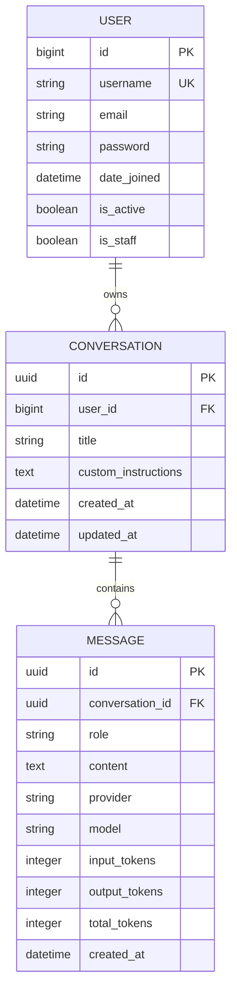

# Database Design

**Project:** NexaMind AI Chat  
**Document:** Database Design  
**Version:** 1.0  
**Status:** Proposed  
**Location:** `docs/02-system-design/database-design.md`

---

## 1. Purpose

This document defines the proposed relational database architecture for NexaMind.

NexaMind needs persistent storage for user accounts, conversations, and messages. The database must support:

- Multiple registered users.
- Private conversations for each user.
- Persistent message history.
- Conversation-specific custom instructions.
- Retrieval of messages in chronological order.
- AI provider and model metadata.
- Available token usage information.
- Reliable data relationships and constraints.

The initial database will use **PostgreSQL**, accessed through Django's ORM.

This document defines the logical data model and proposed physical schema. Exact Django implementation details will be finalized during backend development.

## 2. Database Technology

### 2.1 Selected database

**PostgreSQL**

PostgreSQL is the selected relational database for the initial implementation.

Reasons:

- Strong relational data modeling.
- Foreign key and constraint support.
- Transaction management.
- Indexing capabilities.
- JSON support for future structured metadata.
- Compatibility with Django ORM.
- Suitable for a multi-user application.

### 2.2 Database access

Django will communicate with PostgreSQL through its ORM.

Conceptual architecture:

```text
React Frontend
      |
      v
Django REST Framework
      |
      v
Django Application Services
      |
      v
Django ORM
      |
      v
PostgreSQL Database
```

The React application must never connect directly to PostgreSQL.

Database credentials must remain on the backend.

## 3. Data Modeling Principles

The database design follows these principles:

| Principle             | Application                                                          |
| --------------------- | -------------------------------------------------------------------- |
| Relational integrity  | Use primary keys and foreign keys.                                   |
| Data isolation        | Every conversation belongs to a specific user.                       |
| Referential integrity | Prevent orphaned messages.                                           |
| Normalization         | Avoid unnecessary duplication of related data.                       |
| Query efficiency      | Add indexes for frequently executed queries.                         |
| Data consistency      | Use constraints for important database rules.                        |
| Security              | Enforce ownership through backend authorization and scoped queries.  |
| Extensibility         | Allow future features without building unnecessary abstractions now. |
| Migration safety      | Apply schema changes through Django migrations.                      |

## 4. Core Entities

The initial MVP requires three primary application entities.

| Entity       | Purpose                                                       |
| ------------ | ------------------------------------------------------------- |
| User         | Represents a registered NexaMind account.                     |
| Conversation | Represents a user's individual chat.                          |
| Message      | Represents a user or assistant message inside a conversation. |

### 4.1 Relationship overview

One user can own many conversations.

One conversation can contain many messages.

Every message belongs to exactly one conversation.

```text
USER
  |
  | 1
  |
  | owns
  |
  | many
  v
CONVERSATION
  |
  | 1
  |
  | contains
  |
  | many
  v
MESSAGE
```

This relationship structure supports independent conversations for multiple users.

## 5. Entity Relationship Diagram



**Important:** This diagram is a logical model. The User entity will be implemented using a custom Django user model. Its final fields depend on the authentication configuration selected before the first migration.

## 6. User Entity

### 6.1 Purpose

The User entity represents an account registered in NexaMind.

Each user can own multiple conversations, but users must not access another user's conversations or messages.

### 6.2 Proposed implementation

Use a custom Django user model derived from:

```python
django.contrib.auth.models.AbstractUser
```

This is important because authentication requirements may evolve.

A custom user model should be configured before the first database migration.

Set:

```python
AUTH_USER_MODEL = "accounts.User"
```

The exact application label and model path will follow the agreed backend structure.

### 6.3 User fields

| Field        | Type                                | Purpose                                                     |
| ------------ | ----------------------------------- | ----------------------------------------------------------- |
| id           | BigInteger / configured primary key | Unique user identifier.                                     |
| username     | VARCHAR                             | Account username, if retained by the authentication design. |
| email        | VARCHAR                             | User email address.                                         |
| password     | VARCHAR                             | Django-managed password hash.                               |
| first_name   | VARCHAR                             | Optional first name.                                        |
| last_name    | VARCHAR                             | Optional last name.                                         |
| is_active    | BOOLEAN                             | Whether the account is active.                              |
| is_staff     | BOOLEAN                             | Whether the account can access Django administration.       |
| is_superuser | BOOLEAN                             | Django administrative permission flag.                      |
| date_joined  | TIMESTAMPTZ                         | Account creation timestamp.                                 |
| last_login   | TIMESTAMPTZ                         | Most recent login timestamp.                                |

These fields describe the inherited Django user model and possible account requirements. The exact authentication contract must be finalized before implementation.

### 6.4 User constraints

- Each user must have a unique primary key.
- Passwords must be stored as secure hashes generated through Django's authentication system.
- The application must never store plaintext passwords.
- The final login identifier must have an appropriate uniqueness constraint.
- Inactive users must not be allowed to access protected application functionality.

### 6.5 Authentication design decision

The authentication interface still needs a decision about whether users log in with:

- Email and password.
- Username and password.
- Another supported identifier.

The database model must match the selected authentication interface.

Do not assume that making email unique automatically configures Django authentication to use email.

## 7. Conversation Entity

### 7.1 Purpose

The Conversation entity represents one independent chat session belonging to a user.

A conversation contains:

- A title.
- Conversation-specific custom instructions.
- Its owner.
- Creation time.
- Last update time.

### 7.2 Proposed table

```text
conversations_conversation
```

The actual table name can be configured through Django model metadata.

### 7.3 Proposed fields

| Field               | PostgreSQL type | Null | Description                                      |
| ------------------- | --------------- | ---- | ------------------------------------------------ |
| id                  | UUID            | No   | Primary key.                                     |
| user_id             | User model key  | No   | Owner of the conversation.                       |
| title               | VARCHAR(255)    | No   | Conversation title.                              |
| custom_instructions | TEXT            | Yes  | User-defined instructions for this conversation. |
| created_at          | TIMESTAMPTZ     | No   | Conversation creation timestamp.                 |
| updated_at          | TIMESTAMPTZ     | No   | Last conversation update timestamp.              |

### 7.4 Field explanations

**id**

A UUID primary key identifies the conversation.

UUIDs are useful for public resource identifiers because they are less predictable than sequential integers.

However, UUIDs are not an authorization mechanism. Backend ownership checks remain mandatory.

**user_id**

Foreign key referencing the User entity.

This establishes who owns the conversation.

**title**

Stores the conversation title.

A newly created conversation can initially use a default title such as:

```text
New chat
```

Automatic title generation can be introduced later.

**custom_instructions**

Stores optional conversation-specific preferences.

Example:

```text
Explain technical concepts step by step.
Use practical Python examples.
Avoid skipping important implementation details.
```

These instructions are user-controlled data and must be treated as untrusted input when constructing AI prompts.

**created_at**

Records when the conversation was created.

**updated_at**

Records the last time the conversation was modified.

The backend must update this field when a new message is added or when relevant conversation metadata changes.

### 7.5 Conversation relationships

```text
User (1)
   |
   | owns
   |
   v
Conversation (many)
   |
   | contains
   |
   v
Message (many)
```

### 7.6 Conversation constraints

- Every conversation must have an owner.
- The owner must reference an existing user.
- The title must not be empty or whitespace-only.
- Custom instructions may be empty or NULL.
- A conversation must not be accessible to another user through its identifier.
- Deleting a conversation should delete its associated messages according to the selected retention policy.

## 8. Message Entity

### 8.1 Purpose

The Message entity stores individual messages belonging to a conversation.

A message can originate from:

- A user.
- The AI assistant.

Messages form the persistent history used to reconstruct conversations and prepare future AI context.

### 8.2 Proposed table

```text
messages_message
```

The actual name will follow the Django application and model configuration.

### 8.3 Proposed fields

| Field           | PostgreSQL type | Null | Description                              |
| --------------- | --------------- | ---- | ---------------------------------------- |
| id              | UUID            | No   | Primary key.                             |
| conversation_id | UUID            | No   | Parent conversation.                     |
| role            | VARCHAR(20)     | No   | `user` or `assistant`.                   |
| content         | TEXT            | No   | Message content.                         |
| provider        | VARCHAR(50)     | Yes  | AI provider identifier, when applicable. |
| model           | VARCHAR(100)    | Yes  | Model identifier, when applicable.       |
| input_tokens    | INTEGER         | Yes  | Available input-token count.             |
| output_tokens   | INTEGER         | Yes  | Available output-token count.            |
| total_tokens    | INTEGER         | Yes  | Available total-token count.             |
| created_at      | TIMESTAMPTZ     | No   | Message creation timestamp.              |

### 8.4 Field explanations

**id**

A UUID uniquely identifies each message.

**conversation_id**

Foreign key referencing the Conversation entity.

Every message must belong to an existing conversation.

**role**

Identifies the message author.

Allowed values:

```text
user
assistant
```

Application-level instructions are not ordinary conversation messages.

They should not be stored as user-visible messages in this table.

**content**

Contains the actual message text.

The field uses PostgreSQL TEXT because conversation content can vary significantly in length.

The application must still enforce an appropriate input and output size policy.

**provider**

Identifies the provider that generated an assistant response.

For the initial integration, this will identify Gemini when the provider metadata is known.

It is NULL for user messages.

**model**

Identifies the model used to generate an assistant message.

It is NULL for user messages.

**input_tokens, output_tokens, total_tokens**

Store usage values when the provider supplies reliable metadata.

These fields are nullable because token usage may not always be available.

Missing metadata must not prevent successful message storage.

**created_at**

Records when the message was created.

Message records should generally be treated as historical records rather than mutable documents.

### 8.5 Message role constraints

The database should enforce valid message roles.

Conceptual rule:

```text
role IN ('user', 'assistant')
```

Django model choices help validate application inputs, while a database check constraint provides an additional integrity boundary.

### 8.6 Usage constraints

Token counts must never be negative.

Conceptual rules:

```text
input_tokens >= 0
output_tokens >= 0
total_tokens >= 0
```

A NULL value means the usage information is unavailable, not that the usage was zero.

### 8.7 Provider metadata

Provider and model metadata apply to generated assistant messages.

The application should validate these fields and avoid relying on arbitrary values supplied by the frontend.

The backend should determine the actual provider and model from its own configuration and provider response.

## 9. Database Relationships and Cardinality

### 9.1 User to Conversation

Relationship:

```text
One User → Many Conversations
```

A user may create multiple conversations.

Each conversation belongs to exactly one user.

### 9.2 Conversation to Message

Relationship:

```text
One Conversation → Many Messages
```

A conversation may contain multiple messages.

Each message belongs to exactly one conversation.

### 9.3 Relationship constraints

| Relationship           | Foreign key               | Cardinality | Proposed deletion behavior |
| ---------------------- | ------------------------- | ----------- | -------------------------- |
| User → Conversation    | `conversation.user_id`    | One-to-many | CASCADE                    |
| Conversation → Message | `message.conversation_id` | One-to-many | CASCADE                    |

CASCADE means deleting a parent record also deletes its dependent records.

Account deletion therefore requires care because it can remove all conversations and messages belonging to that account.

The final account and data-retention policy must define when deletion is permitted and whether a recovery period is necessary.

## 10. Indexing Strategy

Indexes help PostgreSQL locate records without scanning entire tables for every query.

NexaMind has predictable high-frequency queries:

- Retrieve a user's conversations.
- Open one conversation.
- Retrieve its messages.
- Retrieve recent messages for AI context.
- Verify ownership.

Indexes should support these operations.

### 10.1 Conversation indexes

| Index                    | Columns               | Purpose                                            |
| ------------------------ | --------------------- | -------------------------------------------------- |
| Primary key              | `id`                  | Retrieve one conversation.                         |
| Conversation owner index | `user_id`             | Retrieve conversations belonging to a user.        |
| Owner and update index   | `user_id, updated_at` | Retrieve conversations ordered by recent activity. |

A composite index using descending `updated_at` order is a suitable candidate for the recent-conversations query.

### 10.2 Message indexes

| Index                      | Columns                       | Purpose                                         |
| -------------------------- | ----------------------------- | ----------------------------------------------- |
| Primary key                | `id`                          | Retrieve an individual message.                 |
| Conversation history index | `conversation_id, created_at` | Retrieve conversation messages chronologically. |
| Context retrieval index    | `conversation_id, created_at` | Retrieve recent messages for AI context.        |

The conversation history index may also include `id` as a stable tie-breaker when ordering messages with identical timestamps.

Avoid creating duplicate indexes that provide the same useful access path.

### 10.3 Query examples

Retrieve a user's conversations:

```python
Conversation.objects.filter(
    user=request.user
).order_by("-updated_at")
```

Retrieve messages for one authorized conversation:

```python
Message.objects.filter(
    conversation=conversation
).order_by("created_at", "id")
```

Retrieve recent history for context:

```python
Message.objects.filter(
    conversation=conversation
).order_by("-created_at", "-id")[:20]
```

The context builder must restore chronological order before constructing the model input.

The `20` is an illustrative starting value, not a finalized context limit.

The final strategy must consider token budgets, complete conversation turns, and provider limits.

## 11. Data Normalization

The initial model uses three primary entities.

### 11.1 Why separate entities?

User information belongs in the User entity.

Conversation-level information belongs in Conversation.

Individual message content belongs in Message.

This prevents repeating account details or conversation-level instructions in every message record.

### 11.2 Avoid unnecessary duplication

Do not copy the user's email address into each conversation.

Do not copy the conversation title into every message.

Do not store complete conversation history repeatedly inside each conversation record.

Retrieve related information through foreign keys and ORM relationships.

### 11.3 Usage metadata

Usage metadata is attached to the assistant message in this initial design.

This is suitable for basic per-response usage records.

If future requirements introduce detailed generation attempts, retries, billing records, or provider request tracking, a dedicated generation record may become justified.

## 12. Data Integrity and Constraints

The database should enforce important structural rules.

| Rule                                    | Enforcement                                                   |
| --------------------------------------- | ------------------------------------------------------------- |
| Every user has a unique identity        | Primary key                                                   |
| Every conversation has an owner         | Foreign key and NOT NULL                                      |
| Every message belongs to a conversation | Foreign key and NOT NULL                                      |
| Valid message roles only                | Check constraint                                              |
| Nonnegative token counts                | Check constraints                                             |
| Conversation title is not empty         | Application validation and appropriate database constraint    |
| Required timestamps exist               | NOT NULL and defaults                                         |
| Unique login identifier                 | Unique constraint where required by the authentication design |

Django model validation and database constraints serve different purposes.

Model validation helps produce useful application errors.

Database constraints protect data integrity even when records are written outside the normal API validation path.

Do not rely only on frontend validation.

## 13. Data Deletion and Retention

Deletion behavior must be deliberate.

### 13.1 Conversation deletion

When a user deletes a conversation:

1. Authenticate the user.
2. Retrieve the conversation using an owner-scoped query.
3. Confirm the conversation belongs to that user.
4. Delete the conversation.
5. Delete associated messages through the configured cascade behavior.
6. Return a clear API response.

A user must not be able to delete another user's conversation by modifying an identifier.

### 13.2 Account deletion

Account deletion may remove all dependent conversations and messages.

However, the product must define whether account deletion is immediate or whether a retention period is required.

### 13.3 Message retention

The initial design preserves messages for as long as their conversation exists.

Future requirements may introduce:

- Data export.
- Retention policies.
- Permanent deletion.
- Backups and recovery.
- Privacy-related data requests.

These policies must be consistent with applicable legal and provider requirements.

## 14. Database Migration Strategy

Django migrations will manage database schema changes.

The database must not be manually modified as the normal development workflow.

### 14.1 Initial migration sequence

The recommended sequence is:

1. Create the backend Django project.
2. Create the `accounts` application.
3. Implement the custom User model.
4. Configure `AUTH_USER_MODEL`.
5. Configure PostgreSQL connection settings.
6. Create the initial migration.
7. Create the `conversations` application and model.
8. Create the `messages` application and model.
9. Generate and review the migrations.
10. Apply migrations to the development database.
11. Verify relationships and constraints.

**Important:** Configure the custom user model before creating the first migration. Changing the user model after other applications have established foreign-key relationships can require complicated migration work.

### 14.2 Common Django migration commands

Create migrations:

```bash
python manage.py makemigrations
```

Review migration status:

```bash
python manage.py showmigrations
```

Apply migrations:

```bash
python manage.py migrate
```

Inspect generated SQL for a migration:

```bash
python manage.py sqlmigrate accounts 0001
```

The migration name and number are examples; use the actual generated migration identifiers.

### 14.3 Migration principles

- Review generated migrations before applying them.
- Commit migration files to Git.
- Do not edit an already-applied migration casually.
- Avoid destructive schema changes without a backup and migration plan.
- Test schema changes against a development database.
- Keep production schema changes under version control.

## 15. Example Django Model Structure

The following examples illustrate the intended model design. They are not a complete implementation.

### 15.1 User model

```python
# backend/apps/accounts/models.py

from django.contrib.auth.models import AbstractUser


class User(AbstractUser):
    """
    Custom account model for NexaMind.

    Authentication-specific decisions, such as the
    login identifier and email uniqueness, must be
    configured before the first migration.
    """

    pass
```

This simple model establishes a project-owned user model.

Additional fields and authentication behavior can be introduced once the account requirements are finalized.

### 15.2 Conversation model

```python
# backend/apps/conversations/models.py

import uuid

from django.conf import settings
from django.db import models


class Conversation(models.Model):
    id = models.UUIDField(
        primary_key=True,
        default=uuid.uuid4,
        editable=False,
    )

    user = models.ForeignKey(
        settings.AUTH_USER_MODEL,
        on_delete=models.CASCADE,
        related_name="conversations",
    )

    title = models.CharField(
        max_length=255,
        default="New chat",
    )

    custom_instructions = models.TextField(
        blank=True,
        null=True,
    )

    created_at = models.DateTimeField(
        auto_now_add=True,
    )

    updated_at = models.DateTimeField(
        auto_now=True,
    )

    class Meta:
        ordering = ["-updated_at"]
        indexes = [
            models.Index(
                fields=["user", "-updated_at"],
                name="conv_user_updated_idx",
            ),
        ]

    def __str__(self):
        return self.title
```

**Implementation note:** `auto_now=True` updates `updated_at` when the model is saved. Creating a related Message does not automatically save its Conversation. The message service must explicitly update the conversation timestamp when appropriate.

### 15.3 Message model

```python
# backend/apps/messages/models.py

import uuid

from django.db import models


class Message(models.Model):

    class Role(models.TextChoices):
        USER = "user", "User"
        ASSISTANT = "assistant", "Assistant"

    id = models.UUIDField(
        primary_key=True,
        default=uuid.uuid4,
        editable=False,
    )

    conversation = models.ForeignKey(
        "conversations.Conversation",
        on_delete=models.CASCADE,
        related_name="messages",
    )

    role = models.CharField(
        max_length=20,
        choices=Role.choices,
    )

    content = models.TextField()

    provider = models.CharField(
        max_length=50,
        blank=True,
        null=True,
    )

    model = models.CharField(
        max_length=100,
        blank=True,
        null=True,
    )

    input_tokens = models.PositiveIntegerField(
        blank=True,
        null=True,
    )

    output_tokens = models.PositiveIntegerField(
        blank=True,
        null=True,
    )

    total_tokens = models.PositiveIntegerField(
        blank=True,
        null=True,
    )

    created_at = models.DateTimeField(
        auto_now_add=True,
    )

    class Meta:
        ordering = ["created_at", "id"]
        indexes = [
            models.Index(
                fields=["conversation", "created_at", "id"],
                name="msg_conv_created_idx",
            ),
        ]

    def __str__(self):
        return f"{self.role}: {self.content[:50]}"
```

These examples demonstrate:

- UUID primary keys.
- Foreign key relationships.
- Django model choices.
- Nullable provider metadata.
- Timestamp fields.
- Query-oriented indexes.

They must still be tested and refined during implementation.

In particular, the application should validate that provider metadata is used only for assistant-generated messages and that user input cannot supply trusted provider usage values.

## 16. Query Patterns

The following operations represent the main database access patterns.

### 16.1 Retrieve conversations for a user

```python
Conversation.objects.filter(
    user=request.user
).order_by("-updated_at")
```

Expected result: only the authenticated user's conversations.

### 16.2 Retrieve one conversation safely

```python
Conversation.objects.get(
    id=conversation_id,
    user=request.user,
)
```

In an API implementation, handle the not-found case with an appropriate response.

This query combines resource retrieval and ownership scoping.

### 16.3 Retrieve conversation messages

```python
Message.objects.filter(
    conversation=conversation
).order_by("created_at", "id")
```

### 16.4 Retrieve recent messages

```python
recent_messages = list(
    Message.objects.filter(
        conversation=conversation
    )
    .order_by("-created_at", "-id")[:20]
)

recent_messages.reverse()
```

The context builder must apply its actual context-selection rules rather than assuming that a fixed number of messages always fits the model.

### 16.5 Create a message

```python
Message.objects.create(
    conversation=conversation,
    role=Message.Role.USER,
    content=content,
)
```

The backend must obtain `conversation` through an ownership-checked query.

The frontend must never be trusted to choose another user's conversation.

## 17. Transaction and Persistence Considerations

NexaMind combines local PostgreSQL writes with remote AI generation.

These operations cannot be treated as one ordinary database transaction.

### 17.1 Local database transactions

Django provides transaction management through:

```python
from django.db import transaction
```

A database transaction can protect related database writes.

For example, saving a user message and assistant response can be grouped into a local transaction when the chosen lifecycle requires it.

### 17.2 External provider calls

A Gemini API request is an external network operation.

It cannot be rolled back automatically when a PostgreSQL transaction fails.

For example:

```text
Backend
   |
   v
Call Gemini
   |
   v
Gemini generates response
   |
   v
Save response in PostgreSQL
   |
   v
Database failure
```

The provider has already generated a response even though the application failed to persist it.

The message service must handle this possibility explicitly.

### 17.3 Future message lifecycle

The system may later introduce message or generation statuses such as:

```text
pending
completed
failed
```

This could support:

- Loading indicators backed by persisted state.
- Failed generation recovery.
- Retry operations.
- Duplicate request prevention.
- More reliable message histories.

These are not finalized schema requirements yet. They should be decided together with the message lifecycle implementation.

## 18. Scalability Considerations

The initial schema is designed for a conventional relational application.

As usage grows, the system may need additional optimization.

Potential future improvements:

- Cursor-based message pagination.
- More specialized query indexes.
- Database connection pooling.
- Query monitoring.
- Archiving old conversation records.
- Read replicas where justified.
- Partitioning very large message tables where measurement supports it.

Do not introduce advanced database infrastructure before measuring an actual bottleneck.

The first priority is correct relationships, reliable ownership enforcement, and efficient ordinary queries.

## 19. Future Database Extensions

The initial three-entity model is intentionally small.

Future features may introduce additional entities.

| Future entity     | Possible purpose                         | MVP status |
| ----------------- | ---------------------------------------- | ---------- |
| UserPreference    | User-level application settings          | Deferred   |
| GenerationAttempt | Track individual AI generation attempts  | Deferred   |
| UsageRecord       | Detailed provider usage and cost records | Deferred   |
| UploadedFile      | User-uploaded documents                  | Deferred   |
| DocumentChunk     | Store document segments for retrieval    | Deferred   |
| Embedding         | Support semantic search and RAG          | Deferred   |
| APIKey            | User-managed application integrations    | Deferred   |
| ToolExecution     | Track controlled AI tool execution       | Deferred   |

Do not create these tables simply because they appear in a future roadmap.

Add them when actual requirements justify them.

## 20. Open Database Decisions

| ID       | Question                                                          | When to resolve              |
| -------- | ----------------------------------------------------------------- | ---------------------------- |
| DB-OD-01 | Will users authenticate with email or username?                   | Authentication design        |
| DB-OD-02 | Should email addresses be unique?                                 | User model implementation    |
| DB-OD-03 | Will UUIDs be used for all primary keys or only public resources? | Initial model implementation |
| DB-OD-04 | What is the final account deletion and retention policy?          | Security and product policy  |
| DB-OD-05 | Should generation attempts have their own table?                  | Message lifecycle            |
| DB-OD-06 | Should messages support pending and failed statuses?              | Message lifecycle            |
| DB-OD-07 | Is an idempotency key needed for message submissions?             | API and reliability design   |
| DB-OD-08 | What context-selection strategy and message budget will be used?  | AI context implementation    |
| DB-OD-09 | Will detailed usage records be separate from messages?            | Usage implementation         |
| DB-OD-10 | What pagination strategy will be used for long histories?         | API implementation           |

These decisions should be resolved before they become assumptions in the implementation.

## 21. Database Design Completion Criteria

- [ ] PostgreSQL is established as the selected relational database.
- [ ] The main entities are defined.
- [ ] Entity relationships are documented.
- [ ] The ER diagram is available.
- [ ] User model responsibilities are defined.
- [ ] Conversation fields are documented.
- [ ] Message fields are documented.
- [ ] Primary and foreign key relationships are documented.
- [ ] Important constraints are identified.
- [ ] Indexing strategy is proposed.
- [ ] Query patterns are documented.
- [ ] Data deletion behavior is considered.
- [ ] Migration order is defined.
- [ ] Transaction boundaries are explained.
- [ ] Future entities are kept outside the MVP unless justified.
- [ ] Open decisions are recorded.

## 22. Related Documents

- [Project README](../../README.md)
- [Project Charter](../00-project-foundation/project-charter.md)
- [Product Requirements Document (PRD)](../01-requirements/PRD.md)
- [Software Requirements Specification (SRS)](../01-requirements/SRS.md)
- [Functional Requirements](../01-requirements/functional-requirements.md)
- [Non-Functional Requirements](../01-requirements/non-functional-requirements.md)
- [System Context](../02-system-design/system-context.md)
- [Architecture Overview](../02-system-design/architecture-overview.md)
- [Backend Architecture](../02-system-design/backend-architecture.md)
- [AI Architecture](../02-system-design/ai-architecture.md)
- [Security Architecture](../02-system-design/security-architecture.md)

---

**Document status:** Proposed database design.  
**Implementation status:** Not yet implemented or migration-verified.  
**Next document:** `docs/02-system-design/security-architecture.md`
