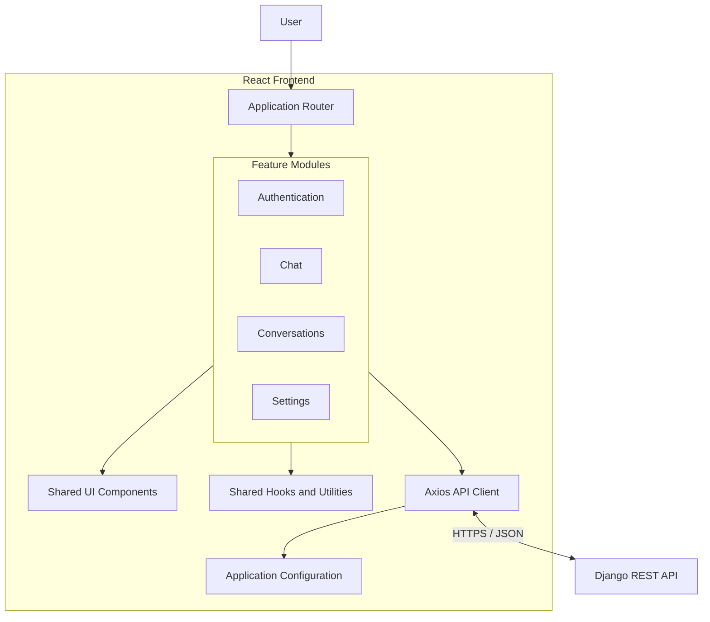
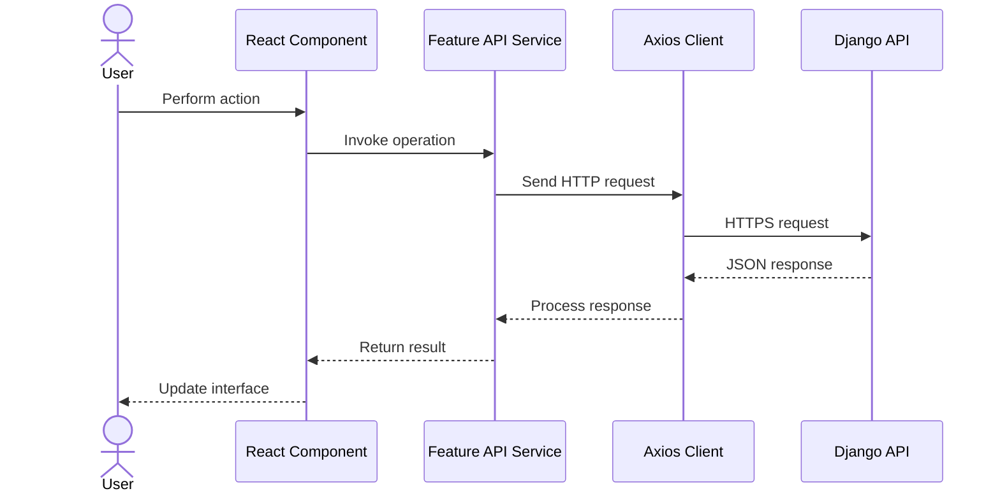

# NexaMind — Frontend Architecture

**Project:** NexaMind AI Chat
**Document:** Frontend Architecture
**Version:** 1.0
**Status:** Draft — System Design
**Related documents:**

- [System Context](./system-context.md)
- [Architecture Overview](./architecture-overview.md)
- [Functional Requirements](../01-requirements/functional-requirements.md)
- [Non-Functional Requirements](../01-requirements/non-functional-requirements.md)
- [Acceptance Criteria](../01-requirements/acceptance-criteria.md)

---

## 1. Purpose

This document defines the frontend architecture of NexaMind.

It describes:

- Frontend technology choices.
- Application organization.
- Feature and component responsibilities.
- Routing strategy.
- State-management approach.
- Backend API communication.
- Authentication-related frontend behavior.
- Loading, error, and empty states.
- Testing and quality considerations.

The objective is to establish a maintainable frontend architecture before implementing React components.

## 2. Frontend Architectural Goals

| ID        | Goal                   | Description                                                                       |
| --------- | ---------------------- | --------------------------------------------------------------------------------- |
| FE-AG-001 | Maintainability        | Organize code so individual features can be understood and changed independently. |
| FE-AG-002 | Reusability            | Build reusable UI components where reuse provides genuine value.                  |
| FE-AG-003 | Separation of concerns | Separate presentation, application state, and API communication.                  |
| FE-AG-004 | Responsiveness         | Support desktop, tablet, and mobile experiences.                                  |
| FE-AG-005 | Testability            | Make important UI behavior and feature logic testable.                            |
| FE-AG-006 | Reliability            | Handle API failures and asynchronous operations predictably.                      |
| FE-AG-007 | Accessibility          | Support keyboard interaction, semantic HTML, and accessible feedback.             |
| FE-AG-008 | Security               | Avoid treating frontend controls as security enforcement mechanisms.              |

## 3. Technology Stack

| Technology            | Responsibility                       | Status          |
| --------------------- | ------------------------------------ | --------------- |
| React                 | UI component library                 | Selected        |
| Vite                  | Development server and build tooling | Selected        |
| JavaScript            | Frontend programming language        | Selected        |
| React Router          | Client-side navigation               | Proposed        |
| Axios                 | HTTP communication with backend      | Selected        |
| CSS / Tailwind CSS    | Styling and responsive layout        | To be finalized |
| Vitest                | Unit and component test runner       | Proposed        |
| React Testing Library | Component behavior testing           | Proposed        |

Technology selection does not mean every dependency must be installed immediately. Dependencies will be introduced when the relevant implementation phase begins.

## 4. Frontend Architectural Style

### 4.1 Feature-Based Architecture

NexaMind will use a feature-based React structure.

Instead of organizing the entire application only by technical file types, related functionality will be grouped into features.

For example:

- Authentication functionality belongs to `features/auth/`.
- Chat functionality belongs to `features/chat/`.
- Conversation management belongs to `features/conversations/`.
- User-facing settings functionality belongs to `features/settings/`.

This structure helps keep related components, hooks, and API operations together.

### 4.2 High-Level Frontend Architecture



The diagram represents logical responsibilities. It does not prescribe the exact component tree.

## 5. Proposed Frontend Directory Structure

```text
frontend/
├── README.md
├── package.json
├── vite.config.js
├── index.html
├── public/
│
└── src/
    ├── main.jsx
    ├── App.jsx
    │
    ├── app/
    │   ├── providers/
    │   ├── router/
    │   └── config/
    │
    ├── components/
    │   ├── ui/
    │   ├── layout/
    │   └── feedback/
    │
    ├── features/
    │   ├── auth/
    │   │   ├── components/
    │   │   ├── hooks/
    │   │   ├── services/
    │   │   └── pages/
    │   │
    │   ├── chat/
    │   │   ├── components/
    │   │   ├── hooks/
    │   │   ├── services/
    │   │   └── pages/
    │   │
    │   ├── conversations/
    │   │   ├── components/
    │   │   ├── hooks/
    │   │   └── services/
    │   │
    │   └── settings/
    │       ├── components/
    │       ├── hooks/
    │       └── services/
    │
    ├── services/
    │   └── api/
    │       ├── client.js
    │       └── endpoints.js
    │
    ├── hooks/
    ├── utils/
    ├── constants/
    ├── styles/
    └── assets/
```

### 5.1 Structure Explanation

| Directory                 | Responsibility                                            |
| ------------------------- | --------------------------------------------------------- |
| `app/`                    | Application-level setup, providers, and routing.          |
| `components/ui/`          | Reusable interface elements such as buttons and inputs.   |
| `components/layout/`      | Shared layout components.                                 |
| `components/feedback/`    | Loading indicators, error messages, and empty states.     |
| `features/auth/`          | Registration, login, and authentication behavior.         |
| `features/chat/`          | Message display, message input, and chat interaction.     |
| `features/conversations/` | Conversation listing, creation, renaming, and deletion.   |
| `features/settings/`      | User-facing application settings where included in scope. |
| `services/api/`           | Shared HTTP client and API infrastructure.                |
| `hooks/`                  | Reusable hooks shared across multiple features.           |
| `utils/`                  | Small reusable helper functions.                          |
| `constants/`              | Shared application constants.                             |
| `styles/`                 | Global styles and design foundations.                     |
| `assets/`                 | Images, icons, and other imported assets.                 |

This is the target organization, not a requirement to create every folder during project setup.

Create feature-specific files when there is actual functionality to implement.

## 6. Application Entry Points

### 6.1 `main.jsx`

The main entry point is responsible for bootstrapping the React application.

Expected responsibilities:

- Mount the React application.
- Load global styles.
- Initialize application-level providers where needed.
- Render the root application component.

### 6.2 `App.jsx`

The root application component coordinates the application shell and routing.

It should not contain all authentication, conversation, and messaging logic.

### 6.3 Application Providers

The `app/providers/` directory may contain application-level providers for shared concerns.

Examples include:

- Authentication state, if shared authentication context is adopted.
- Router configuration.
- Theme configuration, if required.
- Other genuinely application-wide dependencies.

Avoid introducing providers simply because a React feature exists.

## 7. Routing Architecture

React Router is the proposed client-side routing solution.

### 7.1 Proposed Routes

| Route                   | Page                  | Access                            |
| ----------------------- | --------------------- | --------------------------------- |
| `/login`                | Login                 | Public                            |
| `/register`             | Registration          | Public                            |
| `/chat`                 | Chat workspace        | Authenticated                     |
| `/chat/:conversationId` | Selected conversation | Authenticated                     |
| `/settings`             | Application settings  | Authenticated, if included in MVP |

The final route structure may be refined when the frontend is implemented.

### 7.2 Public Routes

Public routes allow visitors to access authentication interfaces.

Examples:

- Login.
- Registration.

### 7.3 Protected Routes

Protected routes provide access to authenticated application functionality.

The frontend can use route guards to improve navigation and user experience.

However:

**A protected React route is not a security boundary.**

Every protected backend request must still be authenticated and authorized by Django.

### 7.4 Navigation Behavior

Expected behavior:

1. An unauthenticated visitor opens the application.
2. The application directs them through authentication.
3. After successful authentication, they enter the chat workspace.
4. They select or create a conversation.
5. The selected conversation is reflected in application navigation.
6. Logging out clears the active client authentication state and redirects the user appropriately.

The exact redirect and token lifecycle behavior depends on the final authentication design.

## 8. Feature Architecture

### 8.1 Authentication Feature

Location: `features/auth/`

Responsibilities:

- Registration form.
- Login form.
- Form validation.
- Authentication API communication.
- Authentication-related loading and error states.
- Logout interaction.
- Coordination with application authentication state.

The authentication feature does not decide backend permissions.

### 8.2 Chat Feature

Location: `features/chat/`

Responsibilities:

- Chat workspace.
- Message list.
- Individual message presentation.
- Message input.
- Message submission.
- Assistant response display.
- Loading and generation states.
- Message-related error handling.

The chat feature should not independently implement its own HTTP client.

### 8.3 Conversations Feature

Location: `features/conversations/`

Responsibilities:

- Conversation sidebar.
- Conversation list.
- Create conversation.
- Select conversation.
- Rename conversation.
- Delete conversation.
- Empty conversation state.

Conversation operations must communicate with the backend rather than treating frontend state as permanent storage.

### 8.4 Settings Feature

Location: `features/settings/`

Responsibilities may include:

- Conversation-specific custom instruction editing.
- Relevant user-facing preferences.
- Settings-related form validation and API operations.

Custom instructions belong to conversations in the initial product model. The frontend should make that relationship clear in its interface.

## 9. Component Architecture

### 9.1 Component Categories

NexaMind components will generally fall into three categories.

**1. Page components**

Represent application pages or route-level screens.

Examples:

- `LoginPage`
- `RegisterPage`
- `ChatPage`

**2. Feature components**

Implement functionality belonging to a particular feature.

Examples:

- `ConversationSidebar`
- `MessageList`
- `MessageInput`
- `ChatMessage`
- `CustomInstructionsEditor`

**3. Shared UI components**

Provide reusable interface primitives.

Examples:

- `Button`
- `Input`
- `Modal`
- `LoadingSpinner`
- `ErrorMessage`
- `EmptyState`

### 9.2 Component Responsibility

A component should have a clear responsibility.

For example, `MessageInput` should primarily handle the message-entry interaction. It should not independently manage authentication, retrieve the entire conversation history, and configure Gemini requests.

This reduces coupling and makes components easier to test.

### 9.3 Reuse Guidelines

Do not create abstractions solely to increase the number of reusable components.

A component should be shared when:

- Multiple features genuinely need the same behavior or presentation.
- Its interface is understandable.
- Reuse reduces duplication without creating unnecessary complexity.

## 10. State Management Architecture

React state management must distinguish between temporary interface state and server-owned application data.

### 10.1 Local Component State

Use local React state for information that belongs to one component.

Examples:

- Current input text.
- Modal visibility.
- Dropdown visibility.
- Temporary form values.
- Local validation messages.

### 10.2 Shared Application State

Use shared state only when multiple parts of the application genuinely need the same information.

Possible examples:

- Current authenticated user.
- Authentication status.
- Application-wide notifications.

React Context may be sufficient for simple shared state.

A dedicated global state library is not required for the initial MVP.

### 10.3 Server-Owned State

The backend is the authoritative source for:

- User account information.
- Conversation records.
- Persisted messages.
- Custom instructions.
- Message history.

The frontend may cache or temporarily hold server data for presentation, but it must not treat that cache as the authoritative record.

### 10.4 State Ownership Table

| State                   | Primary owner             | Persistence            |
| ----------------------- | ------------------------- | ---------------------- |
| Login form input        | React component           | Temporary              |
| Message input           | React component           | Temporary              |
| Active conversation ID  | Frontend navigation/state | URL or temporary state |
| Conversation list       | Backend                   | PostgreSQL             |
| Message history         | Backend                   | PostgreSQL             |
| Custom instructions     | Backend                   | PostgreSQL             |
| Authentication identity | Backend                   | User record            |
| Loading indicator       | React                     | Temporary              |
| API error display       | React                     | Temporary              |

## 11. Backend API Communication

### 11.1 Axios API Client

A shared Axios client will be located in:

`src/services/api/client.js`

Its responsibilities include:

- Define the backend base URL.
- Apply common request configuration.
- Apply the selected authentication mechanism.
- Configure appropriate timeouts.
- Handle common response behavior.
- Provide consistent error handling.

The base URL should be configurable through the frontend environment configuration.

### 11.2 API Endpoint Organization

Feature-specific services should organize API operations.

For example:

| Feature        | Example operations                            |
| -------------- | --------------------------------------------- |
| Authentication | Register, login, logout, refresh session      |
| Conversations  | List, create, retrieve, rename, delete        |
| Chat           | Send message, retrieve messages               |
| Settings       | Retrieve and update conversation instructions |

The exact endpoints and request/response contracts will be defined in the API design phase.

### 11.3 Request Flow



### 11.4 Error Handling

The frontend should distinguish between different categories of errors.

| Error category       | Expected frontend behavior                                                          |
| -------------------- | ----------------------------------------------------------------------------------- |
| Validation error     | Show relevant field or form feedback.                                               |
| Authentication error | Follow the authentication recovery flow.                                            |
| Authorization error  | Show an appropriate access-denied response.                                         |
| Network error        | Explain that the server could not be reached.                                       |
| Server error         | Show a safe general error message.                                                  |
| AI provider error    | Inform the user that generation failed and preserve appropriate conversation state. |
| Timeout              | Explain that the request took too long and allow safe recovery.                     |

The frontend should not display raw internal server exceptions to users.

## 12. Authentication State and Security

Authentication requires coordination between the frontend and backend.

### 12.1 Frontend Responsibilities

The frontend should:

- Submit credentials securely.
- Maintain the authentication state according to the selected token strategy.
- Attach authentication information to protected API requests.
- Handle expired or invalid sessions.
- Prevent normal navigation to protected pages when unauthenticated.
- Clear local authentication state during logout.

### 12.2 Backend Responsibilities

The backend remains responsible for:

- Verifying tokens.
- Identifying users.
- Enforcing resource ownership.
- Rejecting unauthorized operations.
- Protecting sensitive information.

### 12.3 Token Storage Decision

The exact JWT storage strategy is intentionally unresolved.

Options such as secure HttpOnly cookies and browser-managed token storage have different security and implementation trade-offs.

This decision must consider:

- Cross-site scripting risks.
- Cross-site request forgery risks.
- Cookie configuration.
- CORS configuration.
- Refresh-token lifecycle.
- Logout and token revocation.

It must be documented before authentication implementation.

## 13. Asynchronous UI Behavior

NexaMind communicates with a backend and an external AI provider. Therefore, frontend components must handle asynchronous operations explicitly.

### 13.1 Loading State

When a request is pending:

- Provide visible progress feedback.
- Prevent accidental duplicate submissions where appropriate.
- Keep the user informed that the operation is processing.

### 13.2 Success State

When a request succeeds:

- Update the relevant UI.
- Display the returned information.
- Keep the interface consistent with server-owned data.

### 13.3 Error State

When a request fails:

- Display an understandable message.
- Preserve user input where appropriate.
- Avoid falsely displaying a successful result.
- Provide a recovery path when possible.

### 13.4 Empty State

When no conversations or messages exist:

- Display a meaningful empty state.
- Explain the next useful action.
- Avoid presenting an empty interface as a failure.

## 14. Chat Workspace Layout

The initial chat workspace is expected to contain three major areas.

### 14.1 Sidebar

Responsibilities:

- Display the application identity.
- Show available conversations.
- Provide conversation creation.
- Support conversation selection.
- Provide rename and delete actions.

### 14.2 Main Chat Area

Responsibilities:

- Display the selected conversation.
- Render user and assistant messages.
- Show appropriate loading and error states.
- Maintain readable message spacing and scrolling behavior.

### 14.3 Message Input Area

Responsibilities:

- Accept user messages.
- Validate basic input.
- Submit messages.
- Display submission state.
- Prevent unintended repeated submissions.

The layout must adapt to smaller screens, where the sidebar may use a collapsible navigation pattern.

## 15. Accessibility and Responsive Design

The frontend should follow practical accessibility principles.

Requirements include:

- Semantic HTML elements.
- Keyboard-accessible interactive controls.
- Visible focus indicators.
- Labels for form inputs.
- Appropriate accessible names for icon-only controls.
- Sufficient text and interface contrast.
- Accessible validation and error feedback.
- Responsive layouts without critical horizontal overflow.

The design should be tested at representative desktop, tablet, and mobile viewport sizes.

## 16. Frontend Testing Strategy

Proposed testing tools:

- Vitest.
- React Testing Library.
- A suitable browser-based end-to-end testing tool to be selected later.

### 16.1 Unit Tests

Verify isolated behavior such as:

- Validation helpers.
- Formatting utilities.
- Small state-management functions.
- API error normalization.

### 16.2 Component Tests

Verify:

- Login and registration form behavior.
- Message rendering.
- Message input validation.
- Loading indicators.
- Error states.
- Conversation selection interactions.

### 16.3 Integration Tests

Verify interactions between frontend features and a controlled backend API.

Examples:

- Authentication flow.
- Conversation list retrieval.
- Message submission.
- Conversation switching.
- Custom instruction updates.

### 16.4 End-to-End Tests

Verify important complete user journeys:

1. Register an account.
2. Log in.
3. Create a conversation.
4. Send a message.
5. Display the assistant response.
6. Refresh the application.
7. Retrieve the conversation history.
8. Log out.

Automated tests should use controlled backend responses rather than requiring live Gemini generation for every run.

## 17. Frontend Performance Considerations

The frontend should:

- Avoid unnecessary component re-rendering.
- Keep component responsibilities focused.
- Load only the data required for the current view.
- Use pagination or incremental loading for large histories where appropriate.
- Avoid introducing unnecessary dependencies.
- Optimize production builds.
- Use efficient asset handling.

Performance optimization should be driven by measurement rather than premature complexity.

## 18. Frontend Architectural Constraints

The frontend must not:

1. Connect directly to PostgreSQL.
2. Store Gemini credentials.
3. Construct authoritative AI context from untrusted client data.
4. Decide resource ownership.
5. Assume that hidden UI elements provide backend security.
6. Treat temporary React state as persistent application data.
7. Duplicate backend business rules unnecessarily.
8. Introduce a global state library without a demonstrated need.

## 19. Open Decisions

The following decisions remain for later implementation phases:

1. Exact CSS and Tailwind configuration.
2. Final route definitions and route-guard implementation.
3. JWT storage and refresh strategy.
4. Authentication context design.
5. Whether server-state caching requires a dedicated library.
6. Message pagination and incremental loading.
7. Chat scrolling behavior.
8. Mobile sidebar interaction.
9. Notification and toast implementation.
10. Frontend test and end-to-end tool configuration.

These decisions should be resolved when their implementation requirements become clear.

## 20. Frontend Architecture Review Checklist

Before frontend implementation, verify:

- [ ] React and JavaScript are used.
- [ ] Feature-based organization is understood.
- [ ] Shared and feature-specific responsibilities are distinct.
- [ ] Routing responsibilities are defined.
- [ ] Axios communication is centralized.
- [ ] Backend-owned data is distinguished from temporary UI state.
- [ ] Authentication storage remains an explicit security decision.
- [ ] Backend authorization is not delegated to React.
- [ ] Loading, error, and empty states are included in the design.
- [ ] Responsive behavior is considered.
- [ ] Accessibility is included.
- [ ] Testing responsibilities are defined.
- [ ] Unnecessary frontend complexity is avoided.

---

**Document status:** Draft — System Design

**Next review:** Before initializing the React application and implementing its first feature.

**Core principle:** Keep the frontend focused on user experience and interaction. Let the backend remain the authoritative owner of application rules, security, and persistent data.
