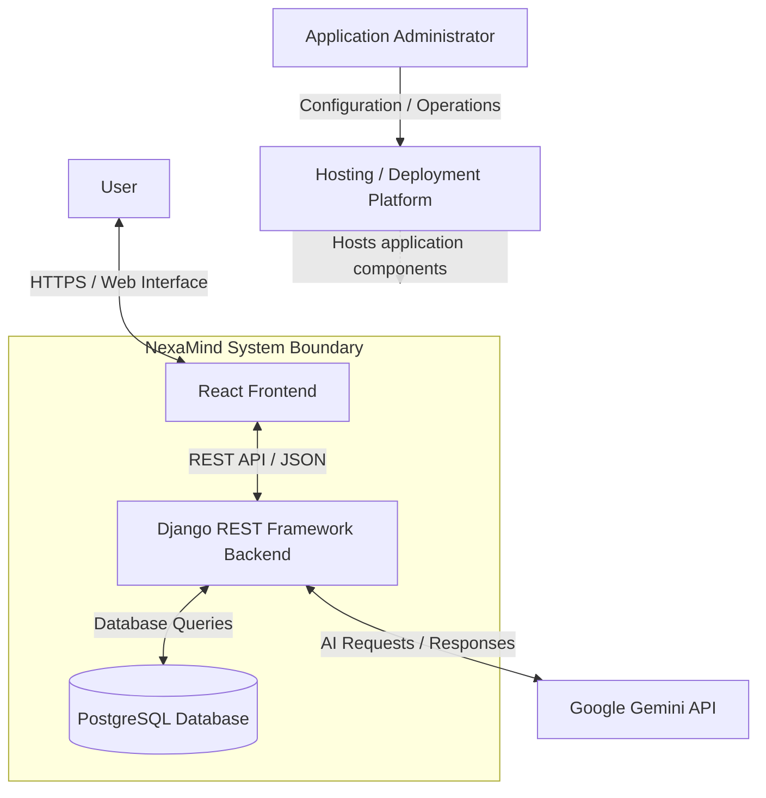
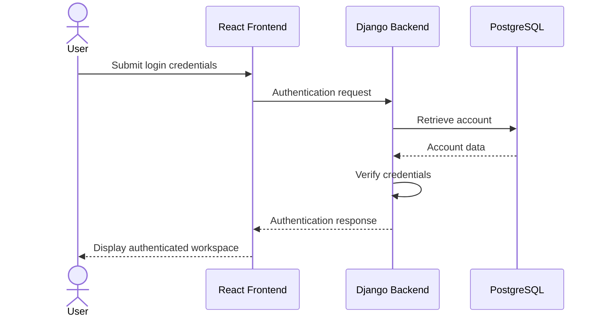
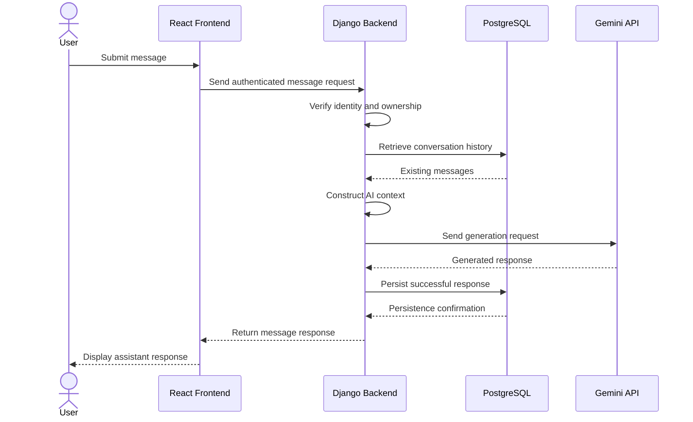

# NexaMind — System Context

**Project:** NexaMind AI Chat
**Document:** System Context
**Version:** 1.0
**Status:** Draft — System Design

## Related Documents

- [Project README](../../README.md)
- [Project Charter](../00-project-foundation/project-charter.md)
- [Product Requirements Document (PRD)](../01-requirements/PRD.md)
- [Software Requirements Specification (SRS)](../01-requirements/SRS.md)
- [Acceptance Criteria](../01-requirements/acceptance-criteria.md)

---

## 1. Purpose

This document defines NexaMind's system context: the people, external systems, and boundaries surrounding the application.

It answers five important questions:

1. Who interacts with NexaMind?
2. What responsibilities belong to NexaMind?
3. Which external services does NexaMind depend on?
4. How does information move between the system and its environment?
5. What is outside the system's responsibility?

This context establishes the foundation for detailed architecture, API design, database design, and security decisions.

## 2. System Overview

NexaMind is a multi-user conversational AI web application.

Users interact with the application through a React frontend. The frontend communicates with a Django REST Framework backend, which manages authentication, conversations, messages, persistence, and communication with Google's Gemini API.

PostgreSQL stores application data, including users, conversations, and messages.

NexaMind—not the browser—is responsible for deciding what conversation history and custom instructions are included in requests to the AI provider.

### 2.1 System Context Diagram

**Diagram interpretation:**

- Users interact with the application through the web interface.
- The React frontend communicates with the backend through HTTP APIs.
- The backend controls access to application data.
- PostgreSQL persists application information.
- Gemini generates AI responses when requested by the backend.
- Hosting infrastructure provides the environment in which the application runs.

The diagram is a logical context view. Actual deployment topology and hosting responsibilities will be documented later.

## 3. System Boundary

### 3.1 Inside the NexaMind Boundary

The following responsibilities belong to NexaMind.

| Component or responsibility | Description                                                                    |
| --------------------------- | ------------------------------------------------------------------------------ |
| User interface              | Displays authentication, conversations, messages, and application states.      |
| Authentication              | Registers users and verifies their identity.                                   |
| Authorization               | Enforces user ownership and access permissions.                                |
| Conversation management     | Creates, retrieves, renames, and deletes conversations.                        |
| Message management          | Validates, stores, and retrieves messages.                                     |
| Context construction        | Selects relevant conversation history and custom instructions for AI requests. |
| AI integration              | Communicates with Gemini through backend-managed credentials.                  |
| Data persistence            | Stores application data in PostgreSQL.                                         |
| Error handling              | Processes application, database, and provider failures.                        |
| Application configuration   | Manages environment-specific settings and operational behavior.                |

### 3.2 Outside the NexaMind Boundary

The following are external dependencies or services.

| External system                 | Responsibility                                                   | NexaMind's relationship                                     |
| ------------------------------- | ---------------------------------------------------------------- | ----------------------------------------------------------- |
| Google Gemini API               | Generates AI responses.                                          | Sends configured requests and processes provider responses. |
| Hosting platform                | Runs deployed application components.                            | Uses its infrastructure and configuration facilities.       |
| Database hosting infrastructure | Provides the environment for PostgreSQL when managed externally. | Connects through secure database configuration.             |
| User's web browser              | Runs the client application.                                     | Receives the frontend and sends user interactions.          |
| Internet/network infrastructure | Transports requests and responses.                               | Depends on network availability and secure communication.   |

NexaMind does not control the internal implementation or availability of external services.

It must handle their failures appropriately.

## 4. External Actors

### 4.1 Visitor

A visitor is someone who accesses NexaMind without an authenticated account.

**Interactions:**

- Opens the application.
- Views available public authentication pages.
- Registers an account.
- Attempts to log in.

**Restrictions:**

- Cannot access protected conversations.
- Cannot retrieve private messages.
- Cannot perform authenticated operations.

### 4.2 Authenticated User

An authenticated user has successfully established an application session.

**Interactions:**

- Creates and manages conversations.
- Sends messages.
- Receives AI-generated responses.
- Views conversation history.
- Updates conversation-specific custom instructions.
- Deletes conversations.

**Restrictions:**

- Can access only resources they are authorized to use.
- Cannot access another user's private conversations or messages.

### 4.3 Application Administrator

The administrator is responsible for operational management rather than ordinary conversation use.

**Responsibilities may include:**

- Configuring deployment environments.
- Managing application configuration and secrets.
- Monitoring application health and errors.
- Applying database maintenance procedures.
- Managing infrastructure and releases.

Administrative capabilities are not automatically part of the MVP user interface. They must be protected through appropriate operational access controls.

## 5. External System Interactions

### 5.1 User Browser and React Frontend

**Purpose:** Provide the user-facing application.

The browser executes the React frontend, which handles user interactions and communicates with the backend.

Responsibilities include:

- Rendering application screens.
- Collecting user input.
- Sending authenticated API requests.
- Displaying conversation messages.
- Managing loading and error states.
- Maintaining appropriate client-side authentication state.

The frontend is not trusted to enforce data ownership or protect provider credentials.

### 5.2 React Frontend and Django Backend

**Purpose:** Exchange application data and commands.

Communication uses HTTPS and REST-style HTTP endpoints with JSON request and response bodies.

The backend is responsible for:

- Authentication verification.
- Authorization and ownership checks.
- Input validation.
- Application business logic.
- Database operations.
- AI request orchestration.
- Consistent error responses.

The frontend must treat the backend as the authoritative source for protected application data.

### 5.3 Django Backend and PostgreSQL

**Purpose:** Persist application state.

The backend uses Django's database layer and ORM to interact with PostgreSQL.

Expected persisted data includes:

- User accounts.
- Conversation records.
- Message records.
- Conversation custom instructions.
- Available AI model and usage metadata.
- Relevant timestamps and relationships.

PostgreSQL does not generate AI responses. It stores and retrieves application data.

### 5.4 Django Backend and Google Gemini API

**Purpose:** Generate AI responses.

The backend communicates with Gemini using the official supported integration approach selected during the AI integration phase.

Expected interaction:

1. Backend receives a valid message request.
2. Backend verifies the authenticated user.
3. Backend checks conversation ownership.
4. Backend retrieves applicable conversation history.
5. Backend applies custom instructions and generation configuration.
6. Backend sends the AI request to Gemini.
7. Gemini returns a response or an error.
8. Backend processes the result.
9. Backend persists the successful assistant response according to the message lifecycle policy.
10. Backend returns the appropriate result to the frontend.

**Security boundary:** The Gemini API key must remain on the backend. It must never be sent to React or exposed in browser network responses.

## 6. High-Level Data Flow

### 6.1 Authentication Flow

This is a logical flow. The exact JWT token issuance, storage, refresh, and revocation strategy remains an implementation decision.

### 6.2 AI Message Flow

This sequence represents the successful path. Provider failures, timeouts, and persistence failures require separate handling and will be defined during backend design.

## 7. Data Ownership and Trust Boundaries

NexaMind has several important trust boundaries.

### 7.1 Browser Trust Boundary

The browser is controlled by the user and must be treated as an untrusted environment.

Consequences:

- Frontend validation cannot replace backend validation.
- Client-side route protection cannot replace backend authorization.
- Provider secrets cannot be stored in frontend source code.
- A user must not gain access to another user's data by modifying a request.

### 7.2 Backend Trust Boundary

The backend is the application's central enforcement point.

It must:

- Verify authentication.
- Check resource ownership.
- Validate requests.
- Apply business rules.
- Control provider access.
- Restrict database operations to authorized data.

### 7.3 Database Trust Boundary

The database stores application information and must not be exposed directly to the browser.

Access should be restricted to trusted application infrastructure and authorized operational users.

### 7.4 External AI Provider Boundary

Gemini is an external service.

The backend must not assume:

- The provider is always available.
- Every request succeeds.
- Every response contains usable content.
- Provider latency is predictable.
- Usage metadata is always available.

Provider errors must be handled without compromising application state or user data.

## 8. Assumptions and Constraints

### 8.1 Assumptions

1. Users have access to a modern web browser.
2. Users have internet connectivity.
3. Gemini API access is available and configured.
4. PostgreSQL is available to the backend.
5. The backend is the only component that communicates directly with Gemini.
6. The initial application uses one AI provider.
7. Conversation data is private to its owner unless a future feature explicitly introduces sharing.

These are project assumptions, not verified production facts.

### 8.2 Constraints

1. Gemini API usage is subject to provider availability, quotas, and pricing.
2. Backend infrastructure must support secure external API communication.
3. Database access must be configured securely.
4. The frontend must communicate through the backend API.
5. Application behavior must remain within the agreed MVP scope.
6. The system must not depend on client-side ownership checks for security.

## 9. Out-of-Scope External Interactions

The initial MVP does not require direct integration with:

- Other commercial LLM providers.
- External document storage services.
- Vector databases.
- Payment processors.
- Third-party identity providers.
- External collaboration platforms.
- Voice or speech services.

These integrations may be evaluated in future product stages.

## 10. Future Context Extensions

The system context may evolve as NexaMind develops.

Potential future external systems include:

| Future integration         | Possible purpose               | Current status |
| -------------------------- | ------------------------------ | -------------- |
| Vector database            | Retrieval-augmented generation | Deferred       |
| File storage               | User document uploads          | Deferred       |
| Additional LLM providers   | Provider choice and fallback   | Deferred       |
| Payment provider           | Subscription and billing       | Deferred       |
| Speech services            | Voice input and output         | Deferred       |
| External productivity APIs | Workflow integrations          | Deferred       |

These possibilities must not be interpreted as MVP commitments.

## 11. Design Decisions Established by This Document

This document establishes the following architectural principles:

1. NexaMind is a web application with a React frontend and Django REST Framework backend.
2. The backend is the authoritative application and security boundary.
3. PostgreSQL is the primary application database.
4. Gemini is an external AI provider, not part of the application itself.
5. The frontend never communicates directly with Gemini.
6. Conversation history is persisted by NexaMind.
7. The backend controls the AI context sent to Gemini.
8. User data ownership is enforced server-side.
9. External-service failures must be handled explicitly.

Detailed implementation choices belong in the relevant architecture and engineering documents.

## 12. Open Questions

The following questions remain for later design phases:

1. Which exact hosting providers will be used?
2. Will PostgreSQL be hosted separately or alongside the backend infrastructure?
3. Which JWT implementation and token lifecycle will be adopted?
4. What API timeout and retry policies should apply to Gemini?
5. How will failed message generation be represented?
6. What operational monitoring and logging services are appropriate?
7. What backup and recovery strategy will be used?

These decisions will be recorded as they are resolved.

---

**Document status:** Draft — System Design

**Next review:** After the architecture overview and component responsibilities are defined.

**Core principle:** NexaMind owns user identity, authorization, conversations, and application data. Gemini provides AI generation as an external service.
